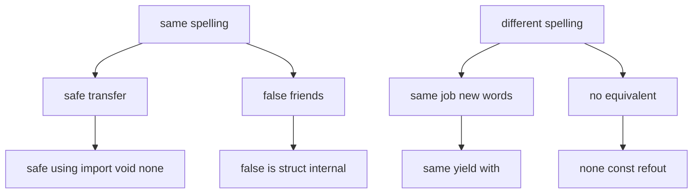

# 00 — C# to Python Mental Model

How to remap what you already know. Python has no solution file, no
`namespace` block, no `new`, no compile-time overload resolution, and no
true `private`.

## 1. Compilation vs interpretation

| C# | Python |
|---|---|
| Compiled to IL, types checked at build | Interpreted (CPython compiles to bytecode at import, transparently). Types are runtime tags on objects, not compile-time slots |
| `csc` error stops the build | `mypy src` is opt-in. Without it, `def f(x: int)` still accepts a `str` at runtime |
| Assembly version in `.csproj` | Version in `pyproject.toml`, optionally mirrored as `__version__` |

Takeaway: hints are documentation plus `mypy`. The interpreter trusts you
(duck typing). Tests plus `mypy` replace the compiler safety net.

## 2. Namespaces, files, projects

```csharp
// C#: namespace is declared inside the file.
namespace PythonMaterial.Arrays;
public static class SecondLargest { ... }
```

```python
# Python: the file path IS the namespace.
# src/python_material/arrays/second_largest.py
"""Return the second largest distinct value."""

__all__ = ["find_second_largest"]


def find_second_largest(numbers: list[int]) -> int:
    """Return the second largest distinct value."""
    ...
```

```python
import python_material.arrays.second_largest as sl
from python_material.arrays.second_largest import find_second_largest
```

No `namespace` keyword, no `public` keyword. Everything module-level is
importable unless convention says otherwise.

## 3. Quick keyword map

| C# | Python | Note |
|---|---|---|
| `using System;` | `import os` / `from x import y` | Runtime binding, see `01-modules-packages.md` |
| `class` / `struct` / `record` / `interface` | `class` (+ `dataclass`, `Enum`, `Protocol`, `ABC`) | One keyword, many patterns |
| `this` | `self` (explicit first param) | Never implicit |
| `new Point(1, 2)` | `Point(1, 2)` | No `new` |
| `void` | `None` (a real value, `-> None`) | Missing `return` returns `None` |
| `params int[]` | `*args` | Tuple of extras |
| `Method(int)` + `Method(string)` | One `def` with defaults / unions | Last definition wins, no overload resolution |
| `private/protected/public/internal` | `x` / `_x` / `__x` | Convention + name mangling, not enforcement |
| `get; set;` | `@property` | See `04-classes-oop.md` |
| `static void Main()` | `if __name__ == "__main__":` | See `02-dunder-attributes.md` |
| `IDisposable` + `using` | `__enter__/__exit__` + `with` | Same shape |
| `IEnumerable` + `yield return` | `__iter__` + `yield` | Same shape |
| `ToString/Equals/GetHashCode` | `__str__/__repr__/__eq__/__hash__` | Always define `__repr__` |
| `abstract` / `interface` | `abc.ABC` + `@abstractmethod` / `typing.Protocol` | Enforcement vs structure |
| `sealed` | `@typing.final` | Advisory to type checkers |
| LINQ | Comprehensions + `itertools` | `[x for x in xs if cond]` |

## 4. Object model surprise list

1. Everything is an object, including functions, classes, modules.
2. Fields are created by assignment in `__init__`, not by declaration.
   An annotation alone (`x: int`) stores nothing.
3. Methods are functions with an explicit `self`. `a.speak()` is sugar for
   `Animal.speak(a)`.
4. Inheritance is multiple. Method resolution follows `Class.__mro__`,
   not single-base lookup.
5. No overloads, no true privacy, no `const` locals enforced at runtime.
   `UPPER_SNAKE` is convention.

## 5. Syntax side-by-side: the comparisons to memorize

Behavior column marks real vs surface similarity. Full per-topic
tables live in the linked files.

| Job | C# | Python | Same? |
|---|---|---|---|
| Make an object | `var d = new Dog("rex");` | `d = Dog("rex")` | Same minus the keyword (`04`) |
| Instance method | `string Speak() { return ...; }` (`this` implicit) | `def speak(self) -> str:` (`self` explicit) | Same job, visible receiver (`10`) |
| Validated property | `double Radius { get; set; }` with checks in the setter | `@property` + `@radius.setter` with `ValueError` on bad input | Same outcome; Python validation is manual (`04`, `11`) |
| Reuse code | `using System;` + project reference | `import os` / `from x import y` per module; install once via `pip install -e .` | Similar workflow; binding is runtime (`01`) |
| Entry point | `static void Main()` | `def main() -> ...:` plus `if __name__ == "__main__":` | Different shape, same job (`02`) |
| Iteration query | `xs.Where(x => x > 1).Select(x => x * 2)` (LINQ) | `[x * 2 for x in xs if x > 1]` (comprehension) | Same outcome, mirrored spelling (`06`) |

## 6. Spelling vs behavior: what transfers and what does not



Same-spelling branches split into safe transfer (`using`, `void`)
and false friends (`is`, `struct`, `internal`) — familiar spelling,
different behavior. Different-spelling branches are honest: same job
in new words, or no equivalent at all.

## Next

- [01-modules-packages.md](01-modules-packages.md) — where code lives.
- [02-dunder-attributes.md](02-dunder-attributes.md) — the `__x__` protocol.
