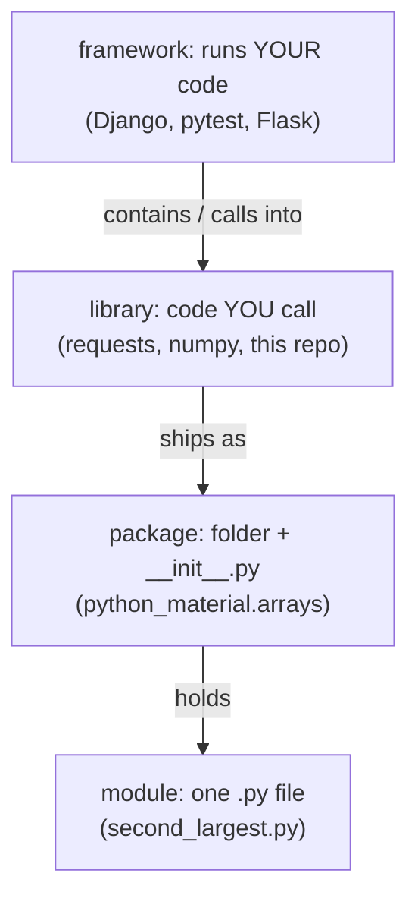
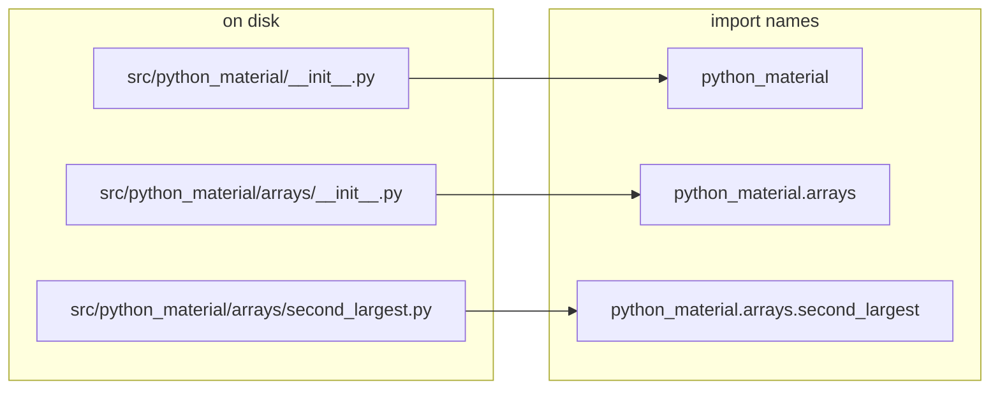
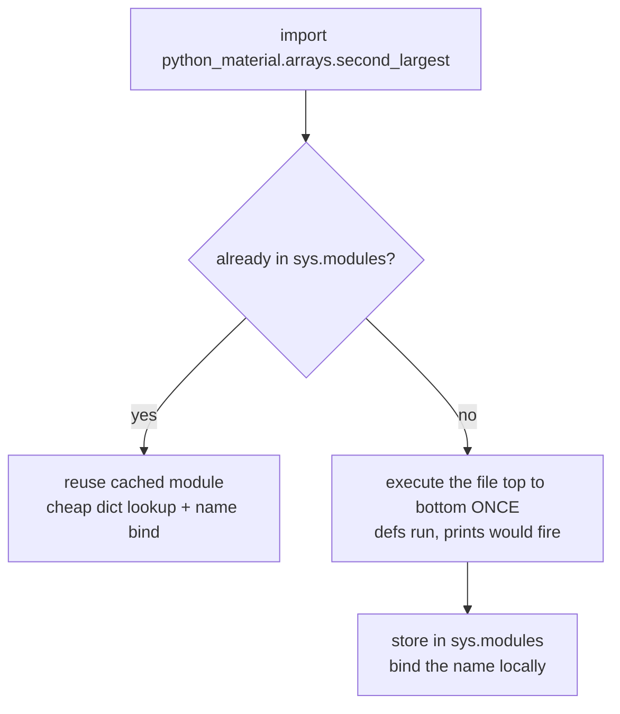
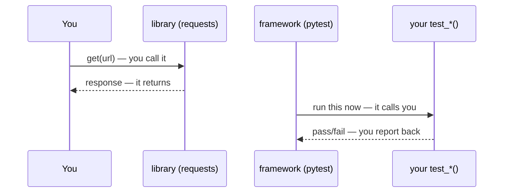

# 01 — Modules and Packages

What a module is, why files are namespaces, where packages come from, how
to import, when code runs on import.

## 1. What

- Module: one `.py` file. Name is its import path.
  `src/python_material/arrays/second_largest.py` imports as
  `python_material.arrays.second_largest`.
- Package: a directory with `__init__.py` plus its `.py` files.
  The `__init__.py` runs once on first import of anything in the package.
- Namespace package: a directory without `__init__.py` (Python 3.3+).
  Works, but this repo keeps `__init__.py` for explicit packaging and
  tooling support.

```text
src/python_material/
    __init__.py
    common/
        __init__.py
    arrays/
        __init__.py
        second_largest.py
```

## 2. Why this shape

C# resolves types at build from project references. Python resolves
imports at runtime via `sys.path`. The file layout is the API layout, so
a clean folder means a clean API. `__init__.py` is the package hook for
re-exports and version metadata.

### C# vs Python: projects, namespaces, visibility

| C# | Python | Same? |
|---|---|---|
| `namespace A.B { ... }` declared inside the file (or `namespace A.B;` file-scoped, C# 10+) | Directory path IS the namespace; no keyword (`src/python_material/arrays/*.py` → `python_material.arrays.*`) | Different mechanism, similar outcome |
| `using System;` per file | `import os` per module | Similar — per-file, never transitive to other modules |
| `using X = System.Convert;` alias | `import os.path as p` / `from m import y as z` | Same shape |
| `using static System.Math;` then `Sin(x)` unqualified | `from math import sin` then `sin(x)` | Similar outcome; keep `from`-imports small and explicit |
| `global using System;` (project-wide, C# 10+) | No equivalent — every module imports what it names | No equivalent |
| Project reference + `dotnet build` (compile-time) | Installed package + `sys.path` lookup at import (runtime) | Different — build-time vs runtime binding |
| Assembly version in `.csproj` | Version in `pyproject.toml` (optionally mirrored as `__version__`) | Similar outcome |
| `internal` (assembly-private, compiler-enforced) | `_name` + omit from `__all__` (convention + wildcard filter only) | Different — Python never enforces |
| `static void Main()` entry point | `if __name__ == "__main__":` guard calling `main()` | Different shape, same job |
| Circular project reference: build error | Circular import: half-initialized module at runtime (`a` sees unfinished `b`) | Different — fail-fast vs fail-at-runtime |

## 3. Where to put code

- Library code: `src/python_material/<category>/<topic>/<topic>.py`.
  Pure functions, return values, no `print()`, no `input()`.
- Shared helpers: `src/python_material/common/`.
- Runnable output: `demos/` only, behind
  `if __name__ == "__main__":`.
- Tests mirror the package: `tests/test_<category>/test_<topic>.py`.

## 4. How to import

```python
"""Module docstring first, then dunders, then imports."""

from __future__ import annotations

__all__ = ["find_second_largest"]

import os
import sys

import pytest

from python_material.common import SortDirection
```

Rules followed here (see `docs/STYLE_GUIDE.md`):

1. Top of file only, after docstring and dunders.
2. Groups: stdlib, blank line, third-party, blank line, local.
3. One import per line, absolute paths only, no `from m import *` except
   documented re-export with `__all__`.

Common forms:

```python
import python_material.arrays.second_largest as sl
from python_material.arrays.second_largest import find_second_largest
from python_material import arrays  # the package __init__
```

### C# `using` vs Python `import` forms

| C# | Python | Note |
|---|---|---|
| `using System;` then `Convert.ToInt32(x)` | `import os` then `os.getcwd()` | Qualified use; both per-file only |
| `using C = System.Convert;` then `C.ToInt32(x)` | `import python_material.arrays.second_largest as sl` | Alias; Python `as` works on any import form |
| `using static System.Math;` then `Sin(x)` | `from math import sin` then `sin(x)` | Unqualified name; Python side reserved for small explicit names |
| Add reference once in `.csproj`, still `using` per file | Install once (`pip install -e .`), still `import` per module | Same workflow shape: register once, name per file |

## 5. When code runs

Import executes the module top to bottom once, then caches it in
`sys.modules`. That means:

```python
# second_largest.py
print("importing")  # Runs once on first import. Do not do this.


def find_second_largest(numbers: list[int]) -> int: ...
```

Guard script behavior:

```python
def main() -> None:
    print(find_second_largest([1, 2, 3]))


if __name__ == "__main__":
    main()
```

## 6. Edge cases

1. Circular imports: `a.py` imports `b.py` which imports `a.py`.
   One of them sees a half-initialized module. Fix by moving the shared
   symbol to `common/`, importing inside the function, or restructuring.
2. Heavy `__init__.py`: importing the package runs it. Database
   connections or prints there slow every import and cause side effects.
   Keep it to re-exports and metadata.
3. Script vs module run: `python second_largest.py` sets `__package__`
   to `None` and breaks absolute imports. Prefer
   `python -m python_material.arrays.second_largest` from the repo root.
4. `from m import *` without `__all__` imports all public names
   (everything not starting with `_`), including imported helpers.
   Define `__all__` to keep wildcard imports clean.
5. Name shadowing stdlib (`email.py`, `random.py`) hijacks imports.
   Never name a module after the stdlib.

## 7. Import scope and memory

Sibling import (absolute only):

```python
# src/python_material/arrays/first.py
class Helper:
    """Helper."""


def util() -> int:
    """Return 1."""
    return 1
```

```python
# src/python_material/arrays/second.py
from python_material.arrays.first import Helper, util
```

Scope: imported names bind in the importing module's namespace only,
like C# `using` being per-file. Other modules do not see them unless
they import them too.

Memory: no copy. First import executes the module once and caches it
in `sys.modules`. Later imports are a dict lookup plus a reference
bind, so `import x` and `from x import Y` cost the same module load:

```python
import python_material.arrays.first as first
from python_material.arrays.first import Helper

assert first.Helper is Helper  # Same object, same id().
```

A function-level `import` defers that first-execution cost to the
first call (useful for heavy or circular deps). After that it is also
a cached lookup, so per-call overhead is negligible. Top-level imports
stay the default for readability.

## 8. module < package < library < framework (the nesting doll)

Human version first: a **module** is one recipe card. A **package**
is the recipe box holding related cards. A **library** is the whole
bookshelf you borrow from. A **framework** is the restaurant kitchen:
you hand it your recipe and IT calls YOU when an order arrives. Each
level contains the previous one — nothing skips a layer.



### 8a. Each level, plainly

| Level | Is | This repo / stdlib example | Rule |
|---|---|---|---|
| Module | One `.py` file; its path is its import name | `second_largest.py`, `math`, `os` | One job per file; docstring + `__all__` on top |
| Package | Directory with `__init__.py` grouping modules | `python_material/arrays/`, `email`, `logging` | `__init__.py` re-exports the public surface only, never heavy logic |
| Library | Installable bundle of packages you import and call | This repo (`pip install -e .`), `requests`, `numpy` | Version lives in `pyproject.toml`; you own `main()` |
| Framework | Library with inversion of control: it owns `main()` and calls your code | `pytest` runs your `test_*`, Django calls your views | You fill the blanks (tests, handlers); it drives |

C# mirror: module ≈ one file's worth of code, package ≈
namespace/folder, library ≈ NuGet package/assembly, framework ≈
ASP.NET (hosts your controllers the way Django hosts views).

### 8b. How this repo maps folders to dotted names



Read it left to right: each `__init__.py` turns its folder into one
more dotted level, and the file name becomes the final level. That
is the whole namespace system — no declarations, just layout.

### 8c. What `import` actually does (once, then cached)



Two consequences you can feel: importing never re-runs the file
(second import is ~free), and anything at module top level (prints,
connections) fires exactly once, on first import — which is why
side effects live behind `if __name__ == "__main__":`, never at top
level.

### 8d. Library vs framework: who calls whom (the one distinction)



If you call it, it is a library. If it calls you, it is a
framework. `pytest` never `import`s your helpers to reuse them — it
discovers your `test_*` functions and drives them, which is why test
files follow its naming contract instead of the other way round.

## Next

- [02-dunder-attributes.md](02-dunder-attributes.md) — the names with
  double underscores.
- [03-functions-def.md](03-functions-def.md) — declaring behavior.
