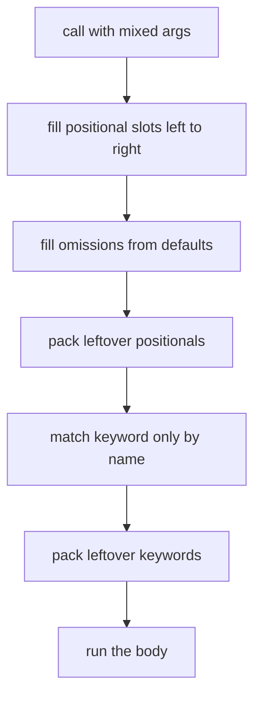
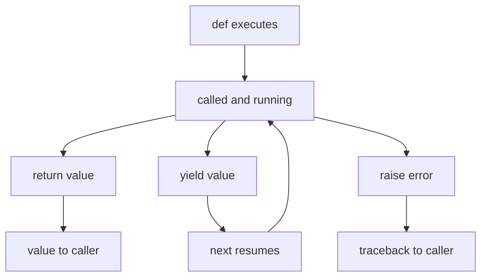
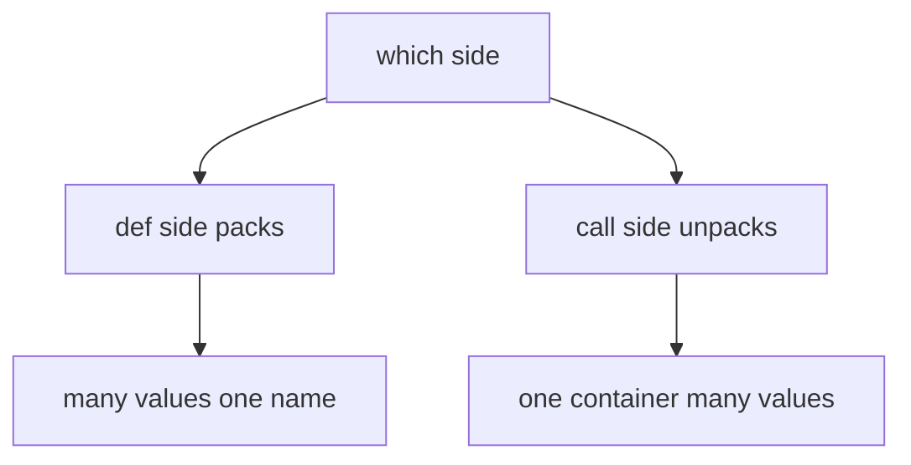
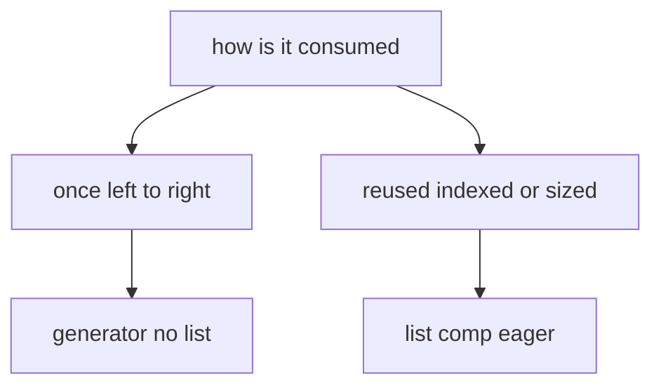

# 03 — Functions with `def`

How to declare functions and methods, how parameters and arguments work,
what returns, and where C# habits break.

## 1. Basic shape

```python
def find_second_largest(numbers: list[int]) -> int:
    """Return the second largest distinct value.

    Args:
        numbers: Input values (at least two distinct required).

    Returns:
        The second largest distinct value.

    Raises:
        ValueError: If fewer than two distinct values exist.
    """
    if numbers is None:
        raise ValueError("numbers must not be None")

    # Track the two best distinct values seen so far.
    largest: int | None = None
    second: int | None = None

    # Single pass: promote on a new max, else update the runner-up.
    for value in numbers:
        if value == largest:
            continue
        if largest is None or value > largest:
            second = largest
            largest = value
        elif second is None or value > second:
            second = value

    if second is None:
        raise ValueError("Need at least two distinct values.")

    return second
```

Rules: `def` name, parenthesized params, `-> return` hint, colon,
4-space body. Public signatures always hinted. Docstring mandatory.

### C# vs Python: functions at a glance

| C# | Python | Same? |
|---|---|---|
| `int F(string s) { ... }` | `def f(s: str) -> int:` plus docstring | Similar shape; Python hints are runtime-ignored (`mypy` + `ValueError` enforce) |
| `void` (no value) | `None` (`-> None`; a real value — missing `return` gives `None`) | Similar outcome, different mechanism |
| `void F(int x = 3)` optional arg | `def f(x: int = 3)` | Same shape; Python allows any default object, so only immutable defaults |
| Named `F(x: 1)` | `f(x=1)`, plus keyword-only after `*` | Same, with a stricter Python-only option |
| `params int[] rest` | `*args` arriving as `tuple` | Same job |
| No direct equivalent (add an overload or a type) | `**kwargs` arriving as `dict` | No C# equivalent |
| Overloads `F(int)` / `F(string)` (compile-time resolution) | One `def` per name; last wins; use defaults, `X \| Y` unions, `@singledispatch` | Different — no overload resolution |
| `ref` / `out` params (caller-visible writes) | No equivalent — `return total, count` (one tuple) or a small dataclass | No equivalent |
| `return (a, b);` ValueTuple, deconstructed by caller | `return a, b` packs one tuple implicitly; caller unpacks | Similar outcome; Python packs without naming the type |
| `yield return` + `IEnumerable<T>` | `yield` + generator (document `Yields:`, not `Returns:`) | Same shape |
| `async Task<int>` + `await` | `async def` + `await`, driven by `asyncio.run()` | Same shape |
| `x => x * 2`; block bodies `(x) => { ...; return z; }` allowed | `lambda x: x * 2`; expression-only, no annotations, name always `<lambda>` | Similar for one-liners; different limits |
| `/// <summary>` + `<param>` / `<returns>` | Docstring `Args:` / `Returns:` / `Raises:` | Same job |

### How a call binds to the signature



Missing required names and unexpected keywords both raise
`TypeError` before the body starts — binding is all-or-nothing.

### Call lifecycle as a state machine



`yield` is the only state that pauses mid-body; everything else
leaves the frame exactly once.

## 2. Parameters vs arguments

Parameter is the declaration (`def f(a, b=10)`), argument is the call
value (`f(1, 2)`). Python adds kinds C# does not have by default:

```python
def f(a, b=10, *args: int, c: int, d: int = 5, **kwargs: str) -> None:
    """Show every parameter kind."""
```

| Kind | Example | Call rule |
|---|---|---|
| Required positional-or-keyword | `a` | `f(1)` or `f(a=1)` |
| Defaulted | `b=10` | May omit; immutable defaults only |
| Variadic positional (`*args`) | C# `params int[]` | Extra positionals arrive as tuple |
| Keyword-only (after `*args` or bare `*`) | `c`, `d=5` | Must write `c=...` |
| Variadic keyword (`**kwargs`) | Extra named args | Arrive as `dict` |

```python
f(1)  # a=1
f(1, 2, 3, 4, c=9)  # args=(3, 4)
f(1, c=9, extra="hi")  # kwargs={"extra": "hi"}
```

Positional-only (left of `/`) and the `SortDirection` rule:

```python
def sort_items(values: list[int], direction) -> list[int]: ...


def f(a, b, /, c): ...  # a, b cannot be passed as keywords
```

This repo uses the `SortDirection` enum, never a `bool` flag, for
direction-like params.

## 3. Returns

- No `return` or bare `return` gives `None` (`-> None`, like `void`
  but a real value).
- `return a, b` returns one `tuple`, not two values.
- Keep returns consistent: all paths return a value or none do. Never
  a bare `return` mid-function in a value-returning function.
- Generators use `yield` and document `Yields:`, not `Returns:`.

```python
def gen() -> int:
    """Yield is C# yield return."""
    yield 1
    yield 2
```

`async def` is C# `async`: must be awaited, driven by `asyncio.run()`.

## 4. Other function forms

```python
square = lambda x: x * 2  # C# x => x * 2. Expression only.
```

Prefer `def` for named functions (tracebacks need names). Lambdas only
for short one-liners. Nested `def` plus closures replace many C#
lambdas capturing locals.

Decorators are wrappers, like attributes with behavior:

```python
import functools


def log_calls(fn):
    """Decorator: document that this is a decorator and test it."""
    import functools

    @functools.wraps(fn)
    def wrapper(*args, **kwargs):
        return fn(*args, **kwargs)

    return wrapper
```

Built-ins you will use: `@property`, `@classmethod`, `@staticmethod`,
`@functools.lru_cache`, `@dataclass`.

## 5. Edge cases

1. Mutable default shares state:

   ```python
   # Wrong: one list reused across calls.
   def collect(items: list[int] = []) -> list[int]:
       items.append(1)
       return items


   # Correct.
   def collect(items: list[int] | None = None) -> list[int]:
       if items is None:
           items = []
       items.append(1)
       return items
   ```

2. Late-binding closure: `[lambda: i for i in range(3)]` all see the
   final `i`. Fix with `lambda i=i: i`.
3. Redefinition wins: two `def foo()` blocks keep only the last. There
   is no overload resolution. Use defaults, `X | Y` unions, or
   `@singledispatch` for type-based dispatch.
4. Hints are unchecked at runtime: `def f(x: int)` accepts `str`
   unless `mypy` or manual guards stop it. Validate public input with
   `ValueError`.
5. `"".join(parts)` in loops, never `s += piece` (quadratic elsewhere).
6. Comprehensions for one `for` plus optional filter only. Nested
   loops go explicit.

## 6. Docstring and blank-line shape

No blank line between `def ...:`, the docstring, and the first
statement. The three form one header block:

```python
def find_second_largest(numbers: list[int]) -> int:
    """Return the second largest distinct value."""
    if numbers is None:
        raise ValueError("numbers must not be None")
```

Blank lines separate logical blocks only (guard, setup, computation,
post-check, return), exactly one between each. A blank line after the
docstring orphans the guard from its header (`STYLE_GUIDE §1.4`).

Docstring shape (`STYLE_GUIDE §7.1`):

1. Opening `"""` stays on the summary line, never alone on its own
   line. Leading-newline form breaks `help()` one-line summaries.
2. Summary line first, then blank line, then detail plus `Args:` /
   `Returns:` / `Raises:` sections.
3. One blank line after a class docstring before the first method;
   never inside a function.
4. Floating triple-quoted strings are not comments. Multi-line comments
   use `#` lines; docstrings are reserved for the first statement.

## 7. The `pass` placeholder: why, when, how

Why it exists: every Python compound statement (`def`, `class`,
`if`, `for`, `while`, `try`, `with`, `match`) requires an indented
suite — an empty body is a `SyntaxError`. C# fills that hole with
empty braces (`void F() {}`); Python has no braces, so `pass` is the
null statement: valid syntax that executes to nothing.

```python
def reserved_name(numbers: list[int]) -> int:
    """Stub carved during top-down design; body lands next."""
    pass
```

How it behaves: `pass` changes nothing. It returns no value (the
function still yields `None`), breaks no loop, skips nothing. It is
legal in every suite position:

```python
class Empty:  # Legal placeholder while the design settles.
    pass
```

```python
for value in range(3):
    pass  # Intentionally ignore every item (rare; comment why).

try:
    pass
except ValueError:
    pass
finally:
    pass
```

When to use it vs its cousins:

| Tool | Shape | Meaning — reach for it when |
|---|---|---|
| `pass` | Statement, valid in any suite | The branch is deliberately empty (`if debug: pass` skeleton, `__exit__` with nothing to release) |
| `...` (Ellipsis) | Expression, also a valid suite body | The body is not filled in yet — idiom in stubs, `Protocol`, and `ABC` (`def speak(self) -> str: ...`) |
| Docstring-only body | First-statement string, satisfies the suite | The stub's contract IS the documentation; still returns `None` |
| `raise NotImplementedError` | Statement, fails loudly | The path is unfinished — tests must fail, not silently get `None` |
| Bare `return` / `return None` | Explicit exit | The function deliberately yields nothing (clearer than falling off a `pass`) |

C# comparison:

| C# | Python |
|---|---|
| `void F() {}` — empty braces | `def f() -> None: pass` — braces do not exist, `pass` fills the suite |
| `if (x) ;` — empty statement | `if x: pass` |
| `throw new NotImplementedException();` stub | `raise NotImplementedError` stub — prefer over bare `pass` |
| `catch (IOException) {}` swallow | `except OSError: pass` — same smell; use `contextlib.suppress(OSError)` or log (see `07` §9) |

Edge cases:

1. Silent-`None` stubs: a bare-`pass` body returns `None`, so callers
   keep running on garbage and tests can pass vacuously. Unfinished
   work gets `raise NotImplementedError`, never a naked `pass`.
2. Swallowing errors: `except ValueError: pass` hides bugs exactly
   like C# `catch {}`. Catch the narrowest type, and either handle it
   or say so with `contextlib.suppress`.
3. `pass` is not an object: `x = ...` binds `Ellipsis`, but
   `x = pass` is a `SyntaxError`. `pass` can only sit where a
   statement goes.
4. Indentation still applies: `pass` must sit inside the indented
   block. Dedenting it ends the suite like any other statement.
5. `pass` in `finally` / `else` is legal but pointless — those blocks
   exist to DO something (cleanup, success path). An empty one should
   be deleted, not filled.

## 8. `*args` vs `**kwargs` in detail (pack vs unpack)

One glyph, two directions. In `def` they PACK many call values into
one name; in calls (and displays) they UNPACK one container into
many values. `*` deals in position (tuples/lists), `**` in names
(dicts, keys always `str`).

```python
def grab(*args: int, **kwargs: str) -> tuple[tuple[int, ...], dict[str, str]]:
    """Pack demo: leftovers arrive bundled, nothing declared per name."""
    return args, kwargs


grab(1, 2, k="v")  # ((1, 2), {"k": "v"}). Pack on entry.
grab()  # ((), {}). Empty pack is fine, never an error.
```

```python
def total(a: int, b: int, c: int) -> int:
    """Fixed-arity callee for the unpack demos below."""
    return a + b + c


total(*[1, 2, 3])  # Unpack list positionally: total(1, 2, 3).
total(**{"a": 1, "b": 2, "c": 3})  # Unpack dict by name. Keys str only.
rows = [[1, 2], [3, 4]]  # Matrix demo for the transpose idiom.
list(zip(*rows))  # Unpack ROWS as args: [(1, 3), (2, 4)]. Columns out.
```

Forwarding (the decorator pattern from `05` §4) plus displays:

```python
def forward(*args: object, **kwargs: object) -> object:
    """Forward everything untouched: the *args/**kwargs contract."""
    return target(*args, **kwargs)  # Same stars, opposite direction.
```

```python
merged = [*[1], *[2, 3]]  # Star IN displays: [1, 2, 3]. Splice, not nest.
uniq = {*[1, 1, 2]}  # Set display dedups: {1, 2}.
both = {**{"a": 1}, **{"b": 2}}  # Double-star merge: later keys win.
```

Pack/unpack direction picker:



Edge cases (executed unless noted):

1. Duplicate keywords in a CALL raise: `f(**{"a": 1}, a=2)` and
   `dict(**{"a": 1}, **{"a": 2})` are both `TypeError` (verified) —
   but `{**{"a": 1}, **{"a": 2}}` in a DISPLAY keeps the later
   `{"a": 2}` (verified). Calls bind, displays overwrite.
2. `**` keys must be `str`: `f(**{1: 2})` is `TypeError`. Non-name
   keys travel in dicts, never through `**`.
3. Bare `*` marks keyword-only without packing: `def f(*, tag:
   str)` forces `tag=` at every call (see §2 kinds table).
4. `*args` is always a TUPLE (immutable shell, mutable cargo —
   same shallow rule as `11`); `**kwargs` is always a fresh DICT
   (mutating it never touches the caller).
5. `return *xs` is `SyntaxError` (verified) — pack explicitly with
   `return tuple(xs)` instead.
6. `*` unpacks LAZY iterables too: `f(*gen)` consumes the generator
   inline, once. Unpacking a non-iterable (`f(*1)`) is `TypeError`.
7. Arity still rules: too many/few positionals after unpacking is
   `TypeError` at bind time, before the body starts (§3 binding).
8. Keyword-only params have no positional escape hatch: with `*args`
   present, names after it accept `name=` ONLY (verified shape in
   §2: `f(1, 2, 3, 4, c=9)`).

## 9. Loops inside call arguments (`my_method(n) for n in items`)

That shape is a generator EXPRESSION: a `for` loop fused with a
call, evaluated LAZILY, yielding one value per pull. As the SOLE
argument the parens do double duty (`sum(x * x for x in xs)`); with
sibling arguments it needs its own parens
(`sorted((x for x in xs), reverse=True)` — the bare form is
`SyntaxError`, verified).

```python
xs = [1, 2, 3]  # Small demo input for every shape below.
sum(n * n for n in xs)  # Fourteen: squares fused with the sum, no list.
max(str(n) for n in xs)  # Max over mapped strings, still no list.
"".join(str(n) for n in xs)  # "123": join consumes the generator.
any(n > 2 for n in xs)  # True, stops at the FIRST hit (short-circuit).
[name for name in ["a", "bb"] if len(name) == 1]  # List comp: EAGER list.
{len(w) for w in ["a", "bb", "a"]}  # Set comp: {1, 2}, deduped eagerly.
```

Laziness is observable (verified): building the generator runs
ZERO iterations — side effects wait for consumption. And it is
ONE-SHOT: after `list(g)` drains it, the second `list(g)` is `[]`.

```python
seen: list[int] = []  # Witness list proving when work happens.
gen = (seen.append(n) or n for n in [1, 2])  # Built: seen still [].
list(gen)  # Consumed now: [1, 2], seen is [1, 2]. Verified pair.
list(gen)  # Drained: []. Generators never rewind. Verified.
```

More shapes that compose:

```python
matrix = [[1, 2], [3, 4]]  # Nested demo input.
[*row for row in matrix]  # Star INSIDE a comp: [1, 2, 3, 4]. Flatten.
[y for x in [1, 2] if (y := x * 2)]  # Walrus filter: [2, 4]. 3.8+.
dict((k, len(k)) for k in ["a", "bb"])  # Genexp of pairs into a map.
{word: len(word) for word in ["a", "bb"]}  # Dict comp: same, eager.
```

Genexp vs list-comp picker:



Rules: `sum`/`min`/`max`/`any`/`all`/`join` want the generator
(O(1) memory, short-circuit kept); reuse, `len()`, indexing, or
debugging want the list; side-effect loops belong in an explicit
`for` — a bare genexp nobody consumes does NOTHING (the lazy
gotcha above, restated once because it bites everyone exactly
once).

## Next

- [04-classes-oop.md](04-classes-oop.md) — methods are functions with
  `self`.
- [00-csharp-to-python.md](00-csharp-to-python.md) — back to the map.
