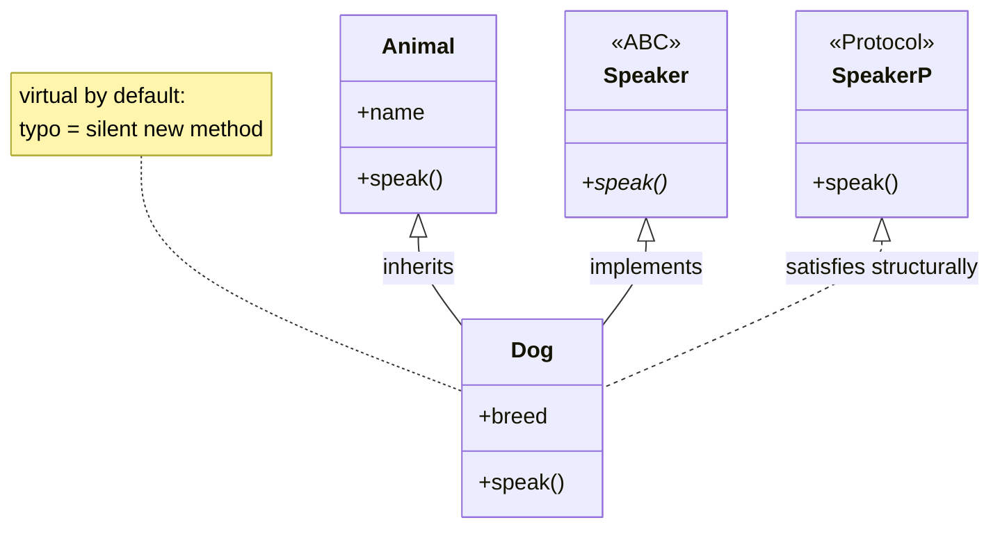
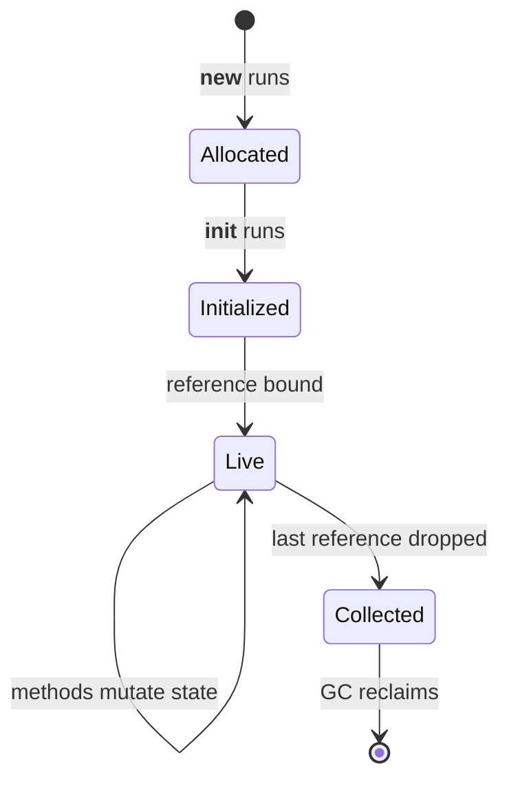

# 04 — Classes and OOP

How to declare classes, fields, methods, properties, inheritance, and
interfaces. Assumes you know C# OOP; focuses on what differs.

## 1. Minimal class

```python
class Animal:
    """Base animal."""

    def __init__(self, name: str) -> None:
        if not name:
            raise ValueError("name must not be empty")
        self.name = name  # Field created by assignment.

    def speak(self) -> str:
        """Return the animal sound."""
        return "..."

    def __repr__(self) -> str:
        return f"{self.__class__.__name__}(name={self.name!r})"
```

1. No `new`: `a = Animal("cat")`.
2. `self` is explicit (`this` passed as first param).
   `a.speak()` equals `Animal.speak(a)`.
3. Class-level `name: str` alone stores nothing. Assignment in
   `__init__` creates the field.
4. Use `self.__class__.__name__` in `__repr__` so subclasses print
   correctly.

### C# vs Python: classes at a glance

| C# | Python | Same? |
|---|---|---|
| `class Dog { ... }` plus `new Dog("rex")` | `class Dog:` plus `Dog("rex")` (no `new`) | Similar, minus the keyword |
| Constructor `public Dog(string n) { ... }` | Two steps: `__new__` allocates (rare), `__init__` configures and must return `None` | Different split; you write `__init__` |
| `this.name` (implicit receiver) | `self.name` (explicit first param) | Same job, visible receiver |
| Field declaration `string name;` reserves storage | Annotation `name: str` alone stores nothing; `self.name = ...` in `__init__` creates it | Different — assignment creates |
| Auto-property `string Name { get; set; }` | Plain public attribute first; `@property` only for validated/derived values | Different default — public attribute wins |
| `static` method / field / class | `@staticmethod` (rare) / class attribute / module (see `08 §2`) | Different — one keyword splits into three ideas |
| `class D : B` single base plus interfaces | `class D(B, C)` multiple bases; lookup via `__mro__`; every link calls `super().__init__()` | Different — multiple + MRO |
| `virtual` / `override` keywords | Virtual-by-default; a typo (`def speek`) silently creates a new method | Different — no keyword, no compiler check |
| `abstract` class / `interface` | `ABC` + `@abstractmethod` / `typing.Protocol` (structural, no inheritance needed) | Similar outcome via two tools |
| `sealed` (compiler-enforced) | `@typing.final` (checker-only; runtime ignores it) | Different — advisory only |
| `record` (built-in value equality) | `@dataclass` (plus `frozen=True`, `eq`) | Similar outcome; instances are still heap objects |
| `struct` (value type, copied on assign) | No equivalent — nearest is an immutable `tuple` / frozen dataclass, but assignment still binds (never copies) | No equivalent |
| Constructor/method overloads | Defaults plus `@classmethod` factories; call `cls(...)`, not `ClassName(...)`, for subclass safety | Different |
| `private` / `protected` / `internal` (enforced) | `x` / `_x` / `__x` (convention + mangling; full map in `11`) | Different — signs, not walls |

## 2. Method types

```python
class Point:
    """2D point with factories."""

    def __init__(self, x: int = 0, y: int = 0) -> None:
        self.x = x
        self.y = y

    def move(self, dx: int, dy: int) -> None:
        """Instance method: takes self, mutates state."""
        self.x += dx
        self.y += dy

    @classmethod
    def from_tuple(cls, value: tuple[int, int]) -> "Point":
        """Named constructor. Use cls(), not Point(), for subclass safety."""
        return cls(value[0], value[1])

    @staticmethod
    def is_origin(x: int, y: int) -> bool:
        """Stateless helper. No self/cls. Often better as a module function."""
        return x == 0 and y == 0
```

This repo prefers module-level functions over `@staticmethod`, and
`@classmethod` only for named constructors and class-state routines.

## 3. No real access modifiers

```python
self.x  # Public.
self._x  # Internal by convention. Importable, but do not touch.
self.__x  # Name-mangled to _ClassName__x. Avoids subclass clashes.
```

`obj._Cls__x` still reaches mangled names. There is no enforcement.
Validate with `@property`, do not rely on hiding.

Properties replace C# `get; set;` for cheap derivations:

```python
class Circle:
    """Circle with validated radius."""

    def __init__(self, radius: float) -> None:
        self.radius = radius  # Goes through the setter.

    @property
    def radius(self) -> float:
        """Return the radius."""
        return self._radius

    @radius.setter
    def radius(self, value: float) -> None:
        if value < 0:
            raise ValueError("radius must be >= 0")
        self._radius = value
```

Use a `_radius` backing store. Assigning `self.radius` inside the
getter or setter recurses. Only use `@property` for cheap,
unsurprising reads, never for expensive work or trivial get/set
(make the attribute public instead).

## 4. Inheritance and MRO

```python
class Dog(Animal):
    """Dog specialization."""

    def __init__(self, name: str, breed: str) -> None:
        super().__init__(name)  # C# base(name).
        self.breed = breed

    def speak(self) -> str:  # Virtual + override by default.
        return "woof"
```

Python allows multiple bases. Lookup follows `Class.__mro__`:

```python
class A:
    def run(self) -> str:
        return "A"


class B(A):
    def run(self) -> str:
        return "B"


class C(A):
    def run(self) -> str:
        return "C"


class D(B, C):
    """MRO is D, B, C, A, object. D().run() is B."""
```

Inspect with `D.__mro__` or `help(D)`. Every class in a cooperative
chain should call `super().__init__()` so MRO dispatch works.
Full C3 walkthrough, diamonds, `**kwargs` forwarding, edges, and
practices live in `12-method-resolution-order.md`.

Edge: method name typos do not error; they create a new method that
never overrides. Tests catch this, the compiler does not.

## 5. Abstraction: ABC vs Protocol

Enforced base (C# `abstract class`):

```python
from abc import ABC, abstractmethod


class Speaker(ABC):
    """Must-speak base."""

    @abstractmethod
    def speak(self) -> str:
        """Return the sound."""
        raise NotImplementedError
```

`Speaker()` raises `TypeError`. Subclasses must implement `speak`.

Structural interface (C# `interface`, duck-typed):

```python
from typing import Protocol


class SpeakerP(Protocol):
    """Anything with .speak() qualifies."""

    def speak(self) -> str: ...


def loud(speaker: SpeakerP) -> str:
    """Work with any matching object, no inheritance needed."""
    return speaker.speak().upper()
```

Prefer `Protocol` for flexible APIs, `ABC` when you need shared base
logic or strict instantiation blocking.

## 6. Dataclasses, enums, slots

C# `record` equivalent without `__init__`/`__eq__`/`__repr__`
boilerplate:

```python
from dataclasses import dataclass


@dataclass(frozen=True)
class PointData:
    """Immutable point value."""

    x: int
    y: int
```

Enum:

```python
from enum import Enum


class SortDirection(Enum):
    """Sort order. Never use bool flags for direction."""

    ASCENDING = "asc"
    DESCENDING = "desc"
```

`__slots__` restricts fields and saves memory:

```python
class Slim:
    """No __dict__, no dynamic attributes."""

    __slots__ = ("x", "y")

    def __init__(self, x: int, y: int) -> None:
        self.x = x
        self.y = y
```

Avoid by default. It complicates multiple inheritance and pickling.

## 7. Polymorphism, errors, resources

- Polymorphism is duck-typed. `mypy` plus `Protocol` restore C#-like
  checking. Runtime style is EAFP: `try/except AttributeError`
  narrowly, not `null` checks everywhere.
- `__eq__` without `__hash__` makes instances unhashable. Define both
  or set `__hash__ = None` intentionally. Use
  `@functools.total_ordering` when ordering.
- `with` plus `__enter__/__exit__` is C# `using`. Narrow `try`,
  specific `except`, `raise X from Y` for chaining.
- No mutable globals, no `print()` in `src/`, `datetime.now(timezone.utc)`
  only, `pathlib` for paths.

Full example tying it together:

```python
"""animals.py."""

from __future__ import annotations

__all__ = ["Animal", "Dog"]


class Animal:
    """Base animal."""

    def __init__(self, name: str) -> None:
        if not name:
            raise ValueError("name must not be empty")
        self.name = name

    def speak(self) -> str:
        """Return the sound."""
        return "..."

    def __repr__(self) -> str:
        return f"{self.__class__.__name__}(name={self.name!r})"


class Dog(Animal):
    """Dog specialization."""

    def speak(self) -> str:
        """Return the sound."""
        return "woof"


def main() -> None:
    print(Dog("rex"))


if __name__ == "__main__":
    main()
```

## 8. `__init__` behaviours: constructor? `self`? attributes?

Three questions C# developers keep asking, answered separately
because each controls a different behaviour.

### 8a. Is `__init__` the constructor? It is the initializer half

Calling `Dog("rex")` runs two steps: `__new__(Dog)` allocates the
instance, then `__init__(instance, "rex")` configures it. You write
`__init__` 99% of the time; colloquially "constructor" is fine, but
mechanically it is step 2 of 2:

| C# `public Dog(string n) {...}` | Python `__new__` | Python `__init__` |
|---|---|---|
| Allocates, configures, picks an overload, can veto by throwing | Allocates only; may return an existing/cached instance (the only veto-before-creation point: singletons, caches, immutable bases) | Configures only; must return `None` (anything else is `TypeError`); throwing vetoes use, but allocation already happened |
| Overloads resolve at compile time | Takes `cls`, not `self` — no instance exists yet | One definition; defaults plus `@classmethod` factories cover overloads |
| Absent ctor: implicit parameterless one | Rarely overridden | Absent: parent's runs, else `object.__init__` (takes no arguments, so `S(1)` is `TypeError`) |

### 8b. `self` in `__init__`: stored vs consumed vs missing

```python
class Stored:
    """Shape 1: stored. Parameter becomes per-instance state."""

    def __init__(self, name: str) -> None:
        self.name = name  # Lives in the instance __dict__.


class Consumed:
    """Shape 2: consumed. Parameter is a local; nothing persists."""

    def __init__(self, name: str) -> None:
        print(f"hello {name}")  # Used, then gone. .name raises AttributeError.


class Stateless:
    """Shape 3: stateless. Self present, nothing stored. Valid."""

    def __init__(self) -> None:
        pass  # Pure-behaviour holder; instances carry no state.


class Broken:
    """Missing self slot. Every instantiation fails."""

    def __init__(name: str) -> None: ...


# Broken("x") -> TypeError: __init__() takes 1 positional argument but 2 were given.
```

The rule: `self.x = v` persists (instance `__dict__`); bare `x = v`
is a local that dies when `__init__` returns; a missing `self`
parameter breaks construction because the instance is always passed
positionally first. `self` also routes through properties:
`self.radius = r` inside `__init__` runs the setter (validation),
while `self._radius = r` skips it — use the backing store only for
already-trusted values.

### 8c. Class-level declarations vs init-only parameters

```python
class Team:
    """Every declaration shape on one class."""

    count = 0  # Class attribute: one copy shared (see 11 Part B Case 6).
    kind: str  # Bare annotation: stores NOTHING. Docs + mypy only.
    tags: list = []  # Mutable class attribute: shared by all instances. Avoid.

    def __init__(self, name: str, seed: int) -> None:
        self.name = name  # Stored param: per-instance state.
        self.total = seed * 2  # Consumed param: seed used, never kept.
```

| Shape | Behaviour |
|---|---|
| Stored param (`self.name = name`) | Per-instance state. The common case. |
| Consumed param (`self.total = a + b`, `super().__init__(n)`, validate-then-drop, one-shot callback/config) | Used during construction, never kept. The instance shows no trace of the raw input. |
| Class attribute (`count = 0`, `KIND = "x"`) | One copy on the class. Reads fall back to it, plain writes shadow per-instance, in-place mutation is shared. |
| Bare annotation (`kind: str`, no value) | Inert in plain classes: `obj.kind` is `AttributeError` until some `self.kind = ...` runs. |
| Annotation plus mutable value (`tags: list = []`) | A shared mutable class attribute — every instance inks one list. Assign per-instance in `__init__` instead. |
| Property plus backing store (`@property radius` over `self._radius`) | Validation/derivation on every access. Assigning via `self.radius` in `__init__` runs the setter; assigning `self._radius` bypasses it. |
| Dataclass annotation (`@dataclass class P: x: int`) | The exception: the decorator turns annotations into real `__init__` params plus assignments, `__eq__`, `__repr__`. |
| No `__init__` at all | Default `object.__init__` (no arguments). Subclasses inherit the parent signature. |

Edge cases:

1. `__init__` returning a value is `TypeError` (`should return
   None`). Need a different return shape? Build it in a
   `@classmethod` factory, not in `__init__`.
2. Typo'd target (`self.nmae = name`) silently creates a second
   attribute; `obj.name` is `AttributeError`. Tests own this, nothing
   else does.
3. Property order in `__init__`: the setter must run before any read.
   Reading `self.radius` before anything assigned `self._radius` is
   `AttributeError`.
4. Mutable class-level defaults are shared (see `11` Part B Case 3);
   the dataclass twin needs `field(default_factory=list)`.
5. A subclass with no `__init__` keeps the parent's full signature —
   `Kid(1, 2)` works when `Base.__init__` takes `(self, a, b)`.

## 9. `del`, `__dict__`, `append()`, `super()`, `super().__init__()`

Five tools every class uses. Each does exactly one job; the edges
come from expecting a second one.

### 9a. `del`: remove a name, attribute, or item (never "cleanup")

```python
handle = open_file()
del handle  # Drops the NAME. The object lives on while others point at it.
```

Three shapes:

```python
total = 3
del total  # Shape 1: removes a local/global name. Next read is NameError.

acc.balance = 0
del acc.balance  # Shape 2: removes an INSTANCE attribute from obj.__dict__.
# Next acc.balance read misses the instance dict, then falls back to any
# class attribute of the same name, else raises AttributeError.

xs = [1, 2, 3]
del xs[0]  # Shape 3: removes an item (lists shrink, dicts drop the key).
del xs[0:2]  # Slices work too.
```

What `del` never does: run cleanup. Reclaiming memory is the garbage
collector's job (CPython refcount plus cycle collector), and
`__del__` timing is unpredictable — this repo bans it. Releasing a
resource means `close()` or `with`, never `del`. Deleting something
missing raises (`NameError` / `AttributeError` / `IndexError` /
`KeyError`), it does not pass silently.

### 9b. `__dict__`: the instance field bag vs the class snapshot

```python
a = Account("amy")
a.__dict__  # {'owner': 'amy', '_balance': 0, ...}. Plain WRITABLE dict.
Account.__dict__  # Read-only mappingproxy of the class namespace.
type(Account.__dict__)  # <class 'mappingproxy'>.
```

Rules:

1. Every `self.x = ...` in `__init__` lands in `obj.__dict__`;
   `del obj.x` removes it there. `vars(obj)` is the same dict.
2. The class mapping holds methods, class attributes, and dunders.
   It is read-only: `Cls.__dict__["x"] = 1` is `TypeError` — write
   through the class (`Cls.x = 1`) instead.
3. Attribute lookup walks instance dict, then class, then bases along
   `__mro__`. That walk is why methods resolve, why class attributes
   act as shared defaults, and why `del obj.x` can reveal a class
   attribute hiding underneath.
4. `__slots__` classes have no `__dict__` (unless a base provides
   one) — reading it is `AttributeError`. Slots restrict names, they
   never hide values.

### 9c. `append()`: the in-place list grower

```python
xs = [1]
xs.append(2)  # Mutates to [1, 2]. Returns None. Always.
```

1. The `None` return is the classic trap: `xs = xs.append(2)` rebinds
   `xs` to `None` and loses the list. Append-then-use, never assign.
2. Cost is amortized O(1): the loop-collect-then-`"".join()` pattern
   from `03` §5 exists because of it.
3. `append` inks the shared object: every alias sees the new item
   (see `11` Part B Case 1). Appending is mutation, not rebinding.
4. On a private store (`self.__loans.append(item)`) it is the
   encapsulation-friendly mutator: callers grow state only through
   the method that can validate first.

### 9d. `super()`: the MRO proxy, not "the parent class"

```python
class Loud(Dog):
    """Loud dog."""

    def speak(self) -> str:
        return super().speak().upper()  # Extend, not replace.
```

Zero-argument `super()` inside a method means "look up past the
current class along this instance's `__mro__`". Consequences:

1. The target depends on the INSTANCE's MRO, not the lexical parent.
   With mixins, `super().save()` may land on a mixin, not the base —
   that dynamic dispatch is the point (cooperative multiple
   inheritance: every link calls `super().__init__()` so each runs
   exactly once; never call each parent explicitly or diamonds
   double-initialize).
2. Two jobs: extend a method (`super().speak().upper()`) and forward
   construction (`super().__init__(name)`).
3. Bare `super()` outside a method is `RuntimeError`. The explicit
   `super(ThisClass, self)` form exists for exotic cases (classmethods
   needing a different start point); prefer the zero-arg form.

### 9e. `super().__init__()`: why skipping it breaks far away

```python
class Dog(Animal):
    """Dog specialization."""

    def __init__(self, name: str, breed: str) -> None:
        super().__init__(name)  # Builds everything Animal owns (self.name).
        self.breed = breed  # Then add what Dog owns.
```

The parent `__init__` creates parent-owned attributes. Skipping the
call leaves them absent, and the failure surfaces far from the cause
(`AttributeError: 'Dog' object has no attribute 'name'` inside some
unrelated method). Rules: call it first, forward every required arg,
and in cooperative hierarchies call it exactly once per link so the
MRO chain completes. A subclass with no `__init__` at all inherits
the parent's — that counts as calling it.

A runnable program tying all five tools to the four OOP pillars
lives in `demos/oop_showcase.py` (run it with
`python3 demos/oop_showcase.py`; demos own all `print()` output).

### Class relationships at a glance



Solid arrows are inheritance (MRO-ordered), the dotted arrow is
structural: no base involved, only a matching method shape.

### Object lifecycle as a state machine



`__init__` failing discards the half-built object; `__del__` timing
is unpredictable, so cleanup belongs in `close()` or `with`, never
in the collector path.

## Next

- [README.md](README.md) — index.
- [12-method-resolution-order.md](12-method-resolution-order.md) — C3,
  cooperative `super()`, diamonds, edges, practices.
- [11-access-modifiers-and-shared-mutation.md](11-access-modifiers-and-shared-mutation.md) — access shapes and shared mutation in detail.
- [02-dunder-attributes.md](02-dunder-attributes.md) — object protocol.
- [08-csharp-keywords-to-python.md](08-csharp-keywords-to-python.md) —
  `this`, `static`, passing, defaults, lifetime, scope.
- [09-object-model-type.md](09-object-model-type.md) — everything is
  an object, `type()`, OOP pillars.
