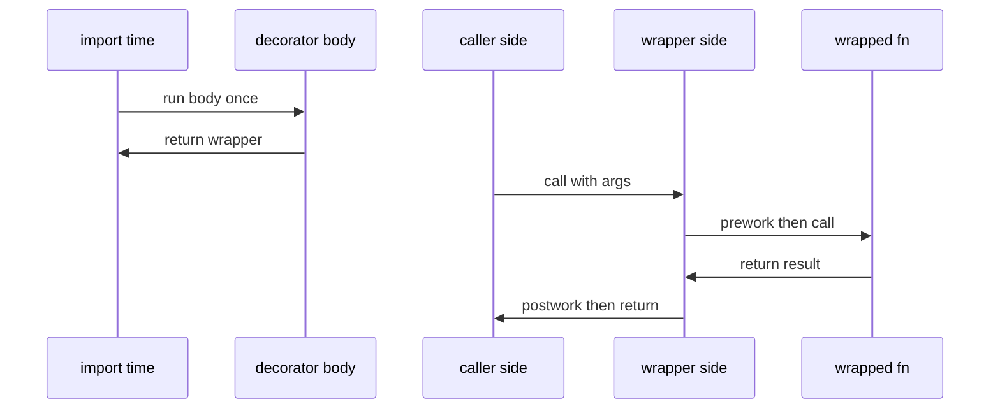
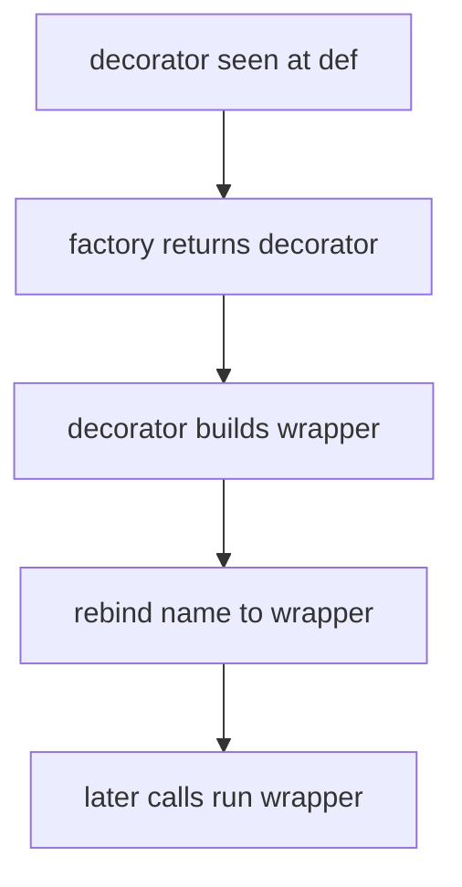

# 05 — Decorators (`@` Syntax)

What `@` means, why it is not a C# attribute, where it applies, how to
write one, when to use it, and when to leave it alone.

## 1. What: `@` is assignment sugar

C# attributes and Java annotations attach metadata. Python decorators
execute: they take a function or class and return a replacement.

```python
@my_decorator
def greet(name: str) -> str:
    """Return a greeting."""
    return f"hello {name}"
```

Means exactly:

```python
def greet(name: str) -> str:
    """Return a greeting."""
    return f"hello {name}"


greet = my_decorator(greet)
```

Key facts:

1. Runs once at `def`/`class` time (import time), not per call.
2. The name `greet` now points at whatever the decorator returned.
3. Stacking applies bottom-up:

```python
@a
@b
def f() -> None: ...


# Same as f = a(b(f)).
```

## 2. Why: cross-cutting behavior without duplication

Logging, timing, validation, caching, retries, access checks. One
wrapper, many call sites. C# would use middleware, filters, or
DispatchProxy; Python inlines it at definition.

## 3. Where it applies

Functions, methods, and classes. Property and method decorators live on
methods; `dataclass` and registration patterns live on classes.

```python
class Circle:
    """Circle with validated radius."""

    def __init__(self, radius: float) -> None:
        self.radius = radius

    @property
    def radius(self) -> float:
        """Return the radius."""
        return self._radius

    @radius.setter
    def radius(self, value: float) -> None:
        if value < 0:
            raise ValueError("radius must be >= 0")
        self._radius = value

    @classmethod
    def unit(cls) -> "Circle":
        """Return a unit circle."""
        return cls(1.0)

    @staticmethod
    def is_valid(value: float) -> bool:
        """Return True for non-negative radii."""
        return value >= 0
```

## 4. How to write one

Minimal pass-through:

```python
import functools
from collections.abc import Callable


def log_calls(fn: Callable) -> Callable:
    """Decorator: log each call, then delegate."""

    @functools.wraps(fn)
    def wrapper(*args: object, **kwargs: object) -> object:
        print(f"calling {fn.__name__}")
        return fn(*args, **kwargs)

    return wrapper
```

Applied:

```python
@log_calls
def add(a: int, b: int) -> int:
    """Return a plus b."""
    return a + b
```

Decorator with its own arguments needs three levels (a factory
returning the real decorator):

```python
import functools
from collections.abc import Callable


def retry(times: int) -> Callable[[Callable], Callable]:
    """Decorator factory: retry the call up to times."""

    def decorate(fn: Callable) -> Callable:
        @functools.wraps(fn)
        def wrapper(*args: object, **kwargs: object) -> object:
            last_error: Exception | None = None

            for _ in range(times):
                try:
                    return fn(*args, **kwargs)
                except ValueError as exc:
                    last_error = exc

            raise last_error or ValueError("retry failed")

        return wrapper

    return decorate


@retry(times=3)
def parse(value: str) -> int:
    """Parse value, retrying transient failures."""
    return int(value)
```

Class decorator (transform or register the class):

```python
def frozen(cls: type) -> type:
    """Class decorator: block attribute assignment after init."""
    old_setattr = cls.__setattr__

    def __setattr__(self: object, name: str, value: object) -> None:
        if getattr(self, "_sealed", False):
            raise AttributeError("frozen")
        old_setattr(self, name, value)

    cls.__setattr__ = __setattr__
    return cls
```

Prefer stdlib (`@dataclass(frozen=True)`) over hand-rolled versions.

## 5. Built-ins you will meet

| Decorator | Effect |
|---|---|
| `@property` + `@x.setter` | C# `get; set;` for cheap derivations |
| `@classmethod` | Factory on `cls`, subclass-safe |
| `@staticmethod` | Stateless helper; often better as module function |
| `@functools.wraps` | Copies `__name__`, `__doc__`, `__module__`; mandatory in wrappers |
| `@functools.lru_cache` | Memoize pure functions |
| `@dataclass` | Generates `__init__`/`__eq__`/`__repr__` |
| `@abstractmethod` | Must-override, with `ABC` |
| `@typing.final` | Do-not-override hint for checkers |
| `@pytest.mark.*` | Test metadata, not behavior |

## 6. When to use vs avoid

Use when: one wrapper replaces repeated try/except, validation,
caching, or context setup across many functions; the behavior is
tested; the docstring says "this is a decorator".

Avoid when: it hides control flow a reader needs (auth silently
returning `None`), does I/O or network at import time, keeps mutable
global state, or stacks three deep on one function. This repo rule
(`docs/STYLE_GUIDE.md`): decorators judiciously, documented,
unit-tested, no external deps at import time.

C# instinct check: if you would write an `ActionFilter`, decorator
fits. If you would write a base class with `virtual` hooks, prefer
inheritance or composition. If you want marker metadata only, use an
attribute on the function (`fn.tag = "x"`) or explicit registration,
not a no-op decorator.

### C# vs Python: attributes are metadata, decorators execute

| C# | Python | Same? |
|---|---|---|
| `[Route("path")]` attaches metadata; behavior lives in the framework (routing, test runner) | `@deco` executes at `def`/`class` time: `greet = deco(greet)` | Different — metadata vs executing replacement |
| Attribute args `[Route("path")]` are constructor args on the attribute | `@retry(times=3)` needs a 3-level factory returning the real decorator | Similar look, different shape (factory) |
| ASP.NET `ActionFilter` / middleware pipeline stage | Wrapper `def wrapper(*args, **kwargs)` plus `@functools.wraps` | Similar outcome for cross-cutting behavior |
| `[Serializable]` marker read by the serializer | `@dataclass` rewrites the class (generates `__init__` / `__eq__` / `__repr__`) | Different — marker vs transformation |
| `[Test]` / `[Fact]` test metadata | `@pytest.mark.*` test metadata | Same job (metadata, not behavior) |
| Several attributes: they do not nest; filter order comes from an `Order` property, not nesting | Stacked `@a @b` means `a(b(f))`; textual order IS nesting order | Different — order is semantics in Python |
| Async filter implements an async interface; sync/async mismatch breaks the pipeline | A sync `wrapper` around `async def` returns an un-awaited coroutine — mirror with `async def wrapper` | Parallel pitfall — match wrapper kind to target kind |

### What happens at def-time vs call-time





Two clocks, never mixed: factory/decorator bodies run once at
import, wrappers run per call. I/O or heavy work in a body taxes
every import; per-call cost belongs in the wrapper.

## 7. Edge cases

1. Missing `functools.wraps` breaks introspection: `help()`,
   tracebacks, and stacked decorators see `wrapper` instead of the
   real name and docstring. Always wrap with it.
2. Runs at import: code in the decorator body (not `wrapper`) executes
   on `import`. Heavy work or I/O there slows every import and fires
   during tests. Keep bodies cheap.
3. Signature loss: `*args, **kwargs` wrappers hide the real signature
   from IDEs. For libraries, copy the signature explicitly or use
   `ParamSpec` typing when the repo adopts it.
4. Argument confusion: `@retry` vs `@retry(times=3)`. The first passes
   the function directly; the second must return a decorator. Mixing
   the shapes raises `TypeError` at import. Pick one shape per
   decorator.
5. Method binding: wrappers take `(*args, **kwargs)` so `self` flows
   through positionally. Do not hardcode `self` unless the decorator
   is method-only.
6. Order matters: `@a @b` is `a(b(f))`. `@property` must be innermost
   under `@lru_cache`-style wrappers or the property object gets
   cached instead of the value.
7. `@property` setter pairing: `@x.setter` must reuse the same base
   name. A typo creates a second property that never fires.
8. Async needs async wrappers: a sync `wrapper` around
   `async def` returns a coroutine object instead of awaiting it.
   Mirror with `async def wrapper` for coroutine targets.
9. Shared mutable state: counters or caches stored on the decorator
   are shared across all callers and threads. Guard with locks or
   scope state per function.
10. Test the wrapper and the wrapped path: call the undecorated
    function (`fn.__wrapped__` when `wraps` is used) plus the
    decorated one, including error and metadata (`__name__`)
    assertions.

## Next

- [README.md](README.md) — index.
- [03-functions-def.md](03-functions-def.md) — signatures the wrapper
  must preserve.
- [04-classes-oop.md](04-classes-oop.md) — properties and methods.
