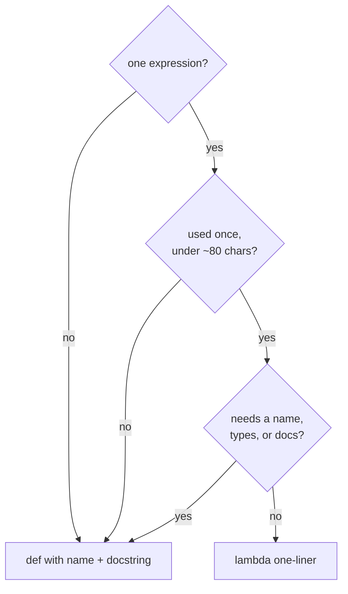

# 06 — `lambda` Functions and IIFE

What `lambda` is, what IIFE means in Python, where each fits, how to use
them, when to reach for `def` instead, plus edge cases from a C# lens.

## 1. What: `lambda` is a single-expression function

C# has full lambdas with blocks (`x => { ...; return y; }`). Python
does not. `lambda` builds one anonymous function holding one
expression:

```python
square = lambda x: x * 2
```

Means roughly:

```python
def square(x):
    return x * 2
```

Differences that matter:

1. Body is one expression, never statements (`if` block, `for`, `with`,
   `return`, assignments are statements and forbidden; the ternary
   `a if cond else b` is an expression and allowed).
2. No type annotations, no docstring, name is always `<lambda>` in
   tracebacks.
3. Created at runtime like any object, closable over locals.

With parameters it looks like `def` without types:

```python
add = lambda a, b=10: a + b
call = lambda *args, **kwargs: (args, kwargs)
```

### C# vs Python: lambdas, IIFE, closures

| C# | Python | Same? |
|---|---|---|
| `x => x * 2` expression lambda | `lambda x: x * 2` | Same for one-liners |
| Block lambda `(x, y) => { ...; return z; }` | No equivalent — the body is one expression; write `def` | No equivalent |
| Typed params `(int x) => x * 2`, delegate types `Func<int, int>` | No annotations on `lambda`; traceback name always `<lambda>` | Different — no types, poor tracebacks |
| Statements allowed in block lambdas | `if` / `for` / `return` / `=` are syntax errors; ternary `a if cond else b` is allowed | Different limits |
| Recursion via a named method (anonymous self-reference needs a named-delegate trick in both languages) | `lambda` has no self-name — bind to a name or write `def` | Same advice: recursive logic belongs in `def` |
| IIFE `new Func<int>(() => 1 + 2)()` compiles but is unidiomatic | `(lambda: 1 + 2)()` works but is unidiomatic; `def` plus a call reads better | Similar — possible in both, idiomatic in neither |
| `for`-loop closure captures the variable (all delegates see the final value; `foreach` was fixed in C# 5) | Late binding too: `[lambda: i for i in range(3)]` gives `[2, 2, 2]`; fix with `lambda i=i: i` or a factory | Same trap; C# fix is a loop-local copy, Python fix is a default-arg snapshot |
| LINQ key `OrderBy(x => x.Score)` | `sorted(users, key=lambda item: item[1])`; prefer `operator.itemgetter(1)` | Same job |

### lambda or def: the decision tree



### Why the loop trap bites: late binding in time order

```mermaid
sequenceDiagram
    participant Loop as for i in range(3)
    participant Cell as shared cell i
    participant F as lambdas f0 f1 f2
    participant Call as later f()
    Loop->>Cell: i = 0, then 1, then 2
    Loop->>F: create f0 f1 f2 (all read Cell)
    Call->>Cell: read i — now 2 for everyone
    Cell-->>Call: 2, 2, 2
```

Each lambda holds the cell, not a snapshot. `lambda i=i: i` copies
the current value into a default at creation time — one snapshot
per lambda instead of one shared cell.

## 2. Why it exists, where it fits

Short throwaway keys and adapters: `sorted`, `min`/`max`, `map`,
`filter`, GUI/event callbacks, test doubles. Anywhere the function is
used once and fits ~60-80 chars.

```python
users = [("amy", 3), ("bob", 1)]

by_score = sorted(users, key=lambda item: item[1])
top = max(users, key=lambda item: item[1])
```

This repo rule (`docs/STYLE_GUIDE.md`): named functions use `def`;
`lambda` only for short one-liners. Prefer `operator.*` and generator
expressions over `map`/`filter` plus `lambda`:

```python
import operator

names = ["amy", "bob"]
upper = list(map(str.upper, names))
total = sum(x**2 for x in range(11) if x % 2 == 0)
second = operator.itemgetter(1)
```

## 3. IIFE: immediately invoked function expression

IIFE comes from JavaScript: `(function () { ... })()` runs once to make
a private scope. Python has no block scope at module level, so the
direct translation is:

```python
result = (lambda: 1 + 2)()
```

This runs and assigns `3`. It works, but idiomatic Python rarely does
it. Reasons:

1. Module scope is already the top scope; wrapping one expression adds
   noise.
2. `def` plus a call reads better for multi-step init.
3. Class/private-module conventions (`_helper`, functions) cover the
   encapsulation need.

When the IIFE shape does help: one-off computation with a temporary
that must not leak, or a default value needing a loop/try:

```python
# Temporary does not leak past the expression.
first_even = (lambda xs: next((x for x in xs if x % 2 == 0), None))([1, 3, 4])
```

Cleaner Python for the same cases:

```python
def _first_even(values: list[int]) -> int | None:
    """Return the first even value, else None."""
    return next((x for x in values if x % 2 == 0), None)


first_even = _first_even([1, 3, 4])
```

If you truly need a one-shot scope with statements, define and call:

```python
def _build() -> dict[str, int]:
    out: dict[str, int] = {}
    for i in range(3):
        out[f"k{i}"] = i
    return out


LOOKUP = _build()
del _build  # Optional: remove the builder from the namespace.
```

`functools.partial` covers the adapter case without `lambda`:

```python
import functools

send_admin = functools.partial("hello {name}".format, name="admin")
```

## 4. Closures and related details

`lambda` closes over variables by reference (late binding), same as
`def`. The loop trap:

```python
# Wrong: every lambda sees the final i.
funcs = [lambda: i for i in range(3)]
print([f() for f in funcs])  # [2, 2, 2]
```

Fix with a default-arg snapshot:

```python
funcs = [lambda i=i: i for i in range(3)]
print([f() for f in funcs])  # [0, 1, 2]
```

Same fix applies to `def` in loops. Prefer a factory function for
clarity when the body grows.

Scope order is LEGB (local, enclosing, global, builtin). `lambda`
inside a method still needs explicit `self`:

```python
class Cart:
    """Cart with total helper."""

    def __init__(self, prices: list[int]) -> None:
        self.prices = prices
        self.total = lambda: sum(self.prices)
```

This works but hides a method as data. Prefer a real method or
`@property` unless the callable is intentionally swappable.

## 5. When to use vs avoid

Use `lambda` when: key/select one-liner, tiny adapter under ~60-80
chars, callback used once, body stays one readable expression.

Avoid when: needs statements, annotations, docstring, reuse, or a
useful traceback name. Then write `def`. Never assign a `lambda` to a
name for a public API (linter rule E731 flags `f = lambda: ...`
because `def` gives the same thing with a name and docs).

Avoid IIFE when: `def` plus call, comprehension, `next()` with default,
or `functools.partial` reads better. Keep the rare IIFE to a single
expression with a comment saying why the scope matters.

## 6. Edge cases

1. No statements: `lambda x: return x` and `lambda: y = 1` are syntax
   errors. Use a ternary or switch to `def`.
2. Traceback name: every failure reports `<lambda>`, so three lambdas
   in one frame are indistinguishable. Small `def` helpers fix that.
3. `map`/`filter` laziness: they return iterators. `map(lambda ...)`
   without `list()` or a consuming loop runs nothing visible.
4. Default-arg snapshot (`lambda i=i`) is idiomatic but cryptic to
   newcomers; comment it or use a factory.
5. Recursion has no self-name: `lambda` cannot call itself unless
   bound to a name or passed as an argument. Recursive logic belongs
   in `def`.
6. `lambda` in defaults evaluates late too: `def f(g=lambda: [])`
   shares one list like any mutable default. Use `None` plus guard.
7. Conditional expression only: `lambda x: "big" if x > 9 else "small"`
   is fine; statement `if` is not.
8. `sorted(key=lambda ...)` runs per element: keep keys cheap or
   precompute (decorate-sort-undecorate) for hot paths.

## Next

- [README.md](README.md) — index.
- [03-functions-def.md](03-functions-def.md) — full signature rules.
- [05-decorators.md](05-decorators.md) — wrappers around callables.
