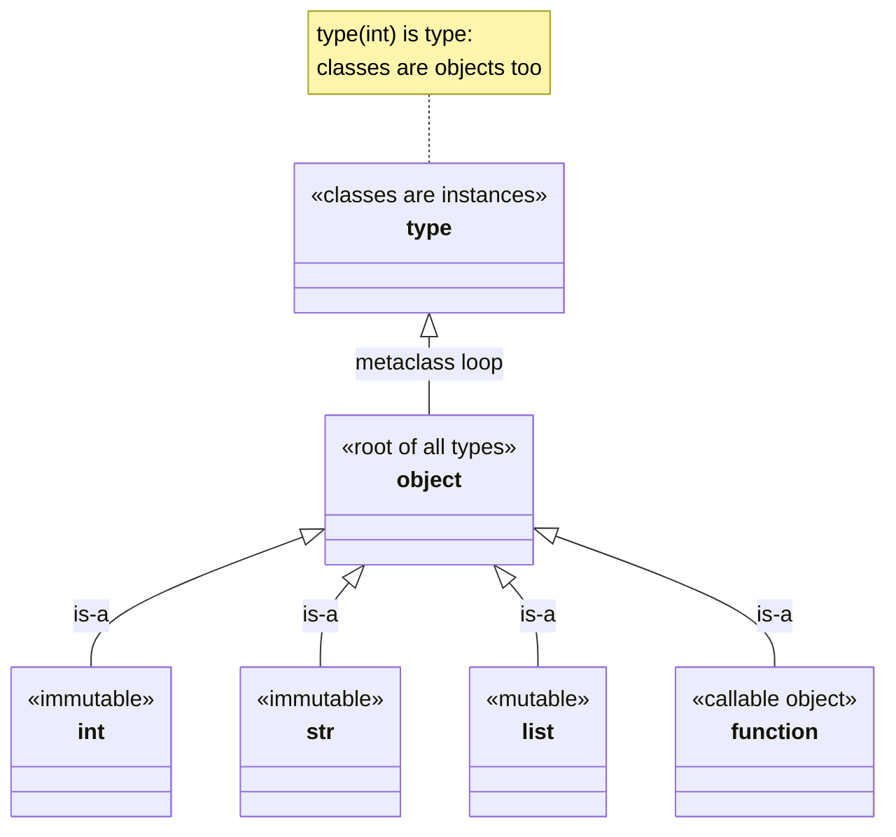
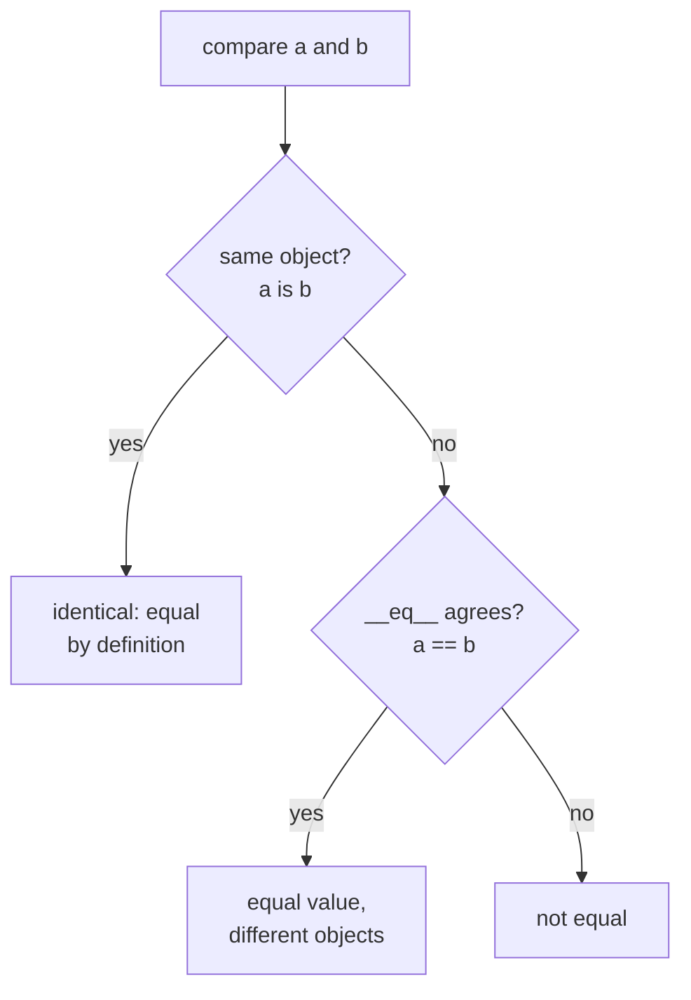

# 09 — Everything Is an Object: `type()`, Classes, and OOP in Python

The one idea that unlocks Python OOP: names point at objects, classes
are objects too, and `type()` tells you which class made an object.

## 1. Human version first

C# has primitives, structs, classes, and compiler magic between them.
Python has one kind of thing: objects living on a heap, with names as
sticky notes. `42`, `"hi"`, `[1]`, functions, classes, and modules are
all objects with a type, an identity, and attributes.

```python
x = 42
print(type(x))  # <class 'int'>. The sticky note x points at an int object.
print(isinstance(x, int))  # True. Prefer this over type(x) is int.
```

Two questions replace C# type habits:

1. What can it do? (duck typing: `speak()`, `__len__`, iteration).
2. What made it? (`type(obj)` / `obj.__class__` for the spoke that
   answers 1.)

## 2. `type()`, `isinstance()`, `id()`

```python
print(type(42))  # <class 'int'>.
print(type("hi"))  # <class 'str'>.
print(type([]))  # <class 'list'>.


def f() -> None:
    """Sample."""


print(type(f))  # <class 'function'>. Functions are objects.
print(type(int))  # <class 'type'>. Classes are objects made by type.
```

| Tool | Answers | Use |
|---|---|---|
| `type(obj)` | Exact maker class | Debugging, dispatch tables |
| `isinstance(obj, Cls)` | Maker or subclass | All runtime checks (repo rule) |
| `id(obj)` | Identity (address-ish) | `a is b` means same object |
| `is` / `is not` | Identity | `None` checks, singletons |
| `==` / `!=` | Value equality | Calls `__eq__` |

Rules: `is None`, never `== None`. `isinstance()`, never
`type(x) is type(1)`. `is` for identity, `==` for value. Small ints and
short strings are cached (same `id`), so `is` on values lies.

### C# vs Python: object model and type tests

⚠️ Two false friends live here: Python `is` is NOT C# `is`, and
Python has no value types. Rows marked FALSE FRIEND need memorizing.

| C# | Python | Same? |
|---|---|---|
| Primitives + `struct`s + classes (three kinds, plus compiler magic) | One kind: everything (ints, strings, functions, classes, modules) is a heap object | Different — one model |
| `obj.GetType()` (runtime), `typeof(X)` (compile-time `System.Type`) | `type(obj)` / `obj.__class__` (always runtime) | Similar job; `typeof` has no equivalent |
| `x is string s` (type test + pattern bind) | `isinstance(x, Cls)` (test only; bind separately) | Similar job, plainer tool |
| `a is b` — C# `is` NEVER means identity | `a is b` means identity (`id(a) == id(b)`); the C# twin is `ReferenceEquals(a, b)` | FALSE FRIENDS — opposite meanings |
| `(string)x` / `x as string` casts | No casts — `isinstance` guard, or `typing.cast` (checker-only, zero runtime effect) | Different — no runtime cast operator |
| `null` (absence; `NullReferenceException` source) | `None` (a real singleton object; `is None` like C# `is null`) | Similar outcome; `None` is an object, not a hole |
| `==` on classes defaults to reference equality unless overloaded | `==` calls `__eq__` (default is identity; overriding is routine) | Similar default, easier override |
| `struct` assign copies (`var b = a` is independent) | Assign always binds; independence comes from immutability (`b = a; a = a + (3,)` leaves `b`) | Different mechanism, similar outcome for immutables |
| Boxing: `object o = 5;` wraps a value | No boxing — `5` is already an object | No equivalent needed |
| `Equals` + `GetHashCode` kept paired | `__eq__` + `__hash__` kept paired (defining `__eq__` sets `__hash__` to `None`) | Same pairing rule |
| Reflection `typeof(X).GetMembers()` | `dir()`, `obj.__dict__`, `help()` | Same job |

### Everything-is-an-object at a glance



No primitives corner, no struct corner — one root, one rule. `type`
closing the loop (classes made by `type`) is why decorators can
take a class and return a new one.

### Identity vs equality: which question to ask



`is` answers the cheap question (one pointer compare); `==`
answers the expensive one (a method call). `None` checks always
take the cheap path.

## 3. Classes are runtime objects

`class` is an executable statement. It builds an object of type
`type`, with methods as attributes:

```python
class Dog:
    """Dog."""

    def speak(self) -> str:
        """Return the sound."""
        return "woof"


print(type(Dog))  # <class 'type'>.
print(Dog.__name__)  # Dog.
print(Dog.speak)  # A function object living on the class.
```

Calling the class (`Dog("rex")`) runs `__new__` then `__init__` and
returns an instance whose `__class__` is `Dog`. Decorators like
`@dataclass` are functions taking that class object and returning a
new one. Metaclasses (custom `type` subclasses) customize this
machinery; this repo bans them as power features.

Instance field lookup: instance `__dict__`, then class, then bases
along `__mro__`. That chain is why methods resolve and why class
attributes act as shared defaults.

## 4. Introspection kit

```python
print(Dog.__class__)  # <class 'type'>.
print(Dog.__mro__)  # (Dog, object). Lookup order.
print(Dog.__dict__.keys())  # Methods and class attrs.
print(dir(Dog("x")))  # Everything reachable, incl. dunders.
help(Dog)  # Human-readable: docstrings, MRO, methods.
```

Use `help()` and `dir()` while learning; ship `isinstance()` checks
and `Protocol` hints in code, not `getattr` spaghetti.

## 5. OOP pillars, Python edition

Encapsulation: convention, not walls. `x` public, `_x` internal,
`__x` name-mangled against subclass clashes. Real invariants go in
`@property` setters and `__init__` guards, not hiding:

```python
class Circle:
    """Circle."""

    def __init__(self, radius: float) -> None:
        self.radius = radius

    @property
    def radius(self) -> float:
        """Return the radius."""
        return self._radius

    @radius.setter
    def radius(self, value: float) -> None:
        if value < 0:
            raise ValueError("radius must be >= 0")
        self._radius = value
```

Inheritance: multiple, cooperative, MRO-ordered. Every link calls
`super().__init__()`. Method typos create new methods silently, so
tests own override checking:

```python
class Dog:
    """Base."""

    def speak(self) -> str:
        """Return the sound."""
        return "..."


class Loud(Dog):
    """Override. Virtual by default, no keyword."""

    def speak(self) -> str:
        return "WOOF"
```

Polymorphism: structural. If it has `.speak()`, it qualifies. `mypy`
plus `Protocol` restore C#-like checking at review time:

```python
from typing import Protocol


class Speaker(Protocol):
    """Anything speakable."""

    def speak(self) -> str: ...


def loud(speaker: Speaker) -> str:
    """Work with any matching object."""
    return speaker.speak().upper()
```

Abstraction: `ABC` plus `@abstractmethod` blocks instantiation until
overridden; `Protocol` needs no inheritance. Prefer `Protocol` for
flexible APIs, `ABC` for shared base logic.

No overloading: one `def` per name wins. Defaults, unions, and
`@classmethod` factories (`Point.from_tuple`) cover C# overloads.

## 6. Dunder hooks that finish the picture

Value objects need `__repr__` always, `__eq__` plus `__hash__` as a
pair (defining `__eq__` nulls the hash unless redefined),
ordering via `@functools.total_ordering`. Containers implement
`__len__`, `__iter__`, `__getitem__`. Resources implement
`__enter__`/`__exit__` for `with`. Callables implement `__call__`.
Full catalog lives in `02-dunder-attributes.md`.

```python
class Point:
    """Value point."""

    def __init__(self, x: int = 0, y: int = 0) -> None:
        self.x = x
        self.y = y

    def __repr__(self) -> str:
        return f"Point(x={self.x!r}, y={self.y!r})"

    def __eq__(self, other: object) -> bool:
        if not isinstance(other, Point):
            return NotImplemented
        return (self.x, self.y) == (other.x, other.y)
```

## 7. Edge cases experts hit

1. Class-level annotation stores nothing: `x: int` without
   `self.x = ...` in `__init__` leaves instances without `x`.
2. Mutable class attribute shared: `items: list = []` on the class is
   one list for all instances. Assign per-instance in `__init__`.
3. `__eq__` without `__hash__` unhashables the class: instances cannot
   be dict keys or set members until both exist.
4. `bool` is an `int` subclass: `isinstance(True, int)` is True.
   Check `bool` first when branching.
5. `type(x) is C` rejects subclasses; `isinstance` accepts them. The
   repo rule exists because the strict form breaks polymorphism.
6. Monkey-patching (`Dog.speak = ...` at runtime) works because
   classes are mutable objects. Powerful in tests, forbidden as
   architecture.
7. `getattr(obj, name)` dynamism hides contracts from `mypy` and
   readers. Prefer explicit attributes and `Protocol`.

## Next

- [README.md](README.md) — index.
- [12-method-resolution-order.md](12-method-resolution-order.md) — C3,
  cooperative `super()`, diamonds, edges, practices.
- [11-access-modifiers-and-shared-mutation.md](11-access-modifiers-and-shared-mutation.md) — access shapes and shared mutation in detail.
- [08-csharp-keywords-to-python.md](08-csharp-keywords-to-python.md) —
  companion keyword map.
- [04-classes-oop.md](04-classes-oop.md) — class reference.
