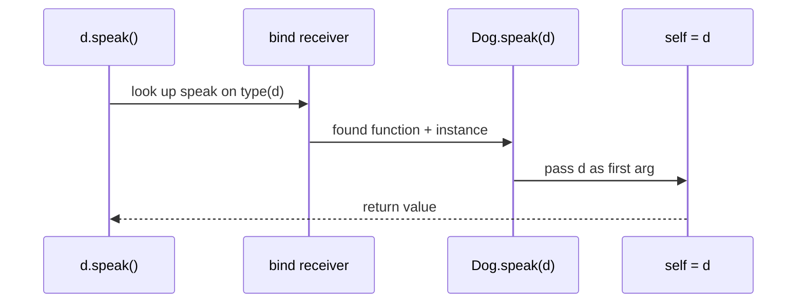
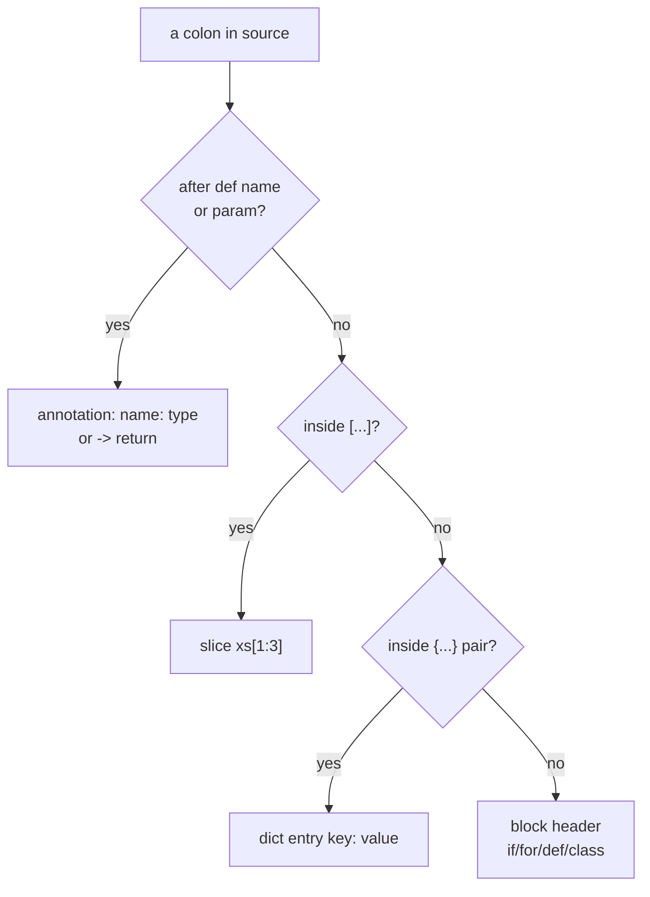

# 10 — `self`, `:`, and `->` in Plain English

The three symbols C# developers trip over first. `self` is the
receiver made visible. `:` and `->` are labels, not locks: they
document types for humans and `mypy`, the interpreter ignores them.

## 1. `self`: the receiver with its name tag on

C# hides `this`. Python puts it on the table as the first parameter of
every instance method:

```python
class Dog:
    """Dog."""

    def __init__(self, name: str) -> None:
        self.name = name

    def speak(self) -> str:
        """Return the sound."""
        return f"{self.name} says woof"
```

```python
d = Dog("rex")
d.speak()  # Sugar. Python really calls Dog.speak(d).
```

Human version: each object carries its methods, but methods are just
functions living on the class. Someone has to say which dog is
speaking. `self` is that someone, passed automatically in first
position.

Bound vs unbound, seen once and never forgotten:

```python
print(Dog.speak)  # Function. Needs an instance: Dog.speak(d).
print(d.speak)  # Bound method. Instance already tucked in.
```

### C# vs Python: the receiver

| C# | Python | Same? |
|---|---|---|
| `this` passed implicitly | `self` as explicit first param | Same job, visible receiver |
| `static` method has no `this` | `@staticmethod` has no `self`/`cls`; repo prefers a module function | Similar + style rule |
| `static` factory calling `new ClassName(...)` | `@classmethod` calling `cls(...)`, subclass-safe | Similar outcome; `cls` keeps polymorphism |
| `base(...)` / `base.Method()` | `super().__init__()` / `super().speak()`; `self` stays the real instance | Same job |
| Extension method `M(this Dog d)` | Plain function `loud(dog)` or `Protocol` | Different shape, same call-site job |
| `this` cannot be rebound (it is not a variable) | Rebinding `self = Box(0)` only moves a local name; mutate (`self.value = 0`) to affect the caller | Different — assignment never crosses (see `11` Part B) |

Full `__init__` behaviour matrix (constructor split, self-less
shapes, stored vs consumed params, class-level declarations): see
`04` §8.

### How a method call really dispatches



`d.speak` (no call yet) stops after binding: a bound method with
`d` already tucked in. `Dog.speak` never binds — you supply the
instance yourself.

### Which colon is this: a dispatcher



Position decides meaning — the glyph is shared, the contexts never
overlap, so read outward from where the colon sits.

## 2. `self` mistakes and what the error means

Forgetting `self`:

```python
class Dog:
    """Dog."""

    def speak() -> str:  # Wrong: no receiver slot.
        """Return the sound."""
        return "woof"


Dog("rex").speak()  # TypeError: speak() takes 0 positional arguments but 1 was given.
```

The `1 was given` is the hidden instance. Fix: add `self`.

Using `self` where none arrives:

```python
def greet(self) -> str:  # Wrong: module function, no instance.
    """Return hi."""
    return "hi"


greet()  # TypeError: missing 1 required positional argument: 'self'.
```

Human version: inside a class, methods get one free argument (the
instance). Outside a class, nobody passes it, so `self` becomes a
mandatory caller argument by accident.

Rebinding `self` does nothing to the caller:

```python
class Box:
    """Box."""

    def __init__(self, value: int) -> None:
        self.value = value

    def reset(self) -> None:
        """Rebind locally. The object outside is untouched."""
        self = Box(0)  # New local sticky note. Original still old.

    def clear(self) -> None:
        """Mutate the attribute. Caller sees it."""
        self.value = 0
```

Same rule as `08 §3`: assignment peels the sticky note, attribute
writes ink the shared object.

## 3. `self` next to its cousins

```python
class Point:
    """Point."""

    def __init__(self, x: int = 0) -> None:
        self.x = x

    def move(self, dx: int) -> None:
        """Instance method: self is the point."""
        self.x += dx

    @classmethod
    def origin(cls) -> "Point":
        """Class method: cls is the class, subclass-safe."""
        return cls(0)

    @staticmethod
    def is_zero(x: int) -> bool:
        """Static: no self, no cls. Prefer a module function."""
        return x == 0

    @property
    def double(self) -> int:
        """Property: self arrives like any method."""
        return self.x * 2
```

Nested functions and lambdas do not get a fresh `self`. They close
over yours:

```python
class Cart:
    """Cart."""

    def __init__(self, prices: list[int]) -> None:
        self.prices = prices

    def total(self) -> int:
        """Closure reads enclosing self."""
        calc = lambda: sum(self.prices)
        return calc()
```

Inheritance: `self` is always the real instance, even inside base
code. `super().__init__()` configures it, `self.method()` dispatches
to the override:

```python
class Loud(Dog):
    """Loud dog."""

    def speak(self) -> str:
        return super().speak().upper()  # self stays the Loud instance.
```

## 4. `self` edge cases checklist

1. Name is convention, not keyword. `this` or `s` runs, but every
   reader, linter, and tutorial expects `self`. Keep it.
2. `__new__` takes `cls`, not `self`: allocation happens before any
   instance exists.
3. `@staticmethod` has no `self`; referencing it there is `NameError`.
4. `@classmethod` has `cls`; `cls()` (not `ClassName()`) keeps
   factories subclass-safe.
5. Method typo plus `self` still runs: `def speek(self)` creates a new
   method that never overrides. Tests catch it, nothing else does.
6. `self._x` vs `self.__x`: single underscore is a please-don't-touch
   sign, double triggers name mangling (`_Class__x`) against subclass
   clashes. Neither blocks access.
7. Dataclasses and `__slots__` use identical `self` rules. Slots only
   restrict which attributes exist, not how `self` arrives.

## 5. `:` and `->`: labels, not locks

Neither is an operator doing work. `:` tags a name with a type,
`->` tags the return:

```python
def greet(name: str, count: int = 1) -> str:
    """Return a repeated greeting.

    Args:
        name: Who to greet.
        count: Repeat times.

    Returns:
        The greeting text.
    """
    return " ".join([f"hello {name}"] * count)


age: int = 3  # Variable annotation. Same label idea.
```

C# mapping: `name: str` is `string name`, `-> str` is the return type
before the C# method name. Placement differs, job matches: tell the
reader the shape.

What the interpreter does with them: stores strings/objects in
`fn.__annotations__`, enforces nothing. `greet(123)` runs until
something inside breaks. `mypy src` is the enforcer; `ValueError`
guards are the runtime backstop:

```python
def repeat(text: str, times: int) -> str:
    """Repeat text.

    Raises:
        ValueError: If times is negative.
    """
    if times < 0:
        raise ValueError("times must be >= 0")
    return text * times
```

### C# vs Python: annotations and the `:` glyph

| C# | Python | Same? |
|---|---|---|
| `string name`, `int F(string s)` (type first; return before the name) | `name: str`, `def f(s: str) -> int:` (type after; `->` for returns) | Same info, mirrored placement |
| Compile-time enforced; wrong type stops the build | Stored in `fn.__annotations__`, ignored at runtime; `mypy src` + `ValueError` guards enforce | Different — labels, not locks |
| Overloads `F(int)` / `F(string)` | One `def`; last wins; unions `X \| Y` and defaults | Different — no resolution |
| `bool` is distinct from `int` | `bool` subclasses `int`: `isinstance(True, int)` is `True` | FALSE FRIEND — branch on `bool` first |
| XML docs `<param>` / `<returns>` | Docstring `Args:` / `Returns:` / `Raises:` | Same job |
| `:` means base list (`class D : B`), ctor chain (`: base(x)`), `case:` labels, `?:` | `:` means block headers (`def`/`if`/`for`), slices (`xs[1:3]`), dicts, annotations | Different glyph-sharing — do not transfer habits |

## 6. When to write them, when to stop

Always: every public function, method, and class field. This repo
fails `mypy src` otherwise. Locals only where they clarify
(`total: int = 0` before a long loop is fine; annotating everything
is noise).

Prefer modern shapes:

```python
def get(names: list[str]) -> str | None:
    """Return first name or None."""
    return names[0] if names else None
```

Forward reference (class mentioning itself) needs quotes or the
future import at the file top:

```python
from __future__ import annotations


class Point:
    """Point."""

    @classmethod
    def origin(cls) -> Point:  # Unquoted works with the future import.
        """Return the origin."""
        return cls(0)
```

Colon déjà vu for C# eyes: slices (`xs[1:3]`), dicts (`{"a": 1}`),
and block headers (`if x:`) reuse the glyph. Only `def`/`lambda`
params, variable declarations, and annotations use the `name: type`
form. `->` appears only in `def` (lambdas cannot annotate returns).

## 7. Annotation edge cases

1. Evaluated at `def` time: unknown names raise `NameError` on
   import unless quoted or behind the future import.
2. `X | None` needs Python 3.10+ at runtime; older targets use
   `Optional[X]` or the future import.
3. `bool` is an `int` subclass: `isinstance(True, int)` is True, so
   annotations do not separate them at runtime either.
4. `Callable`, `Protocol`, generics (`list[int]`) are checker tools.
   They never slow or guard runtime code paths.
5. Over-annotating internals (`x: int = 1` on every throwaway) adds
   lines without safety. Annotate boundaries, test behavior.

## Next

- [README.md](README.md) — index.
- [11-access-modifiers-and-shared-mutation.md](11-access-modifiers-and-shared-mutation.md) — access shapes and shared mutation in detail.
- [08-csharp-keywords-to-python.md](08-csharp-keywords-to-python.md) —
  companion keyword map.
- [03-functions-def.md](03-functions-def.md) — signature rules.
- [04-classes-oop.md](04-classes-oop.md) — class reference.
