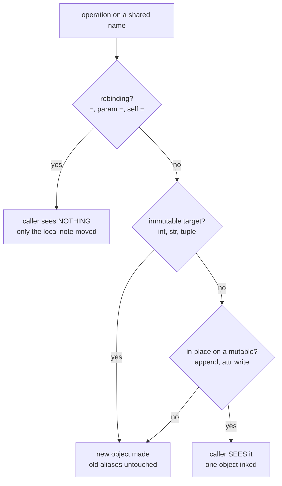
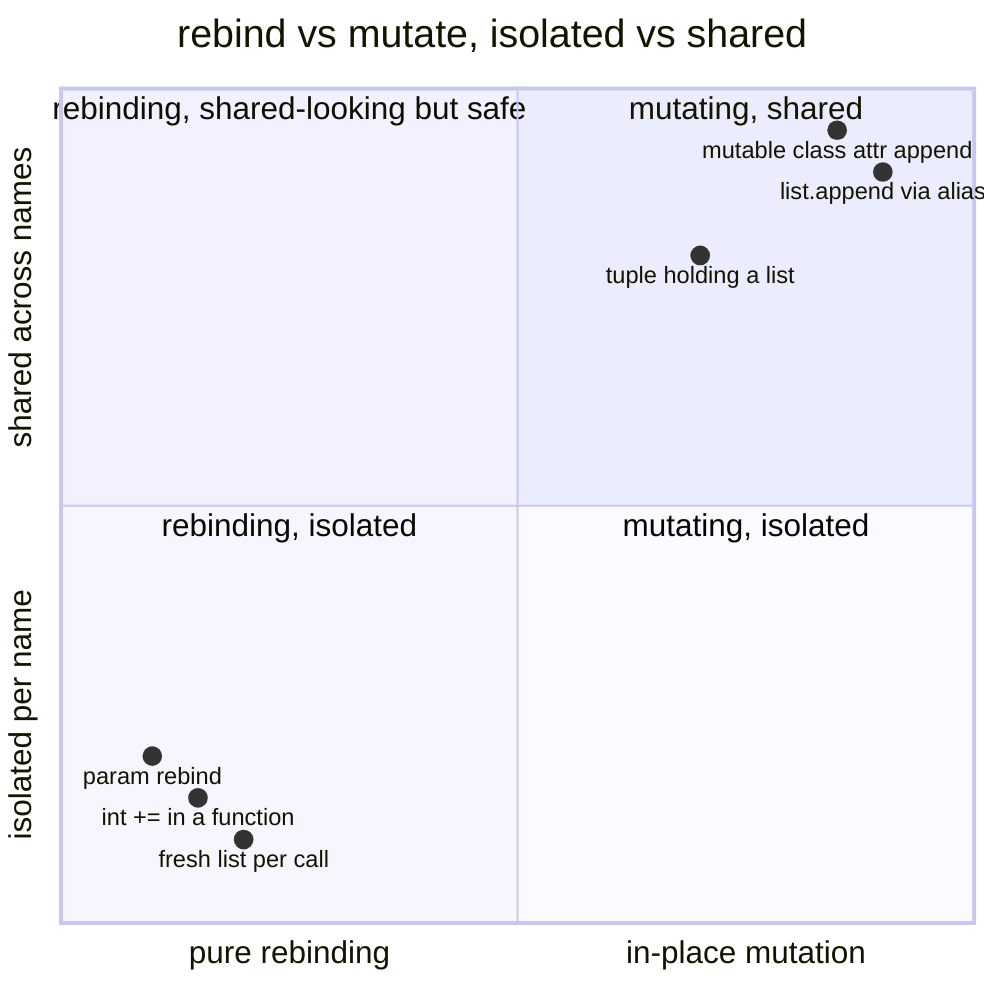

# 11 — Access Specifiers and Shared Mutation in Plain English

How Python handles `public` / `private` / `protected` for classes,
objects, methods, and attributes — and exactly when two names share
one mutation. Assumes you know C# access modifiers; focuses on what
Python replaces them with and where aliasing bites.

Core surprise up front: Python has **no enforced access specifiers**.
`public`, `_internal`, and `__mangled` are naming conventions plus one
mechanical rename (mangling). Privacy is a sign, not a wall. Real
invariants live in `@property` setters, `__init__` guards, and
`ValueError` — never in hiding. Mutation sharing follows one rule:
**assignment rebinds a name; method calls and attribute writes mutate
the object every name points at.**

## Part A — Access specifiers for classes, attributes, methods, objects

### 1. The four name shapes

Every class member, module member, and method name falls into one
shape. The interpreter enforces almost nothing; linters, IDEs, and
`from m import *` respect the convention.

| Shape | Example | C# analogue | What happens |
|---|---|---|---|
| Public | `name`, `speak()` | `public` | Fully visible. Documented API. |
| Single underscore | `_cache`, `_helper()` | `internal` / `protected` (convention) | Importable and callable, but do-not-touch. Excluded from `from m import *` without `__all__`. IDEs grey it out. Nothing blocks access. |
| Double underscore (no trailing `__`) | `__token` | `private` (weak) | Name-mangled to `_ClassName__token`. Avoids subclass clashes. Still reachable as `obj._ClassName__token`. |
| Dunder (both sides) | `__init__`, `__repr__` | Reserved protocol | Interpreter-owned. Never invent your own `__mine__`. Full catalog in `02-dunder-attributes.md`. |

```python
class Account:
    """Access shapes on one class."""

    def __init__(self, owner: str) -> None:
        self.owner = owner  # Public attribute.
        self._balance = 0  # Internal by convention.
        self.__pin = "0000"  # Mangled to _Account__pin.

    def deposit(self, amount: int) -> None:
        """Public method."""
        if amount < 0:
            raise ValueError("amount must be >= 0")
        self._balance += amount

    def _audit(self) -> int:
        """Internal helper. Callable, but not public API."""
        return self._balance

    def __rotate_pin(self) -> None:
        """Mangled helper: _Account__rotate_pin. Avoids subclass clash."""
        self.__pin = "9999"
```

```python
a = Account("amy")
a.owner  # Fine.
a._balance  # Works, but you promised not to.
a._Account__pin  # Works. Mangling is renaming, not locking.
a._Account__rotate_pin()  # Works. No enforcement anywhere.
```

Human version: `_x` is a "staff only" sign on an unlocked door.
`__x` moves the door behind a pillar so subclasses do not collide
with it. Neither locks anything.

### 2. C# modifier map (full)

| C# | Python replacement | Enforced? |
|---|---|---|
| `public` class / member | Public name + export in `__all__` | No — convention + docs |
| `private` field / method | `__name` (mangled) inside a class | Rename only — reachable via `_Cls__name` |
| `protected` member | `_name` + documented subclass contract | No — convention only |
| `internal` (assembly-private) | `_name` at module level, omit from `__all__` | Linter-level — still importable |
| `protected internal` / `private protected` | No equivalent — use `_name` + review | No |
| `sealed` class / method | `@typing.final` on class / method | Checker-only (`mypy`), runtime ignores it |
| `readonly` field | `@property` without setter, `@dataclass(frozen=True)`, or `typing.Final` | Property + frozen enforced at runtime; `Final` is checker-only |
| `const` | `UPPER_SNAKE` module constant | No — reassignable; convention + review |
| `static` method / field | Module function (preferred) or `@staticmethod`; class attribute for shared state | No access change — same `_`/`__` rules apply |
| `interface` | `typing.Protocol` (structural) or `abc.ABC` (nominal) | `ABC` blocks instantiation; `Protocol` never does |

### 3. Classes themselves: public vs internal

A class is a module attribute, so the same `_` rule applies. There
is no `internal class` keyword — you mark intent with the name and
the export list:

```python
"""ledger.py."""

__all__ = ["Ledger"]  # Public surface. _SqlLedger stays importable but hidden.


class Ledger:
    """Public ledger."""


class _SqlLedger(Ledger):
    """Internal implementation. Importable, but not advertised."""
```

`from ledger import *` picks up only `Ledger`. `from ledger import
_SqlLedger` and `import ledger; ledger._SqlLedger` still work. The
`__all__` list is documentation plus wildcard filtering, not a lock
(see `02-dunder-attributes.md §3`).

### 4. Attributes: instance vs class, and where each rule lives

```python
class Team:
    """Class vs instance attribute visibility."""

    count = 0  # Class attribute: one copy shared (see Part B §6).

    def __init__(self, name: str) -> None:
        self.name = name  # Public instance attribute.
        self._tags: list[str] = []  # Internal instance store.
        self.__token = name  # Mangled instance attribute.
```

1. Annotation alone stores nothing: `name: str` at class level
   without `self.name = ...` in `__init__` leaves instances without
   `name` (`AttributeError` on read).
2. `self._x` and `self.__x` follow §1. `__slots__` does **not** hide
   anything — it only restricts which attribute names may exist and
   removes `__dict__`. Do not use slots as privacy.
3. Real guarding is validation, not hiding:

```python
class Circle:
    """Radius validated by a property, not by hiding."""

    def __init__(self, radius: float) -> None:
        self.radius = radius  # Goes through the setter.

    @property
    def radius(self) -> float:
        """Return the radius."""
        return self._radius

    @radius.setter
    def radius(self, value: float) -> None:
        if value < 0:
            raise ValueError("radius must be >= 0")
        self._radius = value
```

Assigning `self.radius` inside the getter or setter recurses — the
backing store must be `self._radius`. Use `@property` for cheap,
invariant-guarding reads only, never for expensive work or trivial
get/set (make the attribute public instead).

`readonly` strength order (from `08 §6`): public + discipline
(weakest) → `@property` without setter (`AttributeError` on write)
→ `@dataclass(frozen=True)` (`FrozenInstanceError` on write) →
`typing.Final` (checker-only, runtime still writable).

### 5. Methods: same prefixes, no special rules

Method visibility uses the identical `_` / `__` prefixes. There is
no per-method `public:` block:

```python
class Store:
    """Method visibility shapes."""

    def get(self, key: str) -> str | None:
        """Public API."""
        return self._load(key)

    def _load(self, key: str) -> str | None:
        """Internal helper. Tests may call it; users should not."""
        return None

    def __rehash(self) -> None:
        """Mangled to _Store__rehash. A subclass def __rehash stays separate."""
        ...

    def __len__(self) -> int:
        """Dunder protocol. Public by design — len(store) calls it."""
        return 0
```

Subclass-clash demo — the one job mangling actually does:

```python
class Base:
    """Base with mangled helper."""

    def __init__(self) -> None:
        self.__hook()

    def __hook(self) -> str:
        """Mangled to _Base__hook."""
        return "base"


class Child(Base):
    """Child hook does NOT override — mangled to _Child__hook."""

    def __hook(self) -> str:
        return "child"


Child()._Base__hook()  # 'base'. Base.__init__ still found its own hook.
Child()._Child__hook()  # 'child'. No collision, no override.
```

`@classmethod`, `@staticmethod`, and `@property` do not change any
visibility rule — `_from_x`, `__parse`, and dunders compose freely
with decorators.

### 6. Introspection: how to see what is really there

```python
a = Account("amy")
a.__dict__  # {'owner': 'amy', '_balance': 0, '_Account__pin': '0000'}.
Account.__dict__  # Methods + class attrs. Mangled names appear with prefix.
dir(a)  # Everything reachable. '__pin' absent; '_Account__pin' present.
help(Account)  # Human-readable: docstrings, MRO, methods.
```

Rules: `is None`, never `== None`. `isinstance(obj, Cls)`, never
`type(obj) is Cls` (the strict form rejects subclasses and breaks
polymorphism). `is` tests identity, `==` tests value.

## Part B — Shared mutation: when two names ink one object

### 1. The onerule

Names are sticky notes on objects. **Assignment (`=`, parameter
binding, `import as`) moves a sticky note. Attribute writes and
mutating-method calls (`obj.x =`, `.append`, `[k] =`, `+=` on a
mutable) ink the object every sticky note points at.** `id()` /
`is` answer "same object?"; `==` answers "equal value?".

| Immutable (rebind creates a new object) | Mutable (in-place change visible to all aliases) |
|---|---|
| `int`, `float`, `bool`, `str`, `tuple`, `frozenset`, `None`, `bytes` | `list`, `dict`, `set`, `bytearray`, most class instances |

```python
a = (1, 2)
b = a  # Same tuple.
a = a + (3,)  # New tuple. b still (1, 2). No shared mutation.

a = [1, 2]
b = a  # Same list.
a.append(3)  # Inks the shared list. b sees [1, 2, 3]. Shared mutation.
```

### 2. When shared mutation HAPPENS

#### Case 1 — Aliasing the same mutable object

```python
xs = [1, 2]
alias = xs  # One list, two names.
alias.append(3)
print(xs)  # [1, 2, 3]. Caller-visible.
```

Same for `dict`, `set`, `bytearray`, and class instances. `is`
confirms: `alias is xs` is `True`.

#### Case 2 — Mutating a call argument (rebinding does not count)

```python
def rebinding(items: list[int]) -> None:
    """Rebind locally. Caller sees nothing."""
    items = [9]


def mutating(items: list[int]) -> None:
    """Mutate in place. Caller sees it."""
    items.append(9)


xs = [1]
rebinding(xs)  # xs still [1]. The parameter sticky note moved; the list did not.
mutating(xs)  # xs now [1, 9]. The shared list was inked.
```

Immutable arguments can never show this: `x += 1` on an `int`
rebinds the local name. The caller is untouched.

#### Case 3 — Mutable class attribute shared by all instances

```python
class Team:
    """One list for every team — almost always a bug."""

    members: list[str] = []

    def __init__(self, name: str) -> None:
        self.name = name


a = Team("a")
b = Team("b")
a.members.append("amy")
print(b.members)  # ['amy']. b never asked for amy.
```

Fix: assign per-instance in `__init__` (`self.members = []` or
`self.members = list(members)`). Class attributes are shared
defaults, not per-object storage.

#### Case 4 — Mutable default argument shared across calls

```python
def collect_bad(items: list[int] = []) -> list[int]:
    """Wrong: one list object reused for every call."""
    items.append(1)
    return items


collect_bad()  # [1].
collect_bad()  # [1, 1]. Yesterday's call leaked into today's.


def collect(items: list[int] | None = None) -> list[int]:
    """Correct: sentinel plus guard makes a fresh list per call."""
    if items is None:
        items = []
    items.append(1)
    return items
```

Same fix in dataclasses: `field(default_factory=list)`, never
`field(default=[])`.

#### Case 5 — Returning (or storing) a live internal reference

```python
class Cart:
    """Leaking getter shares mutation with the caller."""

    def __init__(self, prices: list[int]) -> None:
        self._prices = prices  # Aliases the caller's list, too.

    @property
    def prices(self) -> list[int]:
        """Caller can .append() straight into our internals."""
        return self._prices
```

```python
given = [10]
cart = Cart(given)
given.append(20)  # Mutates cart._prices — constructor aliased it.
cart.prices.append(30)  # Mutates cart._prices — getter leaked it.
```

Fix both ends — defensive copy on the way in and on the way out:

```python
class SafeCart:
    """Copies at the boundary. No aliasing either direction."""

    def __init__(self, prices: list[int]) -> None:
        self._prices = list(prices)

    @property
    def prices(self) -> tuple[int, ...]:
        """Immutable snapshot. Caller cannot ink our state."""
        return tuple(self._prices)
```

#### Case 6 — In-place edit of a class attribute through an instance

Reads fall back to the class; plain writes shadow per-instance; but
**in-place mutation inks the shared class object**:

```python
class Registry:
    """Shared default with three different write shapes."""

    tags: list[str] = []


r = Registry()
r.tags.append("x")  # Inks Registry.tags. Every instance sees 'x'. SHARED.
r.tags = ["y"]  # Shadows: r.__dict__ gains its own list. Others unaffected.
Registry.tags = []  # Resets the shared copy for everyone without a shadow.
```

Same shape for `@classmethod` state: `cls.count += 1` intentionally
mutates class-level state visible to all instances and subclasses.

#### Case 7 — Nested mutable inside an "immutable" shell

`tuple`, `frozenset`, frozen dataclasses, and `Final` are **shallow**:
the container cannot be resized or rebound, but a `list` / `dict`
living inside it still mutates:

```python
pair = (1, [2])
pair[1].append(3)
print(pair)  # (1, [2, 3]). Tuple intact, contents changed.
```

```python
from dataclasses import dataclass


@dataclass(frozen=True)
class Holder:
    """Frozen blocks holder.items = ..., not holder.items.append(...)."""

    items: tuple[int, ...]  # Tuple field: fully safe.


@dataclass(frozen=True)
class LeakyHolder:
    """Frozen with a list field: rebinding blocked, mutation open."""

    items: list[int]
```

Rule: frozen / tuple / `Final` stop **rebinding**, never **nested
mutation**. For a truly fixed payload, hold tuples/frozensets, or
copy on entry and expose snapshots (Case 5).

#### Case 8 — Shallow copy shares the nesting

```python
import copy

original = [[1]]
shallow = copy.copy(original)
shallow[0].append(2)
print(original)  # [[1, 2]]. Inner list is still one object.

deep = copy.deepcopy([[1]])
deep[0].append(2)  # Original untouched. Use when nesting must split.
```

Slicing (`xs[:]`), `list(xs)`, `dict(d)`, `set(s)` are shallow too:
new outer container, same inner objects.

### 3. When shared mutation does NOT happen

1. **Rebinding any name** — `a = ...`, `param = ...`, `self = ...`
   inside a method, `a += 1` on an `int`/`str`/`tuple`. Only the
   local sticky note moves.
2. **Operating on immutables** — `int`, `str`, `tuple` (flat),
   `frozenset`, `None`. Every "change" builds a new object.
3. **Per-instance assignment in `__init__`** — `self.items = []` or
   `self.items = list(items)` gives each object its own store.
   Class-level sharing (Case 3) disappears.
4. **`None`-guarded defaults** — `def f(xs: list | None = None)`
   plus `xs = [] if xs is None else xs` builds a fresh list per
   call (Case 4 fixed).
5. **Copying at the boundary** — `list(x)`, `dict(d)`, `set(s)`,
   `xs[:]`, `tuple(x)`, `copy.deepcopy` for nesting. New container,
   old contents untouched (shallow caveat in Case 8).
6. **Per-instance shadowing by assignment** — `r.tags = [...]`
   writes `r.__dict__` and leaves `Registry.tags` and siblings
   alone. (But `r.tags.append(...)` does the opposite — Case 6.)
7. **Blocked rebinding** — `@property` without setter, frozen
   dataclass field assignment, `__slots__` unknown-attribute
   assignment. Each raises (`AttributeError` /
   `FrozenInstanceError`) instead of sharing. None of them blocks
   nested mutation (Case 7).

```python
class Box:
    """Rebind vs mutate on self."""

    def __init__(self, value: int) -> None:
        self.value = value

    def reset_bad(self) -> None:
        """Rebinds the local name. Original object untouched."""
        self = Box(0)

    def reset(self) -> None:
        """Mutates the shared object. Caller sees value 0."""
        self.value = 0
```

### C# vs Python: same outcome, different mechanism (or not)

Last cross-check: several rows LOOK equivalent but differ in what
the runtime guarantees. "Same outcome?" means observable behavior
for the shown case — read the mechanism note before transferring
the habit.

| C# | Python | Same outcome? |
|---|---|---|
| `private` field: the compiler blocks outside access | `__x` mangling renames to `_Cls__x`; `obj._Cls__x` still reaches it | NO — rename, never a lock (Part A §2) |
| `readonly` field: only declaration/ctor/`init` writes, runtime-enforced | `@property` without setter / `@dataclass(frozen=True)` enforce at runtime; `typing.Final` is checker-only | Partial — only the fences enforce (Part A §4) |
| `const` (compile-time constant) | `UPPER_SNAKE` module constant (reassignable) | NO — convention only (Part A §2) |
| `struct` copy: `var b = a; b.X = 1` leaves `a` (a real copy) | Immutable rebind: `b = a; a = a + (3,)` leaves `b` (a new object, no copy made) | Similar outcome, different mechanism — never "copy" in Python |
| `sealed` (compiler-enforced) | `@typing.final` (checker-only) | NO at runtime (Part A §2) |
| `ref`/`out` param writes visible to caller | Mutable-arg mutation visible; parameter rebinding invisible | Partial — only mutation crosses (Part B Case 2) |
| `using` / `IDisposable` deterministic cleanup | `with` / `__enter__` / `__exit__` | Same shape (`07` §2) |

### Does the caller see the change: the decision tree



Work any example down this tree: `items = [9]` exits at the first
diamond, `items.append(9)` falls through to shared, `a = a + (3,)`
exits at immutable.

### Rebind-vs-mutate landscape



Top-right is the danger zone (mutation + sharing); everything that
rebinds lives safely on the left no matter how many names exist.

### 4. Prevention cheat-sheet

| Risk | Pattern |
|---|---|
| Constructor aliasing caller's list | `self._items = list(items)` |
| Getter leaking internals | Return `tuple(self._items)` or `list(self._items)` |
| Mutable default | `None` sentinel + guard; dataclass `field(default_factory=list)` |
| Shared class attribute | Assign in `__init__`, keep class attr only for intentional singletons/counters |
| Nested mutation through frozen/tuple | Hold tuples/frozensets; deep-copy untrusted nesting |
| Unclear direction param | `SortDirection` enum, never `bool` flags |
| Global state | No mutable globals (repo rule); return tuples/dataclasses instead of `ref`/`out` |

### 5. Edge cases experts hit

1. `bool` is an `int` subclass: `isinstance(True, int)` is `True`.
   Branch on `bool` first.
2. Small ints and short strings are cached: `a is b` may be `True`
   for equal values. Never use `is` for value comparison — `None`
   and singletons only.
3. `type(x) is C` rejects subclasses; `isinstance` accepts them.
   The repo rule (`isinstance`) exists to preserve polymorphism.
4. Method-name typos (`def speek`) create new methods silently —
   with `self` or without, nothing errors. Tests own override
   checking.
5. Loop variables leak (`for i in ...` leaves `i` in function
   scope); comprehensions do not (Python 3).
6. `obj._Cls__x` always reaches mangled state, and monkey-patching
   (`Cls.method = ...`) always works — classes are mutable runtime
   objects. Powerful in tests, forbidden as architecture.
7. `Final`, `_private`, and `@final` are reviewer promises. Only
   `@property` setters, frozen dataclasses, and explicit
   `ValueError` guards enforce anything at runtime.

## Next

- [README.md](README.md) — index.
- [04-classes-oop.md](04-classes-oop.md) — class reference.
- [08-csharp-keywords-to-python.md](08-csharp-keywords-to-python.md) —
  passing, defaults, `readonly`, scope.
- [09-object-model-type.md](09-object-model-type.md) — identity,
  `type()`, pillars.
- [02-dunder-attributes.md](02-dunder-attributes.md) — `__all__` and
  the dunder protocol.
