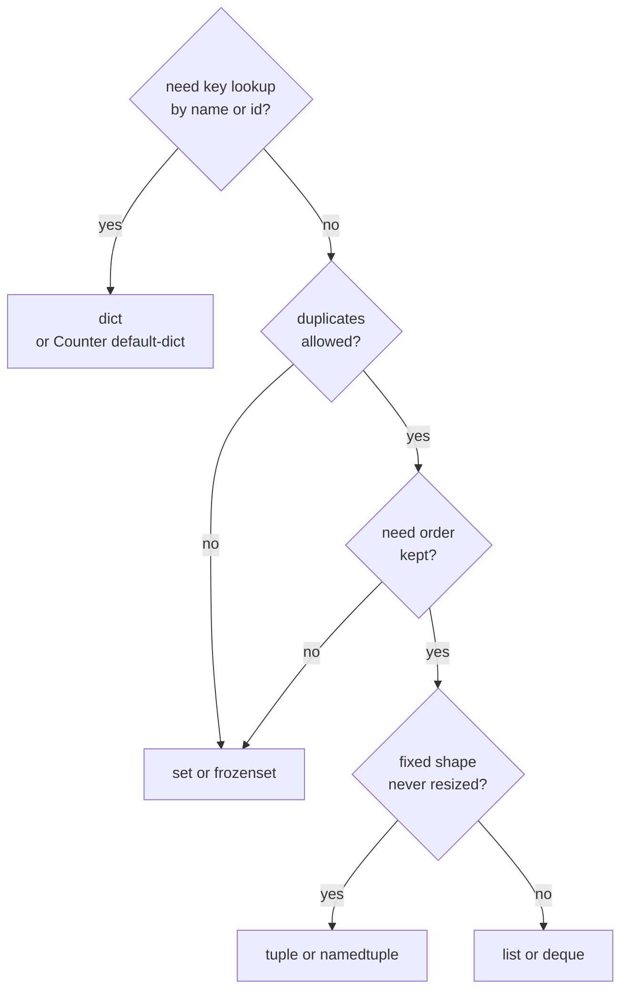
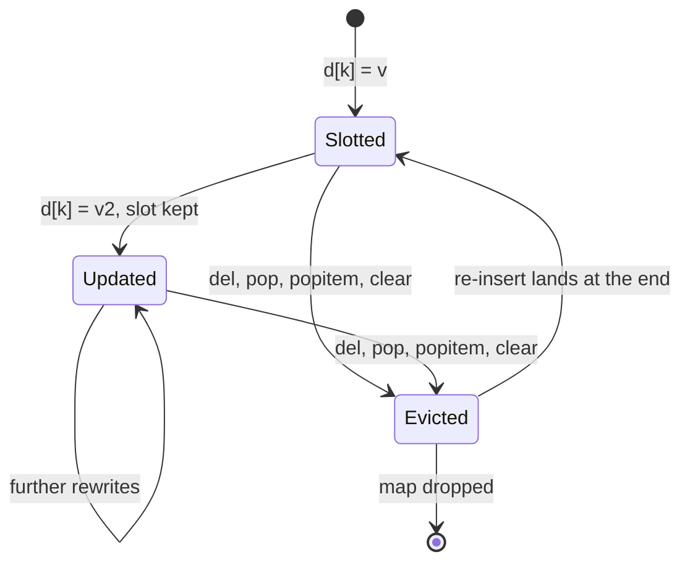
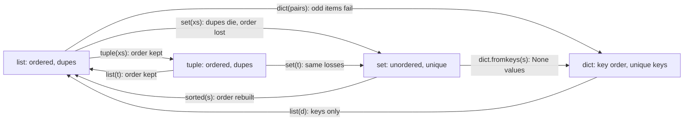
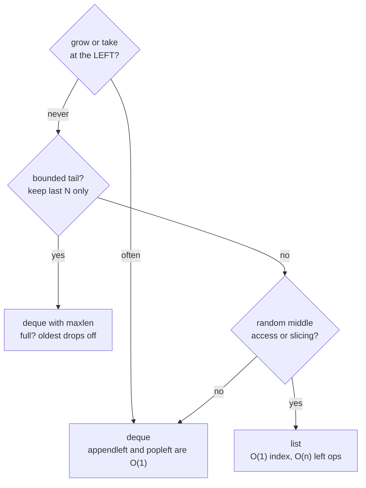

# 13 — Collections: `list`, `tuple`, `set`, `dict`, and `collections`

The four built-in containers plus the `collections` upgrades, in one
place: what each is, exact syntax, ordering and mutability rules,
searching/sorting/inserting/deleting, converting between them (and
what data dies in transit), `lambda` glue, and the expert edges.
Reference: https://docs.python.org/3/library/collections.html

## 1. Master table: the four built-ins (plus `frozenset`)

| Container | Definition | Syntax | Example | Ordered? | Mutable? | Unique only? | Main use case |
|---|---|---|---|---|---|---|---|
| `list` | Growable ordered sequence | Square brackets, commas | `[1, 2, 3]` | Yes, insertion order | Yes | No, duplicates kept | General workhorse: collect, stack, queue-ish, sort |
| `tuple` | Fixed ordered record | Commas (parens usual) | `(1, 2)` or `1, 2` | Yes, insertion order | No (shallow: nested mutables still mutate) | No | Fixed shapes, multi-return, dict keys, unpacking |
| `set` | Unordered bag of distinct hashables | Curly braces with values | `{"a", "b"}` | No, never rely on order | Yes | Yes, duplicates die | Dedup, membership tests, set algebra |
| `frozenset` | Immutable set | `frozenset(...)` call | `frozenset([1, 2])` | No | No | Yes | Set-as-dict-key, constant member pools |
| `dict` | Key-to-value map | Curly braces with pairs | `{"a": 1}` | Yes, insertion order | Yes | Keys unique (last write wins) | Lookup tables, records, counters, kwargs |

Two one-line traps: `{}` is an empty DICT, never a set (write
`set()`), and `(1)` is the int `1` in parens — a one-tuple needs its
comma (`(1,)`).

### Which container: the decision tree



## 2. Ordering: insertion, deletion, and default sorting

Insertion order (what iteration yields first to last):

```python
xs = [3, 1, 2]  # List keeps exactly what you put in.
row = (3, 1)  # Tuple keeps it too, forever (it cannot change).
d = {"b": 1, "a": 2}  # Dict keeps insertion order: b first, a second.
d["b"] = 99  # Rewriting a key keeps its ORIGINAL slot: still b, a.
bag = {"b", "a", "c"}  # Set keeps NO promise: order is hash-driven.
```

```python
d = {}  # Fresh map for the position demo.
d["a"] = 1  # Slot one is a.
d["b"] = 2  # Slot two is b.
d["a"] = 99  # Rewrite: value changes, slot stays first.
assert list(d) == ["a", "b"]  # Position survives reassignment.
```

Deletion order (which end each remover takes):

```python
xs = [1, 2, 3]  # Ordered demo list.
xs.pop()  # Removes AND returns the LAST item: 3.
xs.pop(0)  # Removes AND returns the FIRST item: 1. O(n) shifting.
xs.remove(2)  # Removes the first EQUAL value, returns None always.
del xs[0]  # Statement form of removal by index or slice.
```

```python
d = {"a": 1, "b": 2}  # Ordered demo map.
d.pop("a")  # Removes AND returns by key: 1. Missing key is KeyError.
d.pop("zzz", None)  # Two-arg pop: safe default instead of KeyError.
d.popitem()  # Removes AND returns the LAST pair: LIFO order.
del d["b"]  # Statement form of removal by key.
```

```python
bag = {"a", "b"}  # Unordered demo set.
bag.pop()  # Removes AND returns an ARBITRARY member. Never index it.
bag.discard("zzz")  # Safe remove: missing member is silently ignored.
bag.remove("a")  # Strict remove: missing member raises KeyError.
```

Default sorting: NOTHING stays sorted by itself. Sorting is always
an explicit act — `sorted()` builds a new list, `list.sort()`
reorders in place, dicts sort via `sorted(d)` (keys) or
`dict(sorted(d.items()))` (pairs). Full shapes live in §3/`§6`.

Entry lifecycle inside a dict, drawn:



## 3. `list` in detail

```python
xs = [1, 2, 3]  # Literal: the everyday form, double quotes for strings.
ys = list("abc")  # From any iterable: ["a", "b", "c"], chars split out.
zs = list(range(3))  # From a range: [0, 1, 2]. No surprises.
empty: list[int] = []  # Annotated empty: hints travel with containers.
```

Indexing and slicing (slices copy shallowly, never alias):

```python
xs = [10, 20, 30, 40]  # Positions 0..3, or -4..-1 from the right.
xs[0]  # First item: 10. xs[-1] is the last: 40.
xs[1:3]  # Slice: [20, 30]. Stop index excluded, fresh list returned.
xs[::2]  # Step slice: [10, 30]. Every second item.
xs[::-1]  # Reversed COPY: [40, 30, 20, 10]. Original untouched.
xs[1:3] = [7, 8, 9]  # Slice ASSIGNMENT: splice a new middle in place.
```

Growing, shrinking, and the `None`-return rule:

```python
xs = [1]  # Start small for the mutation tour.
xs.append(2)  # In-place grow to [1, 2]. Returns None: never assign it.
xs.extend([3, 4])  # Append EACH element: [1, 2, 3, 4]. One arg only.
xs.insert(0, 0)  # Insert BEFORE index 0: [0, 1, 2, 3, 4]. O(n) shift.
xs.remove(0)  # Drop first equal value. Missing value is ValueError.
xs.pop()  # Take the last: returns 4, list shrinks. Empty list: IndexError.
xs.clear()  # Empty in place: []. Aliases see the emptying too.
```

Searching (linear scan: O(n), fine for small lists):

```python
xs = ["amy", "bob", "amy"]  # Duplicates kept: search finds the first.
"bob" in xs  # Membership: True. Prefer over manual loops, always.
xs.index("amy")  # Position of first match: 0. Missing is ValueError.
xs.count("amy")  # Occurrences: 2. Zero when absent, never an error.
```

Sorting: `sorted()` (new list, any iterable) vs `list.sort()`
(in place, lists only). Both are stable Timsort: equal keys keep
their original relative order.

```python
words = ["pear", "fig", "apple"]  # Unsorted demo words.
sorted(words)  # New list: ["apple", "fig", "pear"]. Original kept.
words.sort()  # In place: words IS now sorted. Returns None, like append.
sorted(words, reverse=True)  # Descending without mutating the input.
sorted(words, key=len)  # Key function: sort by length, ties keep order.
sorted(words, key=lambda w: w[-1])  # Lambda key: sort by last letter.
rows = [("b", 2), ("a", 1), ("b", 1)]  # Multi-key demo rows.
sorted(rows, key=lambda r: (r[0], r[1]))  # Tuple key: grouped, then ranked.
```

Unpacking in calls (lists feed `*args` positionally):

```python
def total(a: int, b: int, c: int) -> int:
    """Add three numbers (demo callee)."""
    return a + b + c


args = [1, 2, 3]  # Parallel to the parameters, position by position.
total(*args)  # Unpack: total(1, 2, 3). Length must match (else TypeError).
first, *rest = args  # Starred unpack: first=1, rest=[2, 3]. Always a list.
```

List edges: aliasing (`b = a; b.append` shows in `a`, see `11`
Part B Case 1); `xs = xs.append(x)` rebinds to `None`; `pop(0)` and
`insert(0, ...)` are O(n) — queues belong to `deque` (§9);
heterogeneous lists sort only while comparable (`[1, "a"].sort()`
is `TypeError`); `list.sort()` on mixed `int`/`bool` works because
`bool` subclasses `int` (see `10`).

## 4. `tuple` in detail

```python
pair = (1, 2)  # Parenthesized pair: the classic fixed record.
bare = 1, 2  # Bare commas pack too: parens are convention, commas decide.
single = (1,)  # One-tuple NEEDS the comma: (1) is just int 1.
empty: tuple[int, ...] = ()  # Empty tuple with a variadic hint.
```

Packing, unpacking, and the starred middle:

```python
x, y = pair  # Unpack: arity must match, else ValueError (too many/few).
first, *middle, last = (1, 2, 3, 4)  # Starred: middle=[2, 3], a list.
a, b = b, a  # Swap via packing: right side packs, left side unpacks.
```

Immutability is SHALLOW (the shell locks, the cargo may not):

```python
row = (1, [2])  # Tuple holding a MUTABLE list: legal and common.
row[1].append(3)  # Mutates the cargo: row is now (1, [2, 3]).
row[0] = 9  # Rebinding a slot is TypeError: shell stays locked.
```

Tuple tools and tuple jobs:

```python
row = (1, 2, 1)  # Small demo tuple.
row.count(1)  # Occurrences: 2. Tuples count like lists do.
row.index(2)  # First position: 1. Missing value is ValueError.
point = (11, 22)  # Hashable record: usable as a dict key or set member.
{(11, 22): "hit"}  # Tuple keys give composite lookups for free.
```

```python
def stats(values: list[int]) -> tuple[int, int]:
    """Return (total, count): one tuple packs both (no out-params)."""
    return sum(values), len(values)  # Bare comma packs the return value.


total, count = stats([1, 2, 3])  # Unpack at the call site. Arity must fit.
```

Tuple edges: `[1] == (1,)` is `False` (never equal across types);
unhashable cargo (`([1],)`) cannot be a dict key or set member even
though the shell is a tuple; tuple methods are only `count` and
`index` — anything else means "use a list"; function parameters
cannot be tuple patterns (Python 3 removed them: take `*args` or one
tuple arg and unpack inside).

## 5. `set` in detail

```python
bag = {"a", "b"}  # Non-empty display: the only brace-literal set form.
empty = set()  # EMPTY set calls set(): {} would be an empty dict.
from_list = set([1, 2, 2, 3])  # From any iterable: {1, 2, 3}, dupes die.
chars = set("abca")  # From a string: {"a", "b", "c"}, chars split out.
comp = {w for w in ["a", "b", "a"] if w}  # Comprehension: dedups inline.
```

Membership is the reason sets exist (average O(1) hash lookup):

```python
bag = {"amy", "bob"}  # Small member pool.
"amy" in bag  # True, hashed, no scan. Lists would walk element by element.
"zzz" not in bag  # Negated membership reads best in guards.
```

Add, drop, and the strict-vs-safe pair:

```python
bag = {"a"}  # One-member start.
bag.add("b")  # Insert one hashable: {"a", "b"}. Returns None always.
bag.update(["c", "d"])  # Insert EACH of an iterable. Multi-add form.
bag.discard("zzz")  # Safe drop: absent members pass silently.
bag.remove("a")  # Strict drop: absent members raise KeyError.
bag.pop()  # Arbitrary member out. Empty set: KeyError (never IndexError).
bag.clear()  # Empty in place. Aliases observe it, as with lists.
```

Set algebra (operators need sets both sides; methods take any iterable):

```python
a = {1, 2, 3}  # Left operand demo.
b = {2, 3, 4}  # Right operand demo.
a | b  # Union: {1, 2, 3, 4}. New set, neither input touched.
a & b  # Intersection: {2, 3}. The overlap only.
a - b  # Difference: {1}. In a, missing from b.
a ^ b  # Symmetric difference: {1, 4}. Either side, never both.
a.union([3, 9])  # Method form accepts LISTS too: {1, 2, 3, 9}.
a <= {1, 2, 3, 9}  # Subset test (method: issubset). Superset flips it.
```

Set edges: members must be HASHABLE (`{[1]}` and `{{"a": 1}}` are
`TypeError`; tuples of hashables are fine); iteration order is
arbitrary — never assert, snapshot, or paginate on it (sort first:
`sorted(bag)`); `True`, `1`, and `1.0` are ONE member (equal hashes);
distinct `nan` objects can cohabit (never equal, see §11);
`frozenset` is the immutable twin: hashable itself, so sets of
frozensets and frozenset dict-keys both work.

## 6. `dict` in detail

```python
user = {"name": "amy", "age": 3}  # Literal: the everyday map form.
pairs = dict([("x", 1), ("y", 2)])  # From pair-iterable: keys must pair up.
kw = dict(x=1, y=2)  # From keywords: keys must be valid identifiers.
zipped = dict(zip(["a", "b"], [1, 2]))  # Zip two lists into a map.
squares = {n: n * n for n in range(4)}  # Comprehension: build by rule.
blank: dict[str, int] = {}  # Annotated empty: the honest starting point.
```

Reading without (and with) falling over:

```python
user = {"name": "amy"}  # One-key demo map.
user["name"]  # Direct hit: "amy". Missing key is KeyError, by design.
user.get("nick")  # Safe read: None when absent, never raises.
user.get("nick", "anon")  # Safe read with default: "anon" when absent.
user.setdefault("nick", "anon")  # Read-or-PLANT: inserts default, returns it.
"age" in user  # Key membership: False. Always test keys, never values.
```

Writing, merging, and draining:

```python
user = {"name": "amy"}  # Fresh map for the write tour.
user["age"] = 3  # Insert or overwrite by key. One statement does both.
user.update({"age": 4, "city": "x"})  # Multi-write from any mapping/pairs.
merged = {"a": 1} | {"a": 9, "b": 2}  # Pipe merge: right wins {"a": 9, ...}.
user |= {"vip": True}  # In-place merge. Mutates, like list.extend does.
user.pop("age")  # Remove AND return by key. Missing key is KeyError...
user.pop("zzz", None)  # ...unless the two-arg safe form supplies default.
user.popitem()  # Remove AND return the LAST pair (LIFO, guaranteed).
del user["name"]  # Statement removal. Missing key is KeyError.
user.clear()  # Empty in place. Views referencing it see emptiness.
```

Views: live windows, not snapshots:

```python
user = {"name": "amy", "age": 3}  # Two-key demo map.
user.keys()  # Live key view: later inserts appear in it automatically.
user.values()  # Live value view, same deal.
user.items()  # Live (key, value) view: the loop workhorse.
for key, value in user.items():  # Unpack pairs straight in the loop head.
    pass  # Placeholder body: replace with real handling.
list(user.items())  # Snapshot on demand: [("name", "amy"), ("age", 3)].
```

Sorting a dict (always explicit, always via `sorted`):

```python
scores = {"b": 2, "a": 3, "c": 1}  # Insertion order is b, a, c.
sorted(scores)  # Keys sorted: ["a", "b", "c"]. The map is untouched.
dict(sorted(scores.items()))  # Rebuilt map, ordered by key.
dict(sorted(scores.items(), key=lambda kv: kv[1]))  # Ordered by VALUE.
max(scores, key=scores.get)  # Key with top value: "a". No lambda needed.
```

Dict edges: keys must be HASHABLE and effectively immutable
(`{[1]: 1}` is `TypeError`; `True`/`1`/`1.0` collide as one key);
dict equality ignores order (`{"a": 1, "b": 2} == {"b": 2, "a": 1}`);
mutating size mid-iteration is `RuntimeError` (iterate over
`list(d)` or build a new map instead); `d[k] += 1` on a missing key
is `KeyError` — reach for `Counter`/`defaultdict` (§9) or
`d.get(k, 0)`; nested maps need per-level construction (`{}` never
auto-vivifies).

## 7. Converting between containers (and what dies in transit)



Loss ledger — read before converting:

| From → to | Kept | Lost | Fails when |
|---|---|---|---|
| `list` → `tuple` | Order, duplicates | Mutability | Never (any list converts) |
| `tuple` → `list` | Order, duplicates | Immutability | Never |
| `list`/`tuple` → `set` | Membership | Duplicates AND order | Members unhashable (`set([[1]])`) |
| `set` → `list` | Membership | Order (arbitrary) | Never (sort it after) |
| `dict` → `list` | Keys, key order | Values | Never (`list(d.values())` keeps values) |
| Pairs → `dict` | Last write per key | Earlier duplicate keys | Items are not pairs (`dict([1, 2])`) |
| `set` → `dict` keys | Membership | Values (supply via `fromkeys`/`zip`) | Never |
| `str` → `list`/`tuple`/`set` | Characters | Word structure (`list("ab")` is `["a", "b"]`) | Never (split first: `"a b".split()`) |

```python
xs = [3, 1, 3, 2]  # Dupes plus order: the conversion stress case.
tuple(xs)  # (3, 1, 3, 2): lossless shell swap, order and dupes kept.
set(xs)  # {1, 2, 3}: dupes die AND order promise dies with them.
sorted(set(xs))  # [1, 2, 3]: dedup first, THEN rebuild order explicitly.
dict.fromkeys(xs)  # {3: None, 1: None, 2: None}: dedup KEEPING order.
list(dict.fromkeys(xs))  # [3, 1, 2]: the order-preserving dedup idiom.
```

```python
pairs = [("a", 1), ("b", 2), ("a", 9)]  # Duplicate key on purpose.
dict(pairs)  # {"a": 9, "b": 2}: LAST write wins, earlier value is gone.
keys = ["a", "b"]  # Parallel list one: zip me with values below.
vals = [1, 2]  # Parallel list two: lengths MUST match (zip truncates!).
dict(zip(keys, vals))  # {"a": 1, "b": 2}: the parallel-list join.
```

## 8. Params, args, unpacking, and `lambda` glue

```python
def head(first: int, *rest: int, tag: str, **flags: str) -> str:
    """Show every parameter kind on collections (demo signature)."""
    return f"{first} {rest} {tag} {flags}"


head(1, 2, 3, tag="t", loud="yes")  # rest=(2, 3) tuple, flags dict.
nums = [1, 2, 3]  # List feeds positional slots via one star.
opts = {"tag": "t"}  # Dict feeds keyword slots via two stars.
head(*nums, **opts)  # Equivalent call: head(1, 2, 3, tag="t").
```

```python
users = [("amy", 3), ("bob", 11), ("cid", 7)]  # Row records to rank.
sorted(users, key=lambda row: row[1])  # Lambda key: rank by second field.
max(users, key=lambda row: row[1])  # Same key, winner only: ("bob", 11).
min(users, key=lambda row: row[1])  # Loser by the same rule.
any(score > 10 for _, score in users)  # True: short-circuit existential.
all(score > 1 for _, score in users)  # True: every row must qualify.
[name for name, _ in users]  # Comprehension beats map+lambda here.
```

Prefer comprehensions and `operator.itemgetter` over `map`/`filter`
plus `lambda` (repo rule, see `06` §2); keep `lambda` keys to one
short expression, and name anything reused as a `def`.

## 9. `collections` module: the upgrades

| Tool | Upgrades | Reach for it when |
|---|---|---|
| `Counter` | `dict` for tallies | Counting hashables; `most_common`; multiset math |
| `defaultdict` | `dict` that never `KeyError`s on read | Grouping into lists/sets, auto-vivified branches |
| `OrderedDict` | `dict` with order operations | Order-sensitive equality, `move_to_end`, both-end `popitem` |
| `deque` | `list` with O(1) both ends | Queues, sliding windows, rotation, `maxlen` tails |
| `ChainMap` | Layered read view over maps | Defaults/overrides/env precedence without copying |
| `namedtuple` | `tuple` with names | Lightweight records; CSV/SQLite rows |
| `UserDict`/`UserList`/`UserString` | Subclassing hooks | Custom mapping/sequence/str behaviour via `.data` |

### `Counter`: tallies with zero-default reads

```python
from collections import Counter  # Dict subclass specialized for counting.

votes = Counter(["a", "b", "a"])  # From any iterable of hashables.
votes["zzz"]  # Missing keys read as 0, never KeyError. Dicts would raise.
votes.most_common(1)  # [("a", 2)]: ranked leaders, ties keep first-seen.
votes.elements()  # Iterator replaying each key count times (ints only).
```

```python
from collections import Counter  # Re-import for the standalone math demo.

left = Counter(a=3, b=1)  # Left multiset operand.
right = Counter(a=1, b=2)  # Right multiset operand.
left + right  # Add counts: Counter({"a": 4, "b": 3}).
left - right  # Keep positives: Counter({"a": 2}). Zero/negatives dropped.
left & right  # Intersection: minimums Counter({"a": 1, "b": 1}).
left | right  # Union: maximums Counter({"a": 3, "b": 2}).
```

Counter edges: setting a zero count KEEPS the entry (`del` removes
it); `==` treats missing as zero (`Counter(a=1) == Counter(a=1,
b=0)`); `update()` ADDS counts from an iterable of elements (not
pairs — unlike `dict.update`); `subtract()` may go negative;
`get()` still returns `None` (only `[]` reads default to zero).

### `defaultdict`: the factory that ends `KeyError`

```python
from collections import defaultdict  # Dict that builds missing values.

groups: defaultdict[str, list[int]] = defaultdict(list)  # Factory: list.
groups["a"].append(1)  # Missing key? list() is built, stored, returned.
groups["a"].append(2)  # Present key? Normal lookup, list grows to [1, 2].
counts: defaultdict[str, int] = defaultdict(int)  # Factory: int() is 0.
counts["x"] += 1  # First touch builds 0, then increments. No guard needed.
```

Factory guide: `list` (grouping), `set` (unique grouping), `int`
(tallies), `dict` (nested maps), `lambda: value` (any constant).
Edges: `.get()` BYPASSES the factory (returns `None`, inserts
nothing); touching a key INSERTS it (iteration later sees it);
pass `None` as factory and it behaves exactly like `dict`.

### `OrderedDict`: order as a first-class operation

```python
from collections import OrderedDict  # Dict with reordering powers.

first = OrderedDict([("a", 1), ("b", 2)])  # Built from pairs, order kept.
second = OrderedDict([("b", 2), ("a", 1)])  # Same pairs, flipped order.
(first == second) is False  # Order-SENSITIVE: dicts would call these equal.
first.move_to_end("a")  # Efficient reorder: [("b", 2), ("a", 1)].
first.move_to_end("b", last=False)  # To the FRONT: order flips again.
first.popitem(last=False)  # FIFO pop: either end poppable, unlike dict.
```

Plain `dict` emulations (slower but dependency-free): right-end
`move_to_end` is `d[k] = d.pop(k)`; left-end has no efficient twin
(that gap is the reason to import `OrderedDict`); FIFO pop is
`(k := next(iter(d)), d.pop(k))`. Since Python 3.7 all dicts
remember insertion order — `OrderedDict` remains for reordering
ops, order-sensitive equality, and `reversed()` views.

### `deque`: double-ended, bounded-optional, O(1) both ends

```python
from collections import deque  # Pronounced "deck": double-ended queue.

line: deque[str] = deque(["b", "c"])  # Init left-to-right via appends.
line.append("d")  # Right end grow: O(1), lists match this too.
line.appendleft("a")  # LEFT end grow: O(1). Lists pay O(n) shifting here.
line.popleft()  # LEFT take: "a", O(1). list.pop(0) would shift everything.
line.pop()  # Right take: O(1), same as lists.
line.rotate(1)  # Right rotation: last becomes first, in place.
```



Deque edges: `maxlen` discards from the OPPOSITE end on overflow
(verified §11-style: `deque([1, 2], maxlen=2).append(3)` keeps
`[2, 3]`); `extendleft("abc")` lands REVERSED (`["c", "b", "a"]`);
`insert` past `maxlen` is `IndexError`; middle indexing is O(n) —
random access stays a list job; appends/pops are thread-safe,
multi-step sequences are not (still guard those).

### `ChainMap`: one view over layered maps

```python
from collections import ChainMap  # Single read view, zero copying.

defaults = {"color": "red", "user": "guest"}  # Bottom layer: fallbacks.
env = {"user": "amy"}  # Middle layer: environment wins over defaults.
cli = {"color": "blue"}  # Top layer: explicit flags win over everything.
config = ChainMap(cli, env, defaults)  # First map searched first.
config["color"]  # "blue": top layer answers, lower layers shadowed.
config["user"]  # "amy": middle layer, defaults never consulted.
config["missing"]  # KeyError: NO layer has it. Views do not invent.
config["user"] = "jo"  # Writes land ONLY in the first map (cli here).
child = config.new_child({"debug": "on"})  # Scoped overlay, parents kept.
list(child.parents)  # Everything below the top: the enclosing scope.
```

ChainMap edges: held BY REFERENCE (mutating a layer shows through
immediately); iteration scans LAST map to FIRST (docs example
`["music", "art", "opera"]`); flatten with `dict(chain)` when a
real map is needed; `| new keys` merge into one dict (3.9+).

### `namedtuple`: tuples with readable fields

```python
from collections import namedtuple  # Factory for named tuple subclasses.

Point = namedtuple("Point", ["x", "y"])  # Typename plus field names.
p = Point(11, y=22)  # Positional or keyword construction both work.
p.x + p[1]  # Name AND index access: 11 + 22. Unpacks like a tuple too.
p._asdict()  # {"x": 11, "y": 22}: dict view for JSON-ish handoffs.
p._replace(x=33)  # NEW instance Point(x=33, y=22). Original untouched.
Point(**{"x": 1, "y": 2})  # Dict splats straight into the constructor.
```

Namedtuple edges: no per-instance `__dict__` (lightweight like a
plain tuple); fields cannot start with `_` or collide with keywords
(`rename=True` auto-fixes to `_1`-style); `defaults=[...]` apply to
the RIGHTMOST fields; subclass to add properties/methods (with
`__slots__ = ()`), never stored fields — build a new type via
`Point._fields + ("z",)` instead; invalid `_replace` keys are
`TypeError` (3.13+).

### `UserDict` / `UserList` / `UserString`: subclassing hooks

Direct `dict`/`list` subclassing skips some overridden methods in
C fast paths; the `User*` wrappers route EVERYTHING through
`.data`, so overrides always fire:

```python
from collections import UserDict  # Dict wrapper with a .data attribute.


class LoudDict(UserDict):
    """Dict that echoes writes (demo subclass)."""

    def __setitem__(self, key: str, value: int) -> None:
        print(f"storing {key}")  # Side channel before delegating.
        super().__setitem__(key, value)  # Real storage into .data.


loud = LoudDict({"a": 1})  # Constructor takes any mapping, like dict.
loud.data  # {"a": 1}: the plain dict underneath, always inspectable.
```

Same shape for `UserList` (`.data` is a real list; constructor
takes any iterable) and `UserString` (`.data` is a real `str`).
Reach for these when customizing behaviour; reach for plain
subclassing when only adding methods.

## 10. Complexity cheat-sheet (CPython, average case)

| Operation | `list` | `tuple` | `set` | `dict` | `deque` |
|---|---|---|---|---|---|
| Index / key read | O(1) | O(1) | — (no index) | O(1) | O(1) at ends, O(n) middle |
| Append / add / store | O(1) amortized | — (rebuild) | O(1) | O(1) | O(1) both ends |
| Left insert / take | O(n) | — | — | — | O(1) |
| Membership `in` | O(n) scan | O(n) scan | O(1) hash | O(1) hash (keys) | O(n) scan |
| Delete known spot | O(n) shift | — | O(1) | O(1) | O(1) at ends |
| Sort | O(n log n) stable | Via `sorted()` copy | Via `sorted()` copy | Rebuild sorted | Via `sorted()` copy |

Read it as buying advice: membership-heavy code pays for itself by
moving the pool into a `set`; left-heavy code pays by moving the
queue into a `deque`; everything else stays in `list`/`dict`.

## 11. Expert edges and complex cases

1. `True`, `1`, `1.0` are ONE key/member: `{1, 1.0, True}` has
   length 1, `{True: "t"}[1]` reads `"t"`. Equal hashes, equal
   values — the container cannot tell them apart. Branch on `bool`
   BEFORE `int` when it matters.
2. Distinct `nan`s cohabit: `{nan_a, nan_b}` keeps both, because
   `nan != nan` by definition. Never use floats-that-may-be-nan as
   dedup keys.
3. `{}` is dict, `{"a"}` is set, `{"a": 1}` is dict, `{1, "a"}` is
   set: one pair of braces, three meanings. Read the CONTENTS, not
   the brackets.
4. Tuple equality is type-strict AND shallow: `(1, [2]) == (1, [2])`
   compares the nested lists by value; `([1],)` as a key is still
   `TypeError` (hash walks the cargo).
5. `d.get(k)` on a `defaultdict` BYPASSES the factory: returns
   `None`, inserts nothing. Only `d[k]` builds. Same for `in`
   checks — presence tests never construct.
6. `Counter` reads missing as `0` but `dict(counter)` keeps real
   entries only; `c["x"] = 0` keeps a visible zero (use `del` to
   truly drop, or `+c` to strip non-positives).
7. `dict.update` REPLACES values while `Counter.update` ADDS
   counts from an element iterable — same name, opposite contract.
   Read the receiver before the verb.
8. `extendleft("abc")` lands as `["c", "b", "a"]` (left-appends
   reverse); `maxlen` overflow discards from the opposite end;
   `rotate(-1)` is left rotation.
9. `sorted(d)` sorts KEYS; `max(d, key=d.get)` finds the argmax
   key; `dict(sorted(d.items(), key=lambda kv: kv[1]))` reorders by
   value. Three recipes, three different questions.
10. `list(d)` is keys-only; `[*d.values()]` splats values; `dict(zip
    (ks, vs))` truncates to the shorter side — `zip(..., strict=True)`
    (3.10+) fails loudly on ragged inputs instead.
11. Shallow copies share cargo: `ys = xs[:]`, `dict(d)`,
    `set(s)`, `tuple(t)` split the shell, never the nesting (see
    `11` Part B Case 8). `copy.deepcopy` splits everything.
12. `min`/`max` on an empty container is `ValueError` — supply
    `default=...` (`max([], default=0)`) at supervised boundaries.

## Next

- [README.md](README.md) — index.
- [06-lambda-iife.md](06-lambda-iife.md) — key functions and adapters.
- [08-csharp-keywords-to-python.md](08-csharp-keywords-to-python.md) —
  passing, mutability, scope.
- [11-access-modifiers-and-shared-mutation.md](11-access-modifiers-and-shared-mutation.md) —
  aliasing and defensive copies.
- [03-functions-def.md](03-functions-def.md) — `*args`/`**kwargs`
  signatures.
