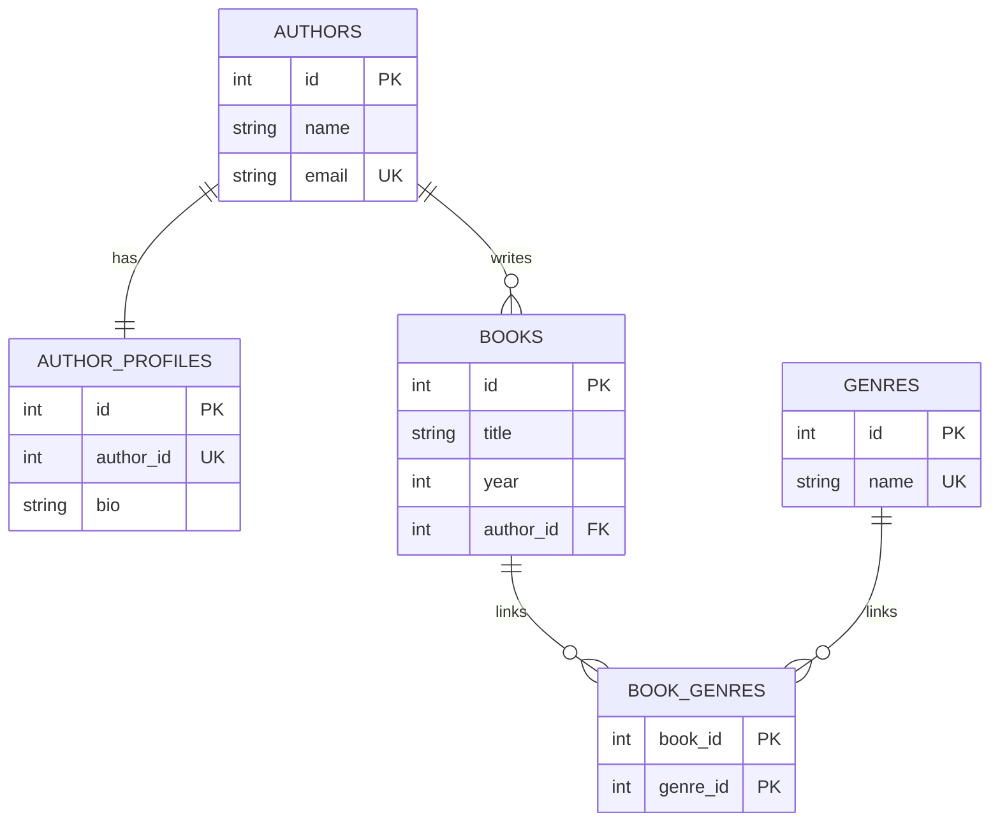
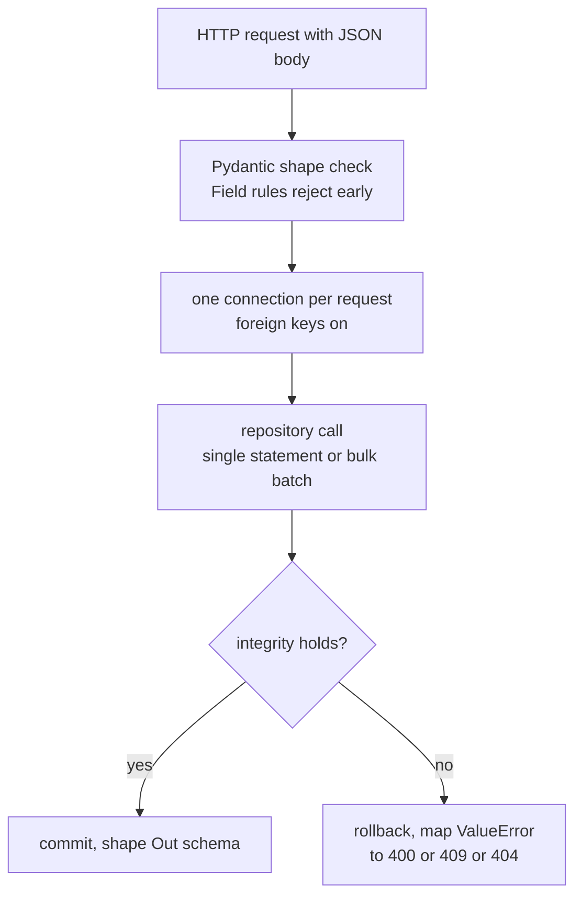

# 14 — Library CRUD API: SQLite Relations, Indexes, FastAPI

A small but complete CRUD app living in
`src/python_material/library/`: raw `sqlite3` SQL over five tables,
every relationship shape, real indexes, single plus bulk endpoints,
and Scalar API docs. Seed data lives in code; the seeded database
file is committed alongside it.

## 1. Domain and relationships

Authors write books (1:many), each author holds at most one profile
(1:1, optional on both sides — Alan ships profile-less), and books
carry many genres through a junction table (many:many).



Enforcement summary: the 1:1 is a UNIQUE foreign key (a second
profile for one author is rejected on write); the 1:many is a plain
foreign key with `ON DELETE CASCADE`; the many:many is a composite
primary key (re-tagging the same pair is a no-op via
`INSERT OR IGNORE`).

| C# (EF Core) | This app | Same? |
|---|---|---|
| `DbSet<T>` + LINQ + migrations | Hand-written DDL/DML with `?` placeholders | Different — every statement visible, no magic |
| Data annotations / Fluent API relations | `REFERENCES ... ON DELETE CASCADE`, UNIQUE, composite PK | Same constraints, declared in SQL |
| Eager `.Include()` loading | `get_author_detail` / `get_book_detail` joined reads | Same outcome, explicit queries |

## 2. Indexing: what exists and proof it is used

PRIMARY KEY and UNIQUE constraints index themselves (ids, emails,
genre names, profile owner, junction pairs). Three explicit indexes
cover the filter columns queries actually use:

| Index | Column | Serves |
|---|---|---|
| `idx_books_author` | `books(author_id)` | Author listings, cascade deletes |
| `idx_books_year` | `books(year)` | Year filter |
| `idx_book_genres_genre` | `book_genres(genre_id)` | Genre listings, tag reads |

Real `EXPLAIN QUERY PLAN` output from the committed database (not a
sketch — captured during this build):

```text
SEARCH books USING INDEX idx_books_author (author_id=?)
SEARCH g USING INDEX idx_book_genres_genre (genre_id=?)
SEARCH b USING INTEGER PRIMARY KEY (rowid=?)
```

Title search (`LIKE %...%`) cannot use a B-tree index — substring
scans stay O(n) by nature, which is why the API escapes wildcards
and keeps that filter honest rather than pretending otherwise.

## 3. Single vs bulk operations

| Shape | Endpoint | Repository | Contract |
|---|---|---|---|
| Single create | `POST /authors`, `POST /books`, `POST /genres` | `create_*` | 201 with snapshot; 400/409 on bad refs/taken uniques |
| Bulk create | `POST /authors/bulk`, `POST /books/bulk` | `create_*_bulk` | One `executemany` + one read-back; all-or-nothing rollback |
| Single read | `GET /authors/{id}`, `GET /books/{id}` | `get_*_detail` | Joined detail; 404 when missing |
| Filtered list | `GET /books?author_id=&year=&genre_id=&q=` | `list_books` | Filters combine; each hits an index except `q` |
| Single update | `PATCH /authors/{id}`, `PATCH /books/{id}` | `update_*` | Supplied fields only; 400 on bad refs |
| Single delete | `DELETE /authors/{id}`, `DELETE /books/{id}` | `delete_*` | Cascades fire; 404 when missing |
| Bulk delete | `POST /books/bulk-delete` | `delete_books_bulk` | One `DELETE ... IN (...)`; returns the count |
| Link ops | `POST/DELETE /books/{id}/genres/{gid}` | `add/remove_genre_*` | Re-tag no-op; unlink silent |

Request lifecycle, drawn:



## 4. Files, database artifacts, and seeding

| Path | What | Committed? |
|---|---|---|
| `src/python_material/library/database.py` | Schema, `connect`, `init_db`, `seed`, `reset_database` | Yes (code) |
| `src/python_material/library/repository.py` | All CRUD + bulk + joins | Yes (code) |
| `src/python_material/library/api.py` | FastAPI routes + Scalar mount | Yes (code) |
| `src/python_material/library/data/library.db` | Seeded database (3 authors, 2 profiles, 5 books, 4 genres) | Yes (data) |
| `library.db-wal` / `library.db-shm` | WAL sidecars: live write buffer + shared memory | No — transient by design |

Why no `-wal`/`-shm` in git: SQLite removes both when the last
connection closes after a checkpoint (`reset_database` checkpoints
explicitly), and recreates them on the next write. Committing them
would snapshot a momentary buffer, not data — the `.db` after a
checkpoint holds everything. They reappear at runtime the moment
the API writes, which is the correct lifecycle, not a missing file.

Seeding is idempotent: `seed()` checks `is_seeded()` (any author
row) and inserts zero rows on a live database, so server restarts
never duplicate data. Regenerate the committed file any time with:

```bash
PYTHONPATH=src python3 -c "from python_material.library import database; database.reset_database()"
```

## 5. Run it (copy-paste)

Server dependencies are intentionally NOT installed by the repo
(`AGENTS.md` forbids automatic installs). Install the extra once:

```bash
python3 -m pip install -e ".[api]"
```

Serve with reload (or pick menu option `1` in `demos/main.py`,
which starts the server, opens `/scalar`, and stops it on Enter):

```bash
python3 -m uvicorn python_material.library.api:app --reload
```

Then open `http://127.0.0.1:8000/scalar` (Scalar reference),
`http://127.0.0.1:8000/docs` (Swagger), or
`http://127.0.0.1:8000/openapi.json` (raw schema). Without the
`scalar-fastapi` package, `/scalar` answers 501 with the install
hint instead of 404ing — explicit beats mysterious.

Repository tour without any server (stdlib only, temp database):

```bash
PYTHONPATH=src python3 demos/library_demo.py
```

Repository tests (no network, no server, temp files only):

```bash
python3 -m pytest tests/test_library/ -q
```

## Next

- [README.md](README.md) — index.
- [13-collections.md](13-collections.md) — containers behind the rows.
- [07-exceptions.md](07-exceptions.md) — `ValueError` boundaries,
  narrow handling.
- [08-csharp-keywords-to-python.md](08-csharp-keywords-to-python.md) —
  passing, `readonly`, scope.
