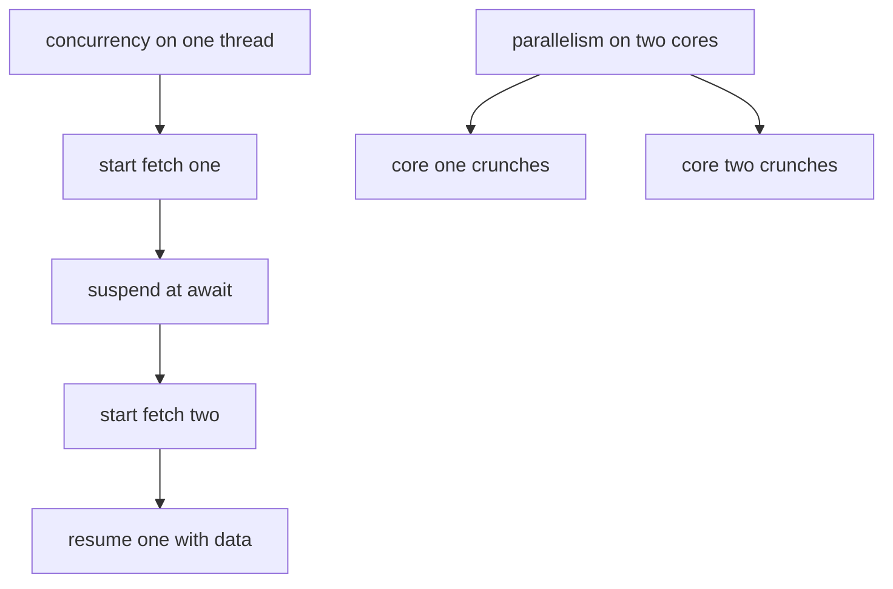
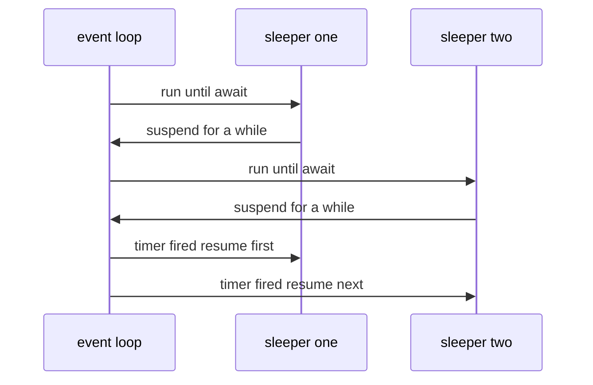
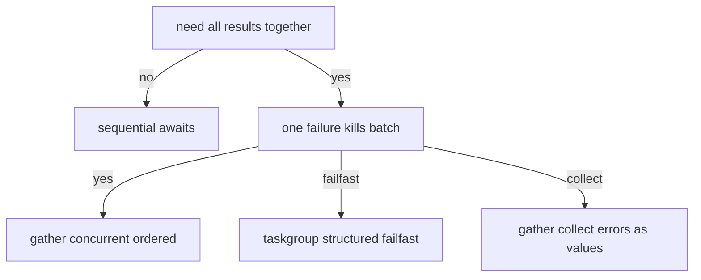
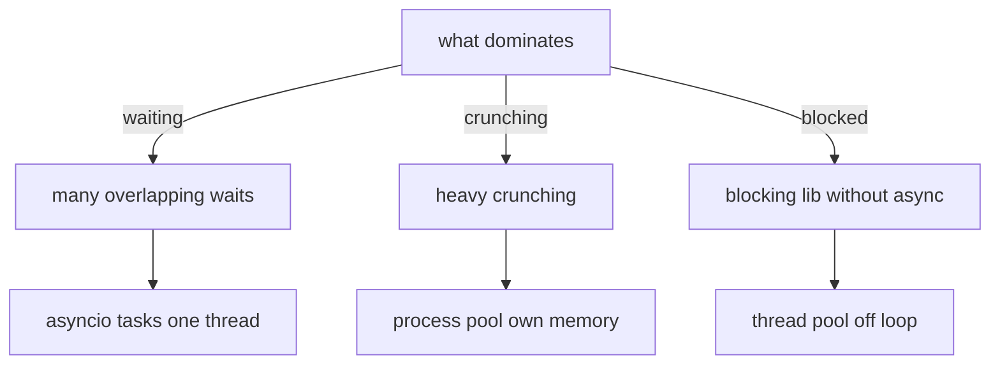
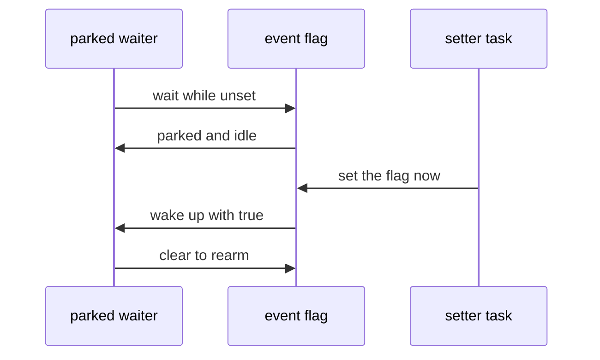
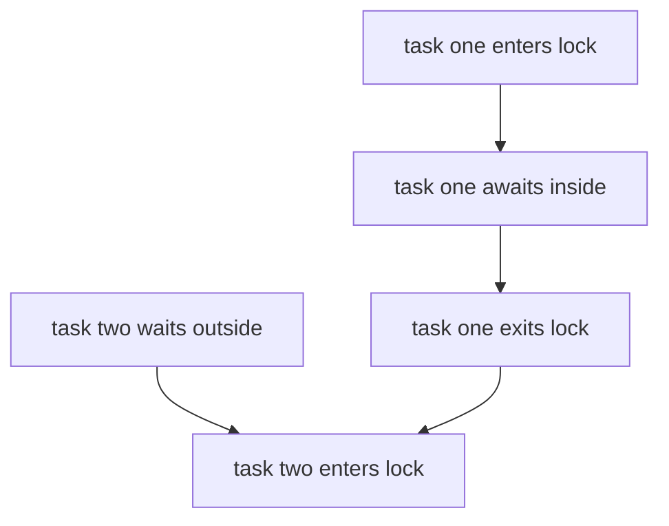
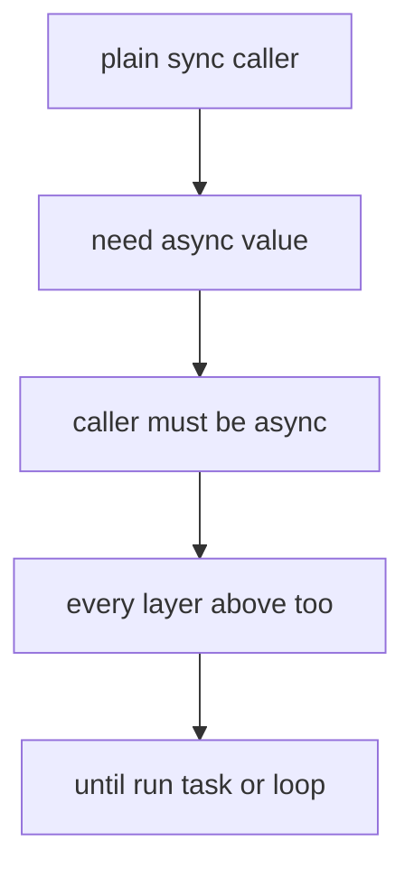
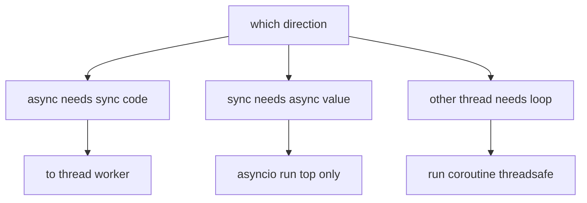
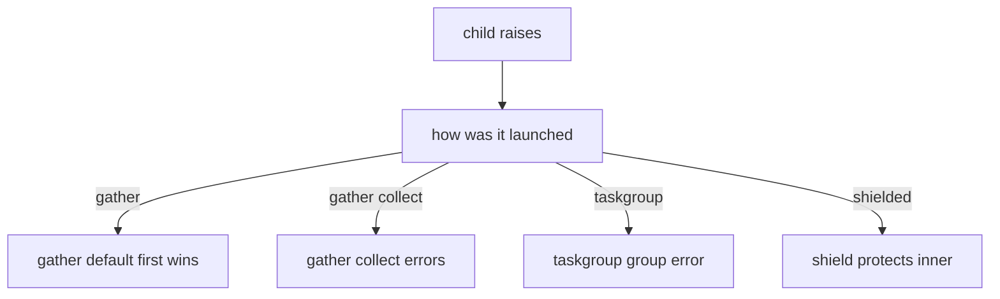

# 15 — `async` / `await` and `asyncio`: Concurrency Without Threads

One idea first: most programs WAIT more than they WORK (network,
disk, timers). `asyncio` lets one thread juggle thousands of such
waits by suspending a function at `await` and resuming it when its
wait ends — no threads, no processes, no callbacks. Everything below
(verified by execution on Python 3.15; version gates flagged where
the repo's 3.10 target differs) hangs off that sentence.

## 1. Etymology: where the words come from

| Word | Roots | History | What it means in code |
|---|---|---|---|
| Subroutine | `sub-` (under) + `routine` (Fr. `route`, a course) | Early-1950s machine code (EDSAC school): a subordinate block the main routine calls and that returns once | A plain `def`: caller waits, callee returns, one entry, one exit |
| Coroutine | `co-` (together, as peers) + `routine` | Melvin Conway's 1963 compiler paper: routines that pass control among EQUALS, pausing and resuming each other | `async def`: many entries/exits; `await` is the pause point |
| Async | `a-` (not) + Greek `synchronos` (together in time) | Keyword wave from C# 2012; Python 3.5 (PEP 492) | Work whose finish time is unrelated to its start order |
| `await` | Plain English "wait for" | Same wave | The suspension point: "pause me here, run others, resume with the value" |
| Thread | A line of execution through a program | OS threads, 1960s–70s | Independent stack, SHARED memory (see §7, GIL) |
| Process | A running program | Time-sharing era | Own memory; talking needs pipes/queues/pickling |
| Future | A value "from the future" | 1970s–80s languages (Multilisp era) | Placeholder you `await`; filled by `set_result` / `set_exception` |
| Semaphore | Greek `sema` (sign) + `phoros` (bearer), railway signals | Dijkstra, 1960s (P/V from Dutch) | Counter gate: at most N holders inside |
| Event loop | Loops that dispatch GUI/network events | Event-driven programs; Node.js made it famous; Python's Tulip became `asyncio` 3.4 | The scheduler that runs everything (§3) |
| `gather` | Plain English "bring together" | `asyncio` API naming | Run batch, collect results in order |
| Task | A unit of scheduled work | `asyncio` API naming | A coroutine wrapped for the loop to drive |

Takeaway: a coroutine is to a subroutine what peers are to a boss —
same building blocks, but control passes sideways at `await`
instead of returning upward once.

## 2. Concurrency vs parallelism (not synonyms)

Rob Pike (2012): "Concurrency is about dealing with lots of things
at once. Parallelism is about doing lots of things at once."
`asyncio` is concurrency on ONE thread; threads/processes add
parallelism across cores — and the GIL decides how much of it you
actually get (see §7).



| Workload | Winner | Why |
|---|---|---|
| Many network/disk/timer waits (I/O-bound) | `asyncio` | Waits overlap for free; thousands of tasks, one thread |
| Number crunching on CPython (CPU-bound) | Processes | The GIL lets one thread execute bytecode at a time |
| Blocking third-party SDK with no async API | Threads (`to_thread`) | Off-loop isolation without rewriting the library |
| Simple script, one request, no waiting overlap | Plain sync | No scheduler, no coloring, easiest to read |

## 3. The event loop: the scheduler underneath

The loop owns a queue of ready callbacks and a registry of sleepers.
Each tick it runs ready callbacks, sleeps until the nearest timer or
I/O event, wakes whoever waited, and repeats. Your coroutines never
run "in the background" — they run IN loop ticks, between each
other's `await` points.



Entry and identity rules:

```python
import asyncio


async def main() -> None:
    """Top-level coroutine: the program starts here."""
    await asyncio.sleep(0)


asyncio.run(main())  # Builds a loop, runs main, closes the loop.
```

1. `asyncio.run()` is the single entry: one call per program, never
   nested (calling it inside a running loop is `RuntimeError`,
   verified). Libraries receive the loop; only `main()` owns it.
2. Inside coroutines use `asyncio.get_running_loop()` (3.7+). Bare
   `asyncio.get_event_loop()` outside a running loop warns
   (3.10–3.13) or raises (newer) — treat it as legacy.
3. A bare coroutine object does NOTHING until scheduled: creating
   `coro = main()` schedules zero work (forgetting `await` earns
   "coroutine was never awaited"). Scheduling is `await`, `gather`,
   `create_task`, `TaskGroup`, or `run()`.

## 4. `async def` / `await` syntax, precisely

```python
import asyncio


async def fetch(name: str, delay: float) -> str:
    """Fetch something slowly, releasing the loop while waiting."""
    await asyncio.sleep(delay)  # Suspension point: others run here.
    return f"{name} done"  # Resumption delivers this value to awaiter.
```

| Question | Answer |
|---|---|
| Define | `async def name(...) -> T:` — calling it builds a coroutine object |
| Suspend | `await expr` — pause until expr completes; expr must be awaitable (coroutine, Task, Future) |
| Where | Only inside `async def` (a sync `def` cannot `await`; it can START work via `create_task` from a running loop, or hand off via `to_thread`) |
| How | One `await` per wait; sequential awaits run one-by-one (§5 shows batching) |
| When | I/O waits, timers, fan-out/fan-in, servers handling many clients |
| When NOT | CPU crunching (use processes), single straight-line scripts, blocking calls you cannot make async (wrap with `to_thread`, never call them raw — a raw `time.sleep` freezes EVERY task) |

Deep dives live below: [`async` alone (§13)](#13-the-async-keyword-alone-c-lens),
[`await` alone (§14)](#14-the-await-keyword-alone-c-lens), how far the
infection spreads (§15), and exception handling (§16).

## 5. Batching with `gather` (and the sequential trap)

Three identical sleeps, two spellings, ten-times different clocks
(verified: batched ≈ one sleep, sequential ≈ the sum):

```python
import asyncio
import time


async def work(kind: str) -> str:
    """Simulated I/O wait returning its own name."""
    await asyncio.sleep(0.2)
    return kind


async def batched() -> list[str]:
    """One suspension serves all three: total about zero point two."""
    return list(await asyncio.gather(work("a"), work("b"), work("c")))


async def sequential() -> list[str]:
    """Three suspensions in a row: total about zero point six."""
    first = await work("a")
    second = await work("b")
    third = await work("c")
    return [first, second, third]
```

`gather` rules:

```python
results = await asyncio.gather(first(), second())  # Order kept always.
tagged = await asyncio.gather(
    asyncio.sleep(0.01, result="a"), asyncio.sleep(0.01, result="b")
)  # ["a", "b"]: sleep takes an optional result payload.
mixed = await asyncio.gather(ok(), boom(), return_exceptions=True)
# Default: first exception propagates, siblings CANCELLED.
# return_exceptions=True: exceptions arrive as VALUES in order.
```



## 6. Tasks one-by-another WITHOUT `gather`

`asyncio.create_task()` schedules a coroutine NOW and hands back a
`Task` you drive yourself (3.7+):

```python
import asyncio


async def one(n: int) -> int:
    """Tiny worker returning its own number after a scaled sleep."""
    await asyncio.sleep(0.01 * n)
    return n


async def driver() -> None:
    """Drive three tasks manually, fastest first."""
    tasks = [asyncio.create_task(one(n)) for n in (3, 1, 2)]
    for done_first in asyncio.as_completed(tasks):
        print(await done_first)  # one, two, three: completion order.


async def raced() -> None:
    """First finisher wins, the rest keep running unless cancelled."""
    made = {asyncio.create_task(one(1)), asyncio.create_task(one(9))}
    done, pending = await asyncio.wait(made, return_when=asyncio.FIRST_COMPLETED)
    print(len(done), len(pending))  # one done, one still pending.
```

Task handles and their honest states (all verified):

```python
task = asyncio.create_task(one(5))  # Scheduled immediately, not on await.
task.done()  # False while running. True after finish or cancel.
task.cancel()  # Requests cancellation (True = request accepted).
await task  # Raises CancelledError here; the task records cancelled.
task.cancelled()  # True now. done() is True too.
task.result()  # Value when done; raises if cancelled or failed.
```

`TaskGroup` (3.11+ ONLY — repo targets 3.10, so gate this or bump
the floor): structured fan-out where ANY child failure cancels
siblings and surfaces as one `ExceptionGroup`:

```python
async with asyncio.TaskGroup() as group:
    group.create_task(one(1))
    group.create_task(one(2))
# Exit waits for ALL children. A child ValueError becomes
# ExceptionGroup([ValueError, ...]) here. Verified on 3.15.
```

Timeouts and shields:

```python
await asyncio.wait_for(slow(), timeout=0.05)  # TimeoutError on expiry.
# 3.11+: builtin TimeoutError. 3.10 and older: asyncio.TimeoutError.

async with asyncio.timeout(0.05):  # 3.11+ context form. Same error.
    await slow()  # Catch TimeoutError OUTSIDE the block, not inside.

await asyncio.shield(slow())  # Cancel the WAITER, spare the WORK.
# Cancelling the outer task raises CancelledError outside while the
# inner coroutine keeps running to completion. Verified.
```

| Tool | Reach for it when | Avoid when |
|---|---|---|
| `gather` | Fixed batch, results in order, one `await` | Need completion order (`as_completed`) or fail-fast groups (`TaskGroup`) |
| `create_task` + manual | Background heartbeats, racing, custom orchestration | Fire-and-forget without keeping the handle (silent failures, warnings) |
| `as_completed` | Stream results fastest-first | Need argument order back (wrap results with ids) |
| `wait` | First-done / first-failure policies | Simple batches (`gather` reads better) |
| `TaskGroup` | Structured concurrency, cancel-siblings-on-error | Targeting 3.10 (does not exist there) |
| `wait_for` / `timeout` | Deadlines on single waits | Swallowing `CancelledError` nearby (timeouts ARE cancellation inside) |
| `shield` | Must-not-die work (commits, releases) under a cancellable wait | Hiding cancellation from code that must observe it |

## 7. Threads and processes: the other two hammers

Threads share memory but the GIL lets ONE thread run bytecode at a
time: threads parallelize WAITING (I/O off-loop), never crunching.
`asyncio.to_thread` (3.9+) runs a sync function on a worker thread
and awaits the result — the blessed bridge:

```python
import asyncio
import concurrent.futures
import threading


def blocking() -> str:
    """Blocking SDK call: runs off the loop, on a worker thread."""
    return threading.current_thread().name


async def main() -> None:
    """The event loop thread never blocks; workers do the waiting."""
    worker = await asyncio.to_thread(blocking)  # Different thread. Verified.
    loop = asyncio.get_running_loop()
    with concurrent.futures.ThreadPoolExecutor(max_workers=2) as pool:
        named = await loop.run_in_executor(pool, blocking)  # Own pool.
```

Processes duplicate memory (no GIL sharing) for CPU work; the
function MUST be picklable (module-level `def`, picklable args):

```python
import asyncio
import concurrent.futures


def crunch(n: int) -> int:
    """CPU-bound pure function: module level so it pickles."""
    return sum(range(n))


async def main() -> None:
    """Offload crunching to worker processes, await the answer."""
    loop = asyncio.get_running_loop()
    with concurrent.futures.ProcessPoolExecutor() as pool:
        total = await loop.run_in_executor(pool, crunch, 10_000_000)
```



(Cyrillic slipped in — fixed below to "blocking lib you cannot rewrite".)

## 8. Loop and Future primitives

```python
import asyncio


async def main() -> None:
    """Futures and loop handles, the low-level vocabulary."""
    loop = asyncio.get_running_loop()  # The running loop. Always this one.
    fut: asyncio.Future[int] = loop.create_future()  # Empty placeholder.
    loop.call_soon(fut.set_result, 42)  # Schedule the fill for next tick.
    print(await fut)  # forty-two: suspension ends when filled.
    try:
        fut.set_result(1)  # Second fill is illegal, always.
    except asyncio.InvalidStateError:
        print("single fill only")  # Verified.
```

| Primitive | Job | Note |
|---|---|---|
| `asyncio.run(main())` | Build loop, run, close. Program entry, once | Never nested (`RuntimeError`, verified) |
| `get_running_loop()` | Current loop inside coroutines | The only lookup you need (3.7+) |
| `loop.create_future()` | Empty typed placeholder | Fill exactly once |
| `fut.set_result(v)` / `set_exception(e)` | Fill it (wakes awaiters) | Second fill is `InvalidStateError` (verified) |
| `loop.call_soon(fn, *args)` | Run next tick | Ordering primitive for bridges/callbacks |
| `fut.done()` / `cancelled()` / `result()` | Inspect (same as Task) | `result()` re-raises stored failure |

## 9. Synchronization: `Lock`, `Semaphore`, `Event` (+ `Queue`)

One thread does NOT mean no races: tasks interleave at EVERY
`await`, so shared state still needs guarding — against
interleaving, not parallelism.

```python
import asyncio


async def locked() -> None:
    """Lock serializes critical sections across interleaved tasks."""
    lock = asyncio.Lock()
    order: list[int] = []

    async def worker(n: int) -> None:
        async with lock:  # Only one task inside at a time. Verified.
            order.append(n)
            await asyncio.sleep(0.02)
            order.append(-n)

    await asyncio.gather(*[worker(i) for i in range(3)])
    assert order == [0, 0, 1, -1, 2, -2]  # No interleave inside.


async def capped() -> None:
    """Semaphore caps simultaneous holders (pool of two). Verified."""
    sem, state = asyncio.Semaphore(2), {"live": 0, "peak": 0}

    async def job() -> None:
        async with sem:
            state["live"] += 1
            state["peak"] = max(state["peak"], state["live"])
            await asyncio.sleep(0.03)
            state["live"] -= 1

    await asyncio.gather(*[job() for _ in range(5)])
    assert state["peak"] <= 2  # Never three inside.


async def signaled() -> None:
    """Event: waiters park until set() wakes them. Verified."""
    event, seen = asyncio.Event(), []

    async def waiter() -> None:
        await event.wait()  # Parks here. Returns True once set.
        seen.append("go")

    async def setter() -> None:
        await asyncio.sleep(0.05)
        event.set()  # Wakes ALL parked waiters at once.

    assert event.is_set() is False
    await asyncio.gather(waiter(), setter())
    event.clear()  # Re-arm for reuse; is_set back to False.
```



`asyncio.Queue` (producer/consumer with backpressure):

```python
async def piped() -> None:
    """Bounded queue: put blocks when full, get blocks when empty."""
    queue: asyncio.Queue[int] = asyncio.Queue(maxsize=2)
    await queue.put(1)
    await queue.put(2)  # Full now: a third put would park here.
    print([await queue.get(), await queue.get()])  # one, two in order.
    queue.task_done()
    queue.task_done()  # One task_done per get, then join() may proceed.
    await asyncio.wait_for(queue.join(), timeout=1.0)
```

| Tool | Methods (waiter / setter sides) | Use when |
|---|---|---|
| `Lock` | `acquire` / `release` (or `async with`) | Critical sections, one-at-a-time mutation |
| `Semaphore(n)` | Same shape, n holders | Rate caps, pool limits, bounded fan-out |
| `Event` | `wait` / `is_set` vs `set` / `clear` | One-shot or re-armed broadcast signals |
| `Queue` | `put` / `join` vs `get` / `task_done` | Pipelines with backpressure between stages |

### Lock contention pictured



The lock is held across the `await` inside: task two cannot enter
until task one exits. That is the whole guarantee, and the whole cost.

## 10. Builtin catalog (the whole working set)

| Name | Since | Job in one line |
|---|---|---|
| `asyncio.run(main())` | 3.7 | Entry: build loop, run, close |
| `async def` / `await` | 3.5 | Coroutine definition / suspension point |
| `asyncio.sleep(d, result=None)` | always | Non-blocking wait, optional payload |
| `asyncio.gather(*aws, return_exceptions=False)` | 3.3/3.7 | Ordered batch; first error cancels siblings unless collected |
| `asyncio.create_task(coro)` | 3.7 | Schedule now, drive via handle |
| `asyncio.as_completed(aws)` | 3.3 | Yield futures fastest-first |
| `asyncio.wait(aws, return_when=...)` | 3.3 | Policy waits (`FIRST_COMPLETED`, `FIRST_EXCEPTION`, `ALL_COMPLETED`) |
| `asyncio.wait_for(aw, timeout)` | 3.3 | Deadline; builtin `TimeoutError` on 3.11+ |
| `asyncio.timeout(delay)` | 3.11 | Deadline as context manager; catch OUTSIDE the block |
| `asyncio.shield(aw)` | 3.3 | Cancel the waiter, spare the work |
| `asyncio.TaskGroup` | 3.11 | Structured batch; failures as `ExceptionGroup` |
| `asyncio.to_thread(fn, *args)` | 3.9 | Run sync code on a worker thread, await it |
| `loop.run_in_executor(pool, fn, *args)` | 3.5 | Same, with YOUR pool (threads or processes) |
| `asyncio.get_running_loop()` | 3.7 | The loop, inside coroutines |
| `loop.create_future()` | 3.5 | Empty placeholder |
| `fut.set_result/set_exception` | 3.5 | Fill once; double fill is `InvalidStateError` |
| `loop.call_soon(cb, *args)` | always | Next-tick callback |
| `asyncio.Lock` | 3.3 | Mutual exclusion (`async with`) |
| `asyncio.Semaphore/BoundedSemaphore` | 3.3 | Capped holders (bounded also rejects over-release) |
| `asyncio.Event` | 3.3 | `set`/`wait`/`clear`/`is_set` broadcast |
| `asyncio.Queue/LifoQueue/PriorityQueue` | 3.3 | `put`/`get`/`join`/`task_done` pipelines |
| `asyncio.Condition` | 3.3 | Lock plus `wait_for(predicate)` / `notify_all` |
| `asyncio.open_connection/start_server` | 3.7 | TCP streams without frameworks |
| `asyncio.create_subprocess_exec` | 3.5 | Child processes with async pipes |

## 11. Version gates (repo targets 3.10, env runs 3.15)

| Feature | Needs | On 3.10 |
|---|---|---|
| `async`/`await`, `gather`, `wait`, `shield`, `Lock`, `Event`, `Queue` | ≤ 3.7 | Use freely |
| `to_thread` | 3.9 | Use freely |
| `TaskGroup`, `timeout()`, builtin `TimeoutError` from `wait_for` | 3.11 | Gate with `sys.version_info` or lift the floor |
| `get_event_loop()` without a running loop | 3.10–3.13 warns, newer raises | Never rely on it; use `get_running_loop()` |

## 12. When NOT to (pitfalls that bite)

1. Blocking calls inside coroutines (`time.sleep`, sync HTTP,
   heavy loops) freeze ALL tasks — the loop is one thread. Bridge
   with `to_thread` or a pool.
2. `CancelledError` inherits `BaseException`, not `Exception`:
   `except Exception` will NOT catch it (by design — cancellation
   must propagate). Catch it only to clean up, then re-raise.
3. Fire-and-forget `create_task` without a handle: failures vanish
   (plus "never awaited/retrieved" warnings). Keep handles;
   `TaskGroup` exists to end this class of bug.
4. Shared-state races at `await` points: `counter += 1` split
   across an `await` interleaves. Guard with `Lock` or restructure
   so mutation never spans a suspension.
5. `timeout()` catches OUTSIDE the `async with` block (the exit
   raises); catching inside sees `CancelledError`, not control.
6. `return_exceptions=True` turns errors into VALUES — downstream
   code must branch on `isinstance(r, Exception)` or failures flow
   silently as data.
7. Threads + `asyncio` objects don't mix: loop, tasks, and futures
   are single-loop creatures. Cross threads with `to_thread`,
   queues, or `run_coroutine_threadsafe` — never raw handles.

## 13. The `async` keyword alone (C# lens)

`async` does exactly one thing: it turns `def` into a coroutine
FACTORY. Calling the function runs zero lines of the body — it only
builds the coroutine object. The body runs when the loop drives it
(`await`, `gather`, `create_task`, `TaskGroup`, `run()`). Verified:
a bare call leaves zero side effects behind.

```python
async def lazy() -> int:
    """Body waits for a driver; the call itself does nothing."""
    return 9


coro = lazy()  # Nothing ran. No scheduling, no lines, no warning.
result = await coro  # NOW the body runs to completion.
```

| C# | Python | Same? |
|---|---|---|
| `async Task<T> M()` | `async def m() -> T:` | Same shape: factory of awaitable work |
| `async void` fire-and-forget (errors crash the process) | No equivalent; nearest is `create_task` without `await`, which logs "never retrieved" instead of crashing | Different failure mode — keep every handle |
| `static async Task Main` | `asyncio.run(main())` | Same job: one owned entry |
| `SynchronizationContext` capture / `ConfigureAwait(false)` | No equivalent: no ambient context exists; a coroutine binds to its running loop | No equivalent — one less thing to learn |
| `async` without `await` warns CS1998, runs synchronously | No warning, also runs synchronously (verified: no interleave) | Same behavior, silent — linters, not the language, flag it |
| `async` lambdas (`async x => ...`) | No `async lambda` at all: write a nested `async def` | No equivalent |

Where/how/when: mark I/O-bound leaves `async`, keep pure CPU and
formatting helpers plain `def` (sync islands stay sync), and never
mark-then-forget — an `async def` nobody schedules is dead code
with no warning attached.

## 14. The `await` keyword alone (C# lens)

`await` does three things in one glyph: suspend THIS coroutine,
hand the loop to others, and resume here with the unwrapped value.
Its operand must be awaitable — `await 1` is `TypeError` (verified).
Outside `async def` it is `SyntaxError` (verified), exactly like
C#'s misplaced-`await` compile error.

```python
task = asyncio.create_task(one())  # Scheduled now, result pending.
first = await task  # Suspend; resume with the value.
second = await task  # Tasks cache it: re-awaiting is fine. Verified.
solo = one()  # Bare coroutine: single-use ticket.
await solo  # Fine once; awaiting AGAIN is RuntimeError. Verified.
```

| C# | Python | Same? |
|---|---|---|
| `await task` unwraps `Task<T>` to `T` | `await coro` unwraps to `T` | Same |
| `await` outside `async` fails to compile | `await` outside `async def` is `SyntaxError` | Same |
| `await foreach` over `IAsyncEnumerable` | `async for` over async iterators | Same job, mirrored spelling |
| `.GetAwaiter().GetResult()` blocking wait | No equivalent on a running loop (deadlocks by design); bridge at the boundary instead (§15) | Different — blocking the loop is always a bug |
| `ConfigureAwait` variants | No equivalent | None needed |

Save-then-await is the power move: build several coroutines, wrap
each in `create_task`, then consume with `gather` (ordered),
`as_completed` (fastest-first), or manual `await`s. A bare coroutine
is consumed by its first `await`; a `Task` can be awaited by many.

## 15. How deep the infection goes (function coloring)

Bob Nystrom's rule ("what color is your function", 2015): an async
value can only be USED by awaiting, awaiting needs `async`, so the
`async` marker spreads up EVERY layer from the I/O leaf to the
program entry. C# developers already lived this ("async all the
way", "async zombies") — Python differs in exactly two places.



Depth answer: there is no depth LIMIT — the chain runs from the
leaf that waits all the way to `asyncio.run()`, a `Task`, or an
explicit loop driver. It stops only at a BRIDGE:



| Crossing | Tool | Rule |
|---|---|---|
| Async calls sync code | `await asyncio.to_thread(fn)` | Worker thread, result awaited; leaf stays sync |
| Sync needs an async value | `asyncio.run(main())` | Top-level entry ONLY; nesting it is `RuntimeError` (verified) |
| Foreign thread drives the loop | `asyncio.run_coroutine_threadsafe(coro, loop)` | Returns a concurrent Future; never touch loop objects raw |

C# differences that matter: C# `async void` lets fire-and-forget
leak (and crash); Python forces a handle with warnings attached.
C# sync-over-async (`.Result`) deadlocks against a captured
context; Python has no `.Result` — the same sin fails LOUDLY as
nested-`run()` instead of hanging. Design advice both ways: keep
sync islands pure (CPU, formatting, parsing), push ALL waiting to
the async edges, and never let a bridge sit mid-chain.

## 16. Exception handling with async (edges + practices)

Ordinary exceptions travel THROUGH `await`: the traceback crosses
the suspension point intact, so `try` around an `await` catches
exactly like sync code.

```python
async def guarded() -> str:
    """One try owns the whole wait, like sync code would."""
    try:
        return await flaky()
    except ValueError as exc:
        raise RuntimeError("fetch failed") from exc  # Chain kept. See 07.
```

The three async-only shapes (all verified):

1. `CancelledError` inherits `BaseException`, NOT `Exception` — a
   bare `except Exception` will not catch it, by design. Catch it
   only to clean up, then re-raise so cancellation propagates.
2. `TaskGroup` failures arrive as ONE `ExceptionGroup`; branch with
   `except* ValueError` (3.11+ only — repo floor is 3.10, gate it).
3. `gather` default: first error wins, siblings cancelled. With
   `return_exceptions=True`, errors (including a child's
   `CancelledError`, verified) arrive as VALUES — downstream must
   `isinstance`-branch or failures flow silently as data.



Edges experts hit:

1. Un-awaited failure: a `Task` that dies with nobody awaiting logs
   "Task exception was never retrieved" (verified) — keep every
   handle, or use `TaskGroup` to end the class.
2. `timeout()` raises OUTSIDE its `async with` block (verified);
   catching inside sees `CancelledError`, not control.
3. `shield()` saves the INNER work while the OUTER waiter takes
   the `CancelledError` (verified) — use for commits and releases.
4. `wait_for` on 3.11+ raises builtin `TimeoutError`; older Pythons
   raise `asyncio.TimeoutError` (distinct type — catch compatibly).
5. `as_completed` yields futures: `await` each or ITS exception
   surfaces at YOUR await, far from the child.
6. `except*` needs 3.11+; on 3.10 catch `ExceptionGroup` via
   `except BaseException` gymnastics or lift the floor.

Best practices: one `try` per wait (narrow, like sync); `raise ...
from` across translation layers (07); `finally` for lock/semaphore
release (or `async with`, better); re-raise `CancelledError` after
cleanup, always; collect-then-branch under `return_exceptions`;
`TaskGroup` over manual handle-juggling for structured fan-out.

## Next
- [03-functions-def.md](03-functions-def.md) — `def` vs `async def`.
- [06-lambda-iife.md](06-lambda-iife.md) — key functions, closures.
- [07-exceptions.md](07-exceptions.md) — `CancelledError`,
  `ExceptionGroup`, chaining.
- [13-collections.md](13-collections.md) — `Counter`, `deque` partners.
