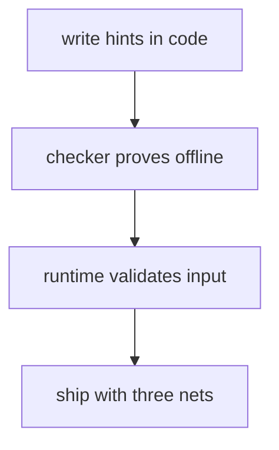
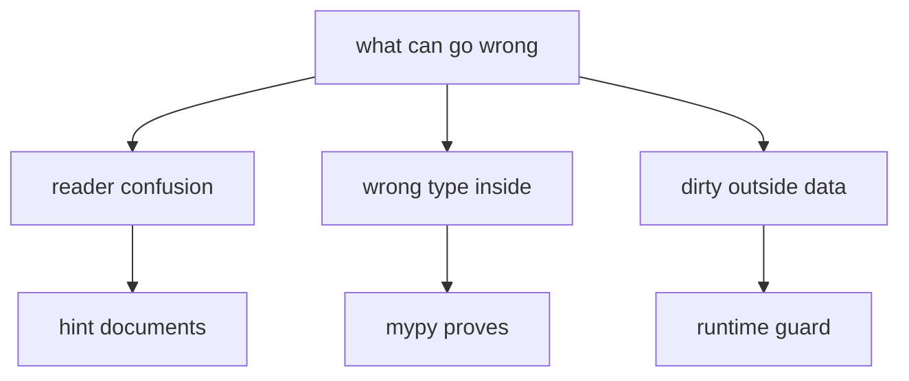
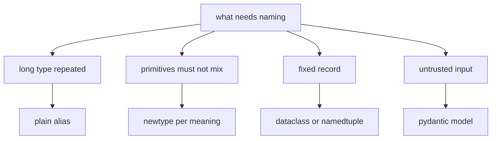

# 16 — Hinting vs Checking vs Validation

Three different jobs with confusingly similar vocabulary. Hinting
DOCUMENTS types (zero runtime effect, verified). Checking PROVES
them offline (`mypy`, before merge). Validation ENFORCES them at
runtime (guards, Pydantic). Most Python bugs come from expecting one
layer to do another layer's job — this doc fixes the mapping.



## 1. Layer model: when each fires, what each catches

| Layer | When it fires | What it catches | Cost when wrong |
|---|---|---|---|
| Hinting (annotations) | Never at runtime — stored as metadata | Reader confusion only | Misleading docs |
| Checking (`mypy` in CI) | Before merge | Wrong types INSIDE your code | Red build, zero prod risk |
| Validation (guards, Pydantic) | On every dirty input, in prod | Wrong data from OUTSIDE (users, files, network) | `ValueError` / `ValidationError` to the caller |

The one rule: hints describe, checkers prove, validators enforce.
Inside your code, checking suffices. At every trust boundary
(HTTP, CLI, files, DB reads), validation is mandatory — neither
hints nor `mypy` exist at runtime to save you.

## 2. Hinting: labels, not locks (verified)

```python
def f(x: int) -> int:
    """Labels only: the interpreter files them and moves on."""
    return x


f("not-an-int")  # Runs fine. Returns the string. No error, ever.
f.__annotations__  # {"x": int, "return": int}. Metadata, not guards.
```

Verified on 3.15: the call above returns `"not-an-int"` with no
complaint, while `mypy` flags the same line (`arg-type`) before it
ever runs. That split — runtime silent, checker loud — is the whole
mental model.

Syntax tour (what to write where):

```python
from typing import Final, Literal, Protocol, TypedDict


def greet(name: str, count: int = 1) -> str:
    """Params, default, and return all labelled."""
    return " ".join([f"hello {name}"] * count)


maybe: str | None = None  # Nullable: X | None (3.10+ spelling).
MAX_SIZE: Final = 100  # Checker-only promise. Runtime still writable.
Mode = Literal["r", "w"]  # Only these two strings type-check.
Point = TypedDict("Point", {"x": int, "y": int})  # Dict with a shape.


class Speaker(Protocol):
    """Anything with .speak() qualifies. No inheritance needed."""

    def speak(self) -> str: ...
```

Class-level annotations alone store NOTHING (`x: int` without
`self.x = ...` leaves instances without `x` — see `04` §8c). The
exceptions that turn annotations into machinery: `@dataclass`
(generates `__init__`), Pydantic (validates, §4), and `Annotated`
metadata for frameworks. Forward references (a class naming
itself) need quotes or `from __future__ import annotations` at the
file top, else `NameError` at `def` time (see `10` §5). Unions,
aliases, `NewType`, generics, and dataclasses get their own deep
dive in §7.

## 3. Checking: `mypy` proves what hints claim

The same `f("oops")` the interpreter waves through, the checker
stops cold (real output shape, captured during this build):

```text
error: Argument 1 to "f" has incompatible type "str"; expected "int"  [arg-type]
```

This repo's contract (`STYLE_GUIDE` §0 G2, config in
`pyproject.toml`): `mypy src` green, every public signature hinted,
`python_version = 3.10`. `ignore_missing_imports` keeps optional
deps (FastAPI) from failing the gate; `strict = false` keeps the
bar at "no wrong types", not "prove everything".

What checkers catch vs never catch:

| Catches (fix before merge) | Never catches (needs tests/validation) |
|---|---|
| Wrong arg/return types (`arg-type`, `return-value`) | Wrong VALUES (`-1` where `> 0` needed) |
| Missing attributes (`attr-defined`) | Missing dict KEYS (use `TypedDict` + validation) |
| `None` where a value is required (`union-attr`) | `None` arriving from outside (guard it) |
| Untyped public defs (with `disallow_untyped_defs`) | Anything hidden behind `Any` (each `Any` is a hole) |
| Protocol violations (missing `.speak()`) | Behavioural contracts (docstrings + tests own those) |

`Any` is gradual typing's escape hatch: every `Any` silences the
checker along that path. Prefer precise types, `object` + narrowing
over `Any`, and never `cast()` to lie — `cast` tells the checker to
trust you with zero runtime effect, so a wrong cast corrupts
downstream proofs silently.

## 4. Validation: enforcement at the boundary

Inside code, `mypy` suffices. At trust boundaries, only runtime
checks exist. The repo ladder, weakest first:

1. `isinstance` + early `return`/`raise ValueError` (all repository
   code — see `14`).
2. `TypeGuard` for narrowing helpers (verified below).
3. Pydantic models at HTTP/CLI/file edges (verified below).
4. Never `assert` for validation — stripped under `python -O`
   (see `07` §5).

```python
from typing import TypeGuard


def is_str_list(value: object) -> TypeGuard[list[str]]:
    """Narrowing helper: True MEANS list[str] to the checker."""
    return isinstance(value, list) and all(isinstance(i, str) for i in value)


def first(values: object) -> str:
    """Boundary fn: validate, then the checker knows the shape."""
    if not is_str_list(values) or not values:
        raise ValueError("need a non-empty list of str")
    return values[0]  # mypy sees list[str]: no error, no cast.
```

Verified: `is_str_list(["a"])` is `True`, `is_str_list([1])` is
`False`, and the guarded `values[0]` type-checks with no cast.

Pydantic v2 (what `library/api.py` uses at every route — executed
below on the installed 2.14):

```python
from pydantic import BaseModel, ConfigDict, Field, ValidationError


class User(BaseModel):
    """Lax by default: coerces where safe, rejects where not."""

    name: str = Field(min_length=1)
    age: int = Field(gt=0)


User(name="amy", age="3")  # Coerces: age becomes int 3. Verified.
User(name="", age=-1)  # ValidationError naming BOTH fields. Verified.


class StrictUser(BaseModel):
    """Strict mode: no coercion, exact types only."""

    model_config = ConfigDict(strict=True)
    age: int


StrictUser(age="3")  # ValidationError. Verified.
```

Rules: validate at the EDGE (route handlers, CLI parsers, file
readers), keep the core on plain dataclasses (validation done
once, not per function); `Field` constraints (`gt`, `min_length`)
replace hand-rolled range checks; `strict=True` where coercion
would hide caller bugs (ids, enums, money).

## 5. Which layer for which risk



| C# | Python three layers | Same? |
|---|---|---|
| Build-time types, no escape | Hints (opt-in docs) + `mypy` (opt-in CI) + guards (runtime) | Different — each layer optional, all three advised |
| `int.Parse` throws on garbage | `int(x)` raises `ValueError`; Pydantic raises `ValidationError` | Same outcome, two tools |
| Nullable reference warnings | `X \| None` + `mypy` + `is None` guards | Same shape across three layers |
| `[Required]` / `ModelState` | Pydantic `Field` + `ValidationError` | Same job at the HTTP edge |
| `as` / pattern narrowing | `isinstance` + `TypeGuard` / `match` | Same job |

## 6. Edges and best practices

1. Hints on every public signature; locals only where they clarify
   (`total: int = 0` before a long loop, not on throwaways).
2. `X | None` needs 3.10+ at runtime (repo floor — fine);
   `except*`/`TaskGroup` need 3.11+ (different gate, see `15` §11).
3. `bool` is an `int`: annotations don't separate them either —
   branch on `bool` first at runtime.
4. Overloads (`@overload`) describe C#-style variants to the
   checker; the implementation still takes unions at runtime.
5. `dataclass(frozen=True)` + `Final` + `@property` is the
   `readonly` ladder (see `08` §6, `11` Part A §4) — hints alone
   never freeze anything.
6. Run all three nets in order: annotate while writing, `mypy src`
   before committing, validate at every boundary in prod. Skipping
   the middle invites red builds; skipping the last invites 500s.

## 7. Unions, `Optional`, aliases, `NewType`, generics, dataclasses

The working vocabulary behind most real-world hints. Every runtime
claim below was executed; every checker claim was captured from
`mypy` output.

### 7a. Unions (`X | Y`) and `Optional` (`X | None`)

```python
def parse(value: int | str) -> int:
    """Either type in, one type out: narrow before touching."""
    if isinstance(value, str):  # Narrows to str here. Checker agrees.
        return int(value)
    return value  # Narrows to int here. No cast needed.
```

`int | str` (3.10+ spelling; legacy `typing.Union[int, str]`)
means "either, checker-verified at every use". `isinstance` (and
`match` arms) narrow unions branch by branch — the checker follows
along, so no casts. `isinstance(x, int | str)` itself works at
runtime (3.10+, verified). `Optional[int]` is exactly
`Union[int, None]` (verified equal) — prefer the `| None` spelling
on modern floors. A lying `Optional` (hint says maybe-`None` but
code never returns it) forces every caller to guard a ghost: hint
what you RETURN, not what you fear.

### 7b. Type aliases: names for long types (zero runtime effect)

```python
from typing import TypeAlias  # Explicit marker for readers + checkers.

UserId = int  # Implicit alias: assignment only, no runtime footprint.
Scores: TypeAlias = dict[str, int]  # Explicit: same object, honest label.
```

Aliases never create types: `UserId` IS `int` everywhere, at
runtime AND to the checker (verified identical). Use them to shorten
(`Scores` beats `dict[str, int]` repeated ten times) and to name a
domain concept — but when two concepts must NOT mix (user id vs
book id), aliases fail silently and `NewType` (§7c) is the tool.
Recursive shapes (`Json: TypeAlias = dict[str, "Json"]`) need the
quoted forward reference from `10` §5.

### 7c. `NewType`: cheap nominal safety (verified both sides)

```python
from typing import NewType

UserId = NewType("UserId", int)  # Distinct static type, int at runtime.
BookId = NewType("BookId", int)  # A DIFFERENT static type. Same runtime.
```

Runtime: `UserId(5) == 5` and `type(...) is int` (verified) — the
call is an identity function, zero cost, zero protection. Static
(captured `mypy` output): `BookId` where `UserId` is expected is
`arg-type`, AND a bare `int` where `UserId` is expected is
`arg-type` too — the subtype flows one way only (a `UserId` works
as an `int`, never the reverse). That asymmetry is the entire
value: ids, keys, and codes stop mixing at BUILD time for free.
Reach for it for any primitive that carries domain meaning; reach
past it (dataclasses, §7e) when the value needs behaviour.

### 7d. Generics: `TypeVar`, `Generic[T]`, and variance

```python
from typing import Generic, TypeVar

T = TypeVar("T")  # One placeholder, bound per call site.


def first(items: list[T]) -> T:
    """Generic function: caller fixes T, checker enforces it."""
    return items[0]  # first([1]) is int; first(["a"]) is str. Verified.


class Stack(Generic[T]):
    """Generic class: one implementation, typed per instantiation."""

    def __init__(self) -> None:
        self._items: list[T] = []

    def push(self, item: T) -> None:
        """Store one T (parameter position: contravariant-safe)."""
        self._items.append(item)

    def pop(self) -> T:
        """Return one T (return position: covariant-safe)."""
        return self._items.pop()
```

Built-in generics need no import (`list[int]`, `dict[str, int]`
work since 3.9). Variance in one paragraph: `list` is INVARIANT —
`list[int]` is NOT a `list[object]` (captured `mypy` error, with
its own note suggesting `Sequence`); read-only `Sequence` is
COVARIANT, so `Sequence[int]` passes where `Sequence[object]` is
wanted (verified clean). Rule of thumb: mutable containers stay
invariant (writes must be exact), read-only views go covariant.
`ParamSpec` types decorator-style `(*args, **kwargs)` forwarding;
`TypeVar(bound=...)` caps a placeholder (`T bound to str` accepts
`str` and subclasses only).

### 7e. Dataclasses: annotations turned into machinery

The one place class-level annotations are NOT inert: `@dataclass`
reads them and writes `__init__`, `__eq__`, and `__repr__` for you
(see `04` §6, `11` Part A §4 for the property/frozen ladder).

```python
from dataclasses import asdict, dataclass, field, replace


@dataclass(frozen=True, slots=True, kw_only=True)
class Point:
    """Immutable point: keyword construction, no dict overhead."""

    x: int
    tags: list[int] = field(default_factory=list)  # Fresh list per obj.


p = Point(x=1)  # kw_only: Point(1) is TypeError. Verified shape.
asdict(p)  # {"x": 1, "tags": []}: recursive dict view. Verified.
replace(p, x=2)  # NEW Point(x=2): copy-with-changes. Verified.
p.x = 9  # FrozenInstanceError. Verified.
```

Rules that bite: mutable defaults MUST use `field(default_factory)`
(a bare `[]` is `ValueError` at class creation — the one place the
mutable-default trap fails LOUDLY); `ClassVar` annotations are
excluded from fields (shared, like plain class attributes);
`__post_init__` is where validation lives (`raise ValueError`
there, never in a bare field); inheritance merges fields base-first
(defaults still trailing); `slots=True` (3.10+) drops `__dict__`
for memory; pick `@dataclass(frozen=True)` for value objects,
`NamedTuple` for tuple-compatible records, Pydantic when input
needs VALIDATION (§4) — three tools, three jobs:

| Need | Tool | Why not the others |
|---|---|---|
| Mutable record + methods | `@dataclass` | NamedTuple frozen-by-nature; Pydantic validates on every write (cost) |
| Immutable value object | `@dataclass(frozen=True)` | Same, plus hashable when all fields are |
| Tuple-compatible row (CSV/SQL) | `NamedTuple` | Dataclasses are not tuples (no unpack-compare) |
| Untrusted input | Pydantic `BaseModel` | Dataclasses never validate (by design) |

### 7f. More: `Self`, `@overload`, `Annotated`

`typing.Self` (3.11+ — gate it on the 3.10 floor) types fluent
returns without naming the class (`def copy(self) -> Self`),
staying correct through subclassing where `"ClassName"` strings
go stale. `@overload` describes C#-style variants to the checker
(each signature checked at calls, one implementation runs) — the
implementation still takes unions at runtime. `Annotated[int,
Field(gt=0)]` hangs framework metadata on hints (FastAPI reads it
for `Depends`/`Query`); the checker sees `int`, the framework sees
the extras — one annotation, two audiences.

### Which type tool: the decision tree



## Next

- [README.md](README.md) — index.
- [10-self-and-annotations.md](10-self-and-annotations.md) — labels
  and receiver mechanics.
- [07-exceptions.md](07-exceptions.md) — `ValueError` boundaries,
  `Raises:` contracts.
- [14-library-crud-api.md](14-library-crud-api.md) — Pydantic edges
  and `ValueError` core in one app.
- [08-csharp-keywords-to-python.md](08-csharp-keywords-to-python.md) —
  `readonly`, passing, scope.
