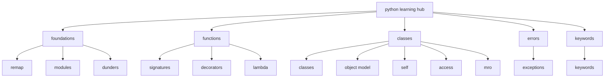

# Python Learning Hub — C# to Python

Study notes for a C# developer learning Python module, function, and class
mechanics. Each topic is one file with what/why/where/how/when plus edge
cases and C# comparisons.

| # | Topic | File | What you learn |
|---|---|---|---|
| 0 | C# → Python mental model | [00-csharp-to-python.md](00-csharp-to-python.md) | Namespaces vs modules, `using` vs `import`, types, access modifiers |
| 1 | Modules and packages | [01-modules-packages.md](01-modules-packages.md) | Files as modules, `__init__.py`, imports, scripts vs libraries |
| 2 | Dunder attributes | [02-dunder-attributes.md](02-dunder-attributes.md) | `__name__`, `__main__`, `__all__`, `__version__`, `__author__`, `__init__`, and the other popular ones |
| 3 | Functions with `def` | [03-functions-def.md](03-functions-def.md) | Params, args/kwargs, returns, hints, `lambda`, decorators, generators |
| 4 | Classes and OOP | [04-classes-oop.md](04-classes-oop.md) | `class`, `self`, methods, properties, inheritance, MRO, ABC/Protocol, dataclasses |
| 5 | Decorators (`@`) | [05-decorators.md](05-decorators.md) | What `@` executes, writing wrappers, factories, when to avoid |
| 6 | `lambda` and IIFE | [06-lambda-iife.md](06-lambda-iife.md) | Expression-only functions, key adapters, IIFE scope, closures |
| 7 | Exceptions | [07-exceptions.md](07-exceptions.md) | Built-ins, `try/except/else/finally`, custom errors, halt/exit |
| 8 | C# keywords to Python | [08-csharp-keywords-to-python.md](08-csharp-keywords-to-python.md) | `this`/`static`, passing, defaults, ctors, `readonly`, scope |
| 9 | Object model and `type()` | [09-object-model-type.md](09-object-model-type.md) | Everything-is-object, `type`/`isinstance`, OOP pillars |
| 10 | `self`, `:` and `->` | [10-self-and-annotations.md](10-self-and-annotations.md) | Receiver, bound methods, labels-not-locks, edges |
| 11 | Access modifiers + shared mutation | [11-access-modifiers-and-shared-mutation.md](11-access-modifiers-and-shared-mutation.md) | `public`/`_internal`/`__mangled`, classes/methods/attrs, when mutation is shared |
| 12 | Method resolution order | [12-method-resolution-order.md](12-method-resolution-order.md) | C3, `__mro__`, cooperative `super()`, diamonds, edges, practices |
| 13 | Collections | [13-collections.md](13-collections.md) | `list`/`tuple`/`set`/`dict`, ordering, conversions, `collections` module |
| 14 | Library CRUD API | [14-library-crud-api.md](14-library-crud-api.md) | SQLite 1:1/1:many/m:m, indexes, single+bulk, FastAPI + Scalar |
| 15 | Async and asyncio | [15-asyncio.md](15-asyncio.md) | Etymology, loop, gather, tasks, threads, sync primitives, catalog |
| 16 | Hinting vs checking vs validation | [16-typing-and-validation.md](16-typing-and-validation.md) | Annotations, `mypy`, guards, Pydantic, layer model |

Conventions used in all files: `src/` layout, pure library code (return
values, no `print()`), Google-style docstrings, type hints on public
signatures, `ValueError` guards on public APIs.

## Map

